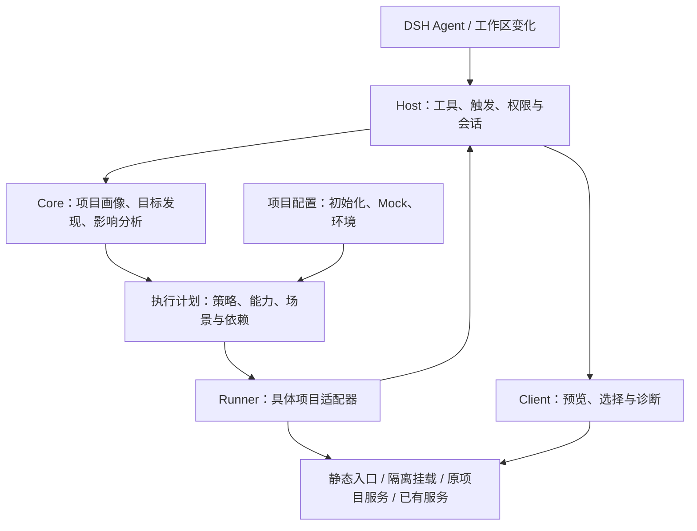

# dsh-page-preview：多技术栈业务页面预览插件开发方案

> 版本：v1.4（2026-11-01 review 后的决策修订，见 §0.3）  
> 修订日期：2026-11-01  
> 项目名 / npm 包名建议：`dsh-page-preview`  
> 定位：面向 AI Coding Agent 的**项目真实页面预览、场景模拟与变更验证**插件  
> 目标宿主：DeepSeek Harness（下文简称 DSH）

## 0. 结论与本轮 Review

**保留 DSH Host + 独立 Runner + Client 展示的方向；将核心从「Vite 挂载 React/Vue 组件」调整为「识别项目能力，选择合适的预览执行方式」。**

目标项目可以采用不同 UI 框架、组件库、语言、模板语法和构建系统。插件自身使用 TypeScript 或某个 UI 框架，不构成对目标项目的要求。`.tsx`、`.vue`、`src/pages` 都只能是识别线索，不能成为接入前提。

核心体验不变：Agent 修改页面相关代码后，定位受影响的页面，复用项目真实代码、样式和运行方式，在 DSH 中查看结果；有适配条件时注入身份、权限和接口数据，避免依赖真实业务服务。**优先隔离目标页面；不能隔离时明确说明所需运行环境，不伪造页面，也不静默改成运行整个应用。**

### 0.1 原稿的关键问题与修正

| 问题 | 实际影响 | 本版修正 |
| --- | --- | --- |
| 框架适配接口必须实现 `configureVite()`、`buildVirtualEntry()` | Webpack、框架 CLI、静态站点、服务端模板无法自然接入 | 核心使用统一执行计划；Vite 虚拟入口只属于具体适配器 |
| 把 React/Vue、TypeScript、UI 库、状态库绑定成固定组合 | JavaScript、自研 UI、无 Store 的项目被误判为不支持 | 分别识别语言/语法、框架、构建、运行时与业务初始化 |
| 页面必须是某个组件文件，依赖必须是 `import` | 遗漏 HTML、多页入口、模板 include、脚本注册、服务端路由 | 页面目标独立建模；文件和依赖图允许不完整 |
| 总目标承诺免后端、不执行原入口，却又列出 SSR 等例外 | 支持边界与统一运行机制不一致 | 区分隔离渲染、原项目运行、已有服务接入，并报告依赖 |
| 在 Mock 初始化前静态导入 Provider 等业务模块 | 模块顶层可能已发请求或读登录状态 | 所有可能有业务副作用的导入均放在拦截与替身就绪之后 |
| 用文件时间/快照区分 Agent 与用户改动 | 只能证明发生变化，不能可靠证明作者 | 记录变更来源证据；无证据时标为工作区变化 |
| 要求未 Mock 网络零直连，但未确定展示载体的拦截能力和放行规则 | 现有 Browser 未必可控，静态资源、HMR 和业务代理也需区分 | 区分数据 Mock 与网络边界，按实际覆盖面报告能力 |
| 复用原构建配置，却承诺绝不读取 `.env` | 构建工具或插件可能自动读取，承诺互相矛盾 | 使用预览环境策略；无法约束的行为明确列为限制 |
| 验收集中在 TS + Vite 的 React/Vue 样本 | 架构偏置无法被测试发现 | 加入纯 JS、非 React/Vue、非 Vite、无构建项目样本 |
| 只有“可达/支持”的笼统描述，没有端到端能力与就绪证据 | 已有服务可能能打开却不能注入场景，登录页也可能返回 HTTP 200 | 能力按目标和展示上下文判定；区分服务可达与目标就绪 |
| 启动异步完成后缺少 Agent 查询入口 | Agent 无法确定预览是否成功，也无法读取后续诊断 | 增加只读状态查询，统一工具与 Client 使用的会话状态 |
| 工具路径、配置来源和静态产物新旧没有统一规则 | 多应用中可能定位错文件，或展示修改前的产物 | 明确路径基准、配置优先级和源码/产物验证状态 |

**本轮完成的是方案审查与修订。**官方文档核对不等于插件集成验证；本文所有兼容范围均是计划和验收要求，不是已经支持的产品能力。

### 0.1.1 v1.3 修订要点

v1.2 的边界和措辞已经比较严谨，但几处约束只写了“必须如何”，没有写“用什么机制做到”。另有几处前后矛盾，会直接卡住实现。本版只修这些问题，不扩大首版范围：

| 问题（v1.2） | 实际影响 | v1.3 修正 | 位置 |
| --- | --- | --- | --- |
| 默认 `mock-only`，但展示载体的网络控制能力未知；静态页 JS 可以直连外部 API | 按 v1.2 规则，静态页和项目命令路径无配置时会全部停在 `needs_configuration`，与 Phase 1 退出条件冲突 | 增加“受控响应层”：自有服务通过 CSP 响应头和注入的 bootstrap 建立浏览器侧边界，并按不同路径定义默认约束 | 6.8、7.3 |
| 错误采集、目标就绪信号和 Mock 都依赖“载体能力”，但文档已确认 Browser 是 iframe，且没有说明插件能控制它 | 在当前已知事实下，大部分能力都会落到 `unknown` | 自有响应中注入 reporter，与载体能力解耦；`attach` 默认不注入 | 6.8 |
| 工具结果 `status` 与会话状态共用一组枚举；`needs_configuration` 出现在状态机中，但这时还没有 `previewId` | 实现时无法确定字段归属 | 拆分 `result.status` 与 `session.state`，并定义错误码表 | 4.2、9.2 |
| HMR 编译失败没有对应状态，只能进入终态 `failed` | 下一次保存可以恢复，却被当作需要重启的失败 | 增加可恢复的更新失败语义 | 9.2 |
| Host 被强制结束时，“执行适用清理”无从执行 | 孤儿 dev server 一直占用端口 | 持久化资源账本，下次启动时对账；按进程组终止 | 9.2 |
| “核对端口归属”没有给出方法；dev server 端口被占用时常静默换端口 | 可能接入其他服务，或拿不到实际地址 | 通过端口反查 PID 并核对进程树；自有服务使用 nonce 探针 | 9.2 |
| 隔离适配器在哪个进程、用哪个 Node 加载项目的 Vite 没有说明 | 如果在 Host 进程内 `createServer()`，项目插件就会跑在宿主里 | Runner 使用独立子进程，从应用根解析项目自己的工具链 | 6.5 |
| `page_preview_status` 必须传 `previewId` | 上下文压缩后 Agent 丢了 ID，就无法恢复 | `previewId` 改为可选，省略时列出调用者拥有的预览 | 4.2 |
| “变更验证”只提供截图路径；DSH 工具是否能把图片交给模型，文档没有说明 | 模型看不到图时，Agent 实际上无法验证结果 | 以文本信号（错误、可见文本或断言）为主，图片能力在 Phase 0 判定 | 4.2 |
| 5.3 要求按任务基线比较内容，6.7 又要求不建设全仓快照；文档也未确认存在 turn 开始事件 | 基线没有可行的获取时机和成本 | 使用轻量元数据索引，并按事件实际情况选择基线时机 | 5.3 |
| 写交互要求“维护最小增删改语义”，但没有说明由谁实现 | 变相要求插件通用生成 CRUD 后端 | 插件只提供可重置的场景存储，语义由项目 handler 实现 | 7.2 |
| 工作项中状态查询排在第 9 项，而 Phase 1 就需要它 | 排期顺序与阶段要求冲突 | 调整工作项顺序 | 16 |
| 首个里程碑同时要求两个隔离适配器和 9 类样本，没有任何工期估算 | 首个可用版本迟迟无法交付 | 第一个隔离适配器按真实业务样本选择；Phase 0 设时间盒和放弃/降级判定 | 1.3、14 |

### 0.3 v1.4 决策（2026-11-01，Aesc 确认）

依据 `docs/review-2026-11-01.md`。**本节与正文其他内容冲突时，以本节为准**；正文中带日期的实现记录只是历史证据，不是约束。

1. **验证等级与允许执行分开。**能力状态（`supported` / `conditional` / `unsupported` / `unknown`）只表示"有没有证据"，不再决定"能不能运行"。
   - 未经样本验证的工具链、版本或平台照常执行：能力保持 `unknown`，结果中附带 `unverified_toolchain` 诊断，不得写成 `supported`。
   - Planner 只在以下情况阻断：能力为 `unsupported`；硬性 `requirements` 由明确的 `unsupported` 或 `none` 判定为不满足；执行项未获批准；配置无效。
   - 执行代码中不得写死版本字面量。验证过的版本只记录在兼容矩阵（`tests/fixtures/README.md`）和 profile 数据中。
   - 仍然有效的规则：能力表、文档和对外说明只对通过样本验证的组合声明"支持"。
2. **诊断转发与脱敏规则**见 §13 第 8 条。原则是：Agent 修复代码所需的错误信息必须转发；凭据和密钥必须去除。
3. **Vue isolated 路径的默认 `mock-only` 采用方案 A。**按已实现的机制如实声明浏览器侧网络能力（受控响应层的 CSP、同源 Mock 中间件、WebSocket 准入），默认约束保持 `mock-only`。`server-process` 只在场景配置了 Node handler 时才纳入要求；`build-process` 不纳入（构建进程执行的是项目配置，如实标为 `none` 并写进 knownDifferences）。
4. **资源账本必须能回收**，见 §9.2 补充条款。崩溃后不能把工作区永久锁死。
5. **入口注册重放必须形成闭环。**遇到 `needs_configuration` 时生成 setup 草稿，交给用户审阅；确认后走执行批准流程。见 §6.9 补充条款。
6. **测试工具链：**批准把 `docs/toolchains/` 下的清单安装到 `tests/toolchains/<组合>/`，约束见 `docs/vue-test-toolchain-dependencies.md`（2026-11-01 批准 vue26-cli、vue27-cli、vue3-resolvers 三份；2026-11-02 追加批准 vue3-self-contained、vue3-unverified-vite6 两份）。安装脚本 `scripts/install-toolchains.mjs` 作为 `pretest` 幂等复现（`--ignore-scripts`、独立 lock），测试门槛优先显式 `DSH_PREVIEW_TEST_MODULES`、缺省回退仓库内 `vue3-self-contained`，CI 环境下跳过即失败。
7. **工作顺序以 §16 的 v1.4 调整为准**：先完成 P0（`docs/development-progress.md`），再做网络旁路加固、影响分析和自动触发。
8. **执行批准为会话级（2026-11-03 Aesc 决策，取代 §15 第 1 条与 R2-1 中「链终止即消费」的表述）。**用户在官方审批弹窗中批准后，同一 DSH 会话对同一工作区、同一项目、同一执行指纹持续有效，预览停止后再次打开不重复询问；执行项变化（新指纹）、其他会话、DSH/Host 重启都重新询问，用户拒绝不产生授权。授权只存于 Host 内存、不落盘，批准指纹随 `start` IPC 传给 Runner 并在执行前重核。会话审批策略为 `never`（如 Full access 预设）时官方服务确定性拒绝，插件如实提示切换权限预设，不绕过。弹窗文案如实说明上述有效范围（官方按钮文案仍为「允许一次」）。
9. **完全访问会话放行与侧边栏自动展示（2026-11-03 Aesc 决策）。**会话沙箱为 `danger-full-access`（Full access 与 Auto 预设）时，执行项按用户的权限选择放行、不弹窗，结果带 `approved_by_permission_preset` 诊断；沙箱模式经 DSH `sandboxPolicy.resolve({ session })` 读取，读不到按未放行处理。Client 跟随屏幕上的会话，把新出现且可达的预览自动在 DSH Browser 页签打开一次；`open` 在有跟随者时等待侧边栏加载文档后返回，并以 `preview_shown_in_sidebar` 告知 Agent 结束。同工作区另一 DSH 会话的预览由新会话按账本完整清理后接管（`preview_taken_over` 诊断；残留时仍 busy）。Vite 依赖预构建缓存放在插件数据目录 `build-cache/<应用根哈希>/vite`，跨预览复用（插件自有长期缓存，不写入目标项目、不登记为单次预览资源）。
10. **初始化由插件自动完成（2026-11-03 Aesc 决策，取代第 5 条的「草稿须用户审阅后保存」）。**项目未配置 `runtime.setup` 时，插件从入口自动生成 setup 并直接使用：重放第三方与业务的 use/component/directive/全局属性、样式与副作用导入（按原顺序），`createApp` 包在顶层初始化函数里时整体搬运其顶层调用链：`createApp(...)` 换成预览 app、去掉 `mount`，传递调用初始化器的顶层函数与顶层调用语句原样保留（R5-1d——登录/接口前置流程按入口执行，发出的请求由场景 fixture 应答、无 fixture 如实 `unmatched_request`，不伪造已登录）；链上搬不动的函数/语句逐项进计划诊断与 `knownDifferences`，并回退为只跑初始化器。业务路由在运行时换成无守卫的空路由（按 vue-router 实例形状判定）。生成源码只在 Runner 内作为模块加载（Vite 虚拟模块 / CLI 本预览临时目录），不写入项目、不进工具输出；其摘要记为计划 `generatedSetup { entry, hash }` 并入执行指纹审批（完全访问会话按第 9 条放行），worker 启动前重新生成核对，入口改动后需重新审批。项目配置了 setup 时以项目为准。无法重放（语法错误、找不到唯一 Vue 应用、初始化引用入口内其他函数或条件创建）时仍返回手写 setup 的形态提示。同时：Vite 正则/非字面量别名只记匹配范围、命中者交给项目构建器解析；入口 HTML 的内联经典脚本不再阻断入口推断，预览文档沿用入口 HTML 的 `<html>`/`<body>` 静态属性与内联经典脚本；bootstrap 把跨源 fetch/XHR 改写到同源 `/__dsh_preview/remote/<origin>/…`，由自有 Mock 按 fixture `origin` 匹配，未命中明确 `unmatched_request` 并带原 origin，永不转发。业务数据仍需场景 fixture（本轮不自动生成）。
11. **Vue 2 / Vue CLI 开放场景（2026-11-03 Aesc 决策）。**`page_preview_open`/`refresh` 的 `scenario` 在 `vue-cli` 宿主放行（open 带场景、refresh 带或不带场景），fixture/handlers/原子换绑与 Vite 同机制；`assertions` 与 `navigation`（含场景内携带 `route`）在 CLI 仍拒绝。能力声明与执行分离不变：CLI 的 `scenarioApply`/`scenarioReset`/`refresh` 均保持 `unknown`（非已验证组合、无浏览器侧证据），HTTP/进程级证据见 `docs/evidence/2026-11-03-cli-toolchain-scenario.md`。

### 0.2 名称与范围

沿用 `dsh-page-preview`、显示名 `Page Preview / 业务页面预览`、工具前缀 `page_preview_*`。包名和发布约定在发布前核验。核心能力限定为**能在浏览器中呈现的真实 UI**；纯原生桌面/移动 UI 需要对应平台运行器，不纳入首版通用承诺。

## 1. 目标、边界与首版范围

### 1.1 目标

1. **定位改动影响的真实页面**：处理组件、脚本、模板、样式、资源、路由、权限和相关配置变更，不以固定后缀筛选全部输入。
2. **复用项目实际实现**：使用原代码、编译器、样式、组件库与必要初始化，不用 AI 重绘的 HTML 冒充运行结果。
3. **尽量减少运行依赖**：能隔离就隔离；能够 Mock 的业务依赖使用场景数据；仍需的服务端运行时明确列出。
4. **交互与刷新可解释**：按实际能力提供交互、HMR、整页刷新或重新构建，不承诺所有项目都支持热更新和状态保留。
5. **配置可复用**：允许少量项目配置，优先复用已有 preview、story、fixture、测试入口和启动脚本。
6. **行为可诊断**：展示选页依据、执行策略、Mock 覆盖、缺失依赖和与真实环境的差异。
7. **尊重项目环境**：不默认修改业务源码、包清单、构建配置、锁文件，不自动安装依赖。

### 1.2 明确边界

- “通用架构”不等于“所有框架和版本零配置可运行”。支持某个组合必须有对应样本和验收记录。
- “免业务后端”不等于“无服务端进程”。SSR、RSC、PHP/JVM/Python 模板可能仍需要本地渲染运行时；只有成功替换数据访问后，才能免业务 API/数据库。
- “预览某页面”不等于“只执行该文件”。路由、主题、全局注册、编译插件及模块副作用可能都是必要依赖。
- 页面权限场景只验证模拟条件下的 UI 行为；不能证明真实身份认证、服务端授权和业务事务正确。
- 受信任工作区内运行代码是首版前提；子进程不是安全沙箱。首版不自行建设通用容器平台。
- 不支持时返回缺失能力与可行接入方式；不自动将业务组件替换为空壳来制造成功。

### 1.3 首版交付范围

采用**通用入口 + 有限深度适配**，避免一次开发所有框架适配器：

| 路径 | 首版范围 | 不承诺的能力 |
| --- | --- | --- |
| 静态页面 | 本地 HTML/CSS/JS、多页入口、已有浏览器可用产物 | 自动执行未知构建链或渲染服务器模板 |
| 已有项目预览 | 接入明确配置的本地服务；管理已授权的项目预览命令 | 任意服务都可注入 Mock、隔离页面或自动定位源码 |
| 组件隔离 | **首个适配器确定为 Vue（2026-10-31 决策）**：Vue 2.6/2.7 与 Vue 3，JS 与 TS，构建方式为 Vite 与 Vue CLI（webpack）；UI 组件库分层适配，见 6.9。React + Vite 排在首个可用里程碑之后 | 任意路由器、UI 库和 Store 零配置初始化 |
| 其他项目 | 通过既有 preview/story/项目命令接入；缺失时报告 | 自动给 Angular、Svelte、SSR 等生成完整隔离运行器 |

静态服务和项目命令接入承担基础覆盖；框架适配器提升隔离、发现、Mock 和诊断质量。两者共用目标、场景和生命周期协议，避免维护两套产品逻辑。

“可接入显示”“可隔离运行”“可模拟业务依赖”“可验证本次修改”分别验收。接入一个既有 URL 只完成第一层，不能算作已实现该技术栈的业务页面隔离能力。首版同时保留直接显示的低成本入口和至少两个真实业务页的隔离场景，避免覆盖面扩大后偏离核心目标。

## 2. 使用方式与预览语义

### 2.1 正常工作流

1. Agent 修改页面相关代码，Host 收集本轮可确认的变化和工作区变化。
2. Detector 识别目标应用、实际工具链和已配置的预览入口。
3. Analyzer 给出候选页面及依据；多应用或低置信度时提供选择。
4. Runner 适配器生成执行计划：目标、策略、运行时、初始化、场景、网络覆盖与缺失项。
5. 在已有授权和配置范围内启动；需要新增命令权限、依赖安装或真实服务访问时先说明具体动作。
6. Client 展示实际页面及能力状态，支持场景切换、刷新和诊断。
7. 后续改动按适配器能力热更新、刷新或重启；不会反复抢占用户当前页面。

### 2.2 显式入口

```text
预览 /settings/models
预览 web/settings.html
预览 src/views/users/index.vue
预览 src/screens/Profile.jsx 的 Profile 导出
预览 account-settings 这个已登记目标
使用项目已有的 preview 脚本预览用户页
以 390×844 尺寸预览当前页面
停止当前预览
```

文件只是入口之一。路由、组件导出、HTML 入口、已有 story、预览目标 ID、本地服务地址都可以表达目标；文件没有默认导出时不得强行按默认组件加载。

### 2.3 展示范围与执行策略分开

**展示范围 `scope`：**`page` 表示业务页面，`component` 表示局部组件，`shell` 表示包含应用布局和导航。默认优先 `page`，但适配器必须声明是否支持。

**执行策略 `strategy`：**决定页面如何运行，详见第 6 节。`shell` 不保证能脱离原应用运行；接入已有服务也不自动获得 `component` 能力。无法满足请求范围时返回限制，不静默改变范围。

## 3. 总体架构



### 3.1 职责

- **Host**：接入 DSH 工具和事件，确定授权工作区，管理会话、Runner、日志及 Client 通知。
- **Core**：统一项目画像、目标、候选证据、执行计划与诊断，不依赖 Vite、React 或某类源文件。
- **Runner**：Host 派生的独立子进程（见 6.5），根据适配器调用实际工具链、挂载页面或接入服务，提供受控响应层（见 6.8），执行场景准备、刷新和清理。
- **Client**：展示页面及实际能力。是否可截图、收集控制台、跨域嵌入或注入脚本取决于展示载体，必须探测。
- **项目配置**：补充业务初始化、目标映射、Mock 和启动方式，不重建一套业务权限逻辑。

### 3.2 保持适配层简单

识别时分别记录源码语法、UI 框架、构建工具和运行时；执行时采用能处理该组合的具体适配器，例如 `vue-vite`、`vue-cli`、`static`、`project-command`、`existing-server`，后续再加 `react-vite`。

首版不建立任意“框架 × 构建器 × 语言”自由组合系统。不同组合的真实编译和初始化规则并不总能拼接。可共享解析、进程、文件和网络辅助函数，但**只有通过验证的组合才声明支持**。v1.4 起，"声明支持"与"允许执行"分开：未验证的组合可以执行，但必须带 `unverified_toolchain` 诊断（§0.3 第 1 条）。

## 4. DSH 集成与对外工具

### 4.1 核对到的宿主机制

官方示例使用 `apply(ctx)` 注册能力；需要工具服务时声明 `inject = ['tools']`，通过 `defineTool()` 和 `ctx.tools.register()` 定义工具。`inject` 是依赖声明，不是所有插件都必须拥有的固定字段。实现时依赖锁定版本的类型定义。[DSH Tool API](https://deepseek-harness.github.io/deepseek-harness/en/develop/basic/tool)

`session/event` 与 `tools/result` 属于宿主事件；`turn/*` 等是会话事件类型，不能直接假设存在同名 Cordis 事件。以会话事件中的轮次结束信号触发分析；`turn/end` 的确切载荷、异常结束和重放语义在 Phase 0 对照目标 SDK 验证。[DSH 事件系统](https://deepseek-harness.github.io/deepseek-harness/en/develop/framework/events)

2026-10-31 第三轮文档核对的结论如下。只读文档，未运行 SDK，因此“未提及”不等于“不存在”：

| 事项 | 文档已说明 | 文档未说明，需要 Phase 0 验证 |
| --- | --- | --- |
| 宿主事件 | 包括 `agent/pre-step`、`agent/request`、`agent/request-error`、`tools/result`、`session/event`（文档表述为“including”，可能不完整）；`tools/result` 的处理器签名为 `(exec, result)`，示例中读取 `exec.name`、`exec.arguments` | 写文件类工具的 `arguments` 是否包含规范化路径；是否能看到 shell 工具的实际写入 |
| 会话事件 | 类型包括 `turn/*`、`step/*`、`tool/call`、`tool/result`、`compaction/*`，通过 `session/event` 的 `event.type` 观察。`@deepseek-ai/dsh-session@0.2.1-rc.5` 的类型定义显示：宿主事件签名为 `'session/event'(session, event)`；事件结构为 `{ type, seq, time, data }`；包含 `'turn/start': { turn }` 与 `'turn/end': { turn, reason: TurnEndReason }`，注释说明取消、失败时也会以对应 reason 关闭轮次 | 以上为类型层面的结论，运行时的触发时机、恢复重放（resume）时是否重复触发仍需实测 |
| Tool 返回 | 通过 `output.render` 把值转成模型可见内容，示例只有 `{ type: 'text' }`。类型定义（`@deepseek-ai/dsh-tools@0.0.1-rc.1`、`@deepseek-ai/dsh-llm`）显示：`ContentBlock` 包含 `image`（引用附件服务），但注释写明“current production adapters declare text-only output, so only user content carries images today”；`defineTool` 可声明 `timeoutMs`（协作式超时），`execute(args, exec)` 中的 `exec.signal` 是取消信号；参数采用逐属性的 `{ type, required: true, description }` DSL | 图片放在 tool-result 中能否送达当前模型（注释没有区分 tool-result 归属哪个角色）；后台任务与进度（tool authoring reference 本轮未读） |
| Browser 载体 | 内置多实例 tab，用 `openTab('browser', { params: { url } })` 打开；默认沙箱下接受公网和 loopback 的 HTTP(S) 地址；基于 iframe 历史 | 具体 sandbox 属性、插件能否注入脚本或读取 DOM/控制台/截图、iframe 的存储分区与 Cookie 行为 |
| Host↔Client | Client 通过生成的 Remote 命名空间、经 Connection 的二进制 RPC 调用 Host 服务 | Host 主动推送给 Client 的方式（订阅或事件），以及 Host 能否替 Agent 打开或刷新 Browser tab |

打包与加载（[第一个插件](https://deepseek-harness.github.io/deepseek-harness/en/develop/basic/)、[打包](https://deepseek-harness.github.io/deepseek-harness/en/develop/basic/publish)）：插件模块导出 `name`、`inject`、`apply(ctx)`，`Context` 来自 `@deepseek-ai/cordis`；开发时用 `pnpm dsh web --patch <cordis.yml>` 按绝对路径插入；发布时 `package.json` 声明 `"dsh": { "bundle": { "patch": "./cordis.patch.yml" } }` 和 `engines.dsh`，patch 中的行通过包名引用插件；共享的 DSH 包同时列入 `peerDependencies` 与 `devDependencies`。`dsh.client` 的声明方式本轮未在文档中找到，待 Phase 0 确认。

由此可以推断：**插件大概率不能直接控制 Browser 内的页面。**设计上不能把错误采集、就绪信号和网络边界寄托在载体上，见 6.8。

2026-10-31 Phase 0 部分实测（macOS，桌面版内置 `0.2.1-rc.5` CLI 的隔离 web profile，Chrome 156）：插件已实际加载。**该版本 web profile 默认禁用 `ui-sidebar-browser`，必须显式启用才能使用 Browser**；不修改用户 profile，探针 overlay 见 `dev/cordis.phase0.example.yml`。启用后手动打开 loopback 页面成功，bootstrap 早于业务脚本、错误回传、跨源 fetch CSP 阻断、同源 WebSocket/SSE 连接均通过。Worker 仅验证了其脚本响应带 CSP 的路径；Service Worker 仅验证注册/注销。Host 自动开 tab、完整 HMR、当前画面截图与模型图片使用仍未验证。详见 `docs/phase0-verification.md`，不据此声明 Phase 0 完成。

同日 Host 实测：4 个工具注册成功，实际工具管线可渲染文本、执行协作式超时（60 ms 返回 `TOOL_TIMEOUT`）并响应调用者取消。`exec.agent.session.id` 可取调用者会话，`ctx.workingDirectory.get(exec.agent.session)` 可取当前工作目录（与初始工作区的关系仍须在多应用/目录切换时核对）。`write` 的 `exec.arguments.file_path` 保留相对输入，结果 `meta.path` 提供绝对路径；不能把工具参数假定为规范化路径。本地脚本模型驱动真实 Agent loop，实测 `turn/start` 后对应 `turn/end` 的 `reason.kind` 为 `completed`、`error`、`aborted`，取消原因是 `{ kind: 'user' }`。Seed 创建不会重发历史 `session/event`，但这不等于完整持久化 resume 验收。探针没有调用外部模型。

同日补充的源码核对（尚非插件 Client 实测）：安装包 `dsh-client-modules/lib/index.js` 已确认 `dsh.client` 使用 `platform`、`inject`、`external`，Client 产物需 `./client` export，并采用 `window.__ModuleLoader__.load({ id, factory })` 注册。2026-11-03 实机（DSH desktop 0.2.1-rc.5）补充：Client `require` 只能命中平台 seed、已到达模块或已注册 client factory 的包（安装包 `client-modules` 的 `makeRequire`）；`@deepseek-ai/dsh-typert-protocol/remote-info` 不在模块表中，产品 Client 曾因外置它而报 "missed the module table" 无法激活，现改为打进 bundle（纯函数、无运行时依赖），构建脚本对运行时 require 与被打包的平台代码做白名单门禁。`dsh-api-remotes` 的事件转发表是固定清单，不包含自定义 preview 事件；Host 不能仅 `emit` 一个新事件就假定 Client 收到。拟通过官方 Remote stream 与 `sidebarRight` Client Service 验证自动开页/刷新，新增直接依赖需按项目规则先获批准，清单见 `docs/phase0-host-client-dependencies.md`。目前不把手工开页等同于 Host 联动，不自行采用 §4.3 的降级。

2026-10-31 后续实测：用户已批准上述直接依赖，`dev/bridge` 的独立包实际通过官方 Remote stream 自动打开、刷新、关闭了隔离会话的 Browser tab。打开和刷新分别收到受控响应层的 `document-loaded`。已完成探针的重复订阅有回归测试；Client 重载后同会话重选/重连仍待完整实测。动态 `$mount` 后必须在 `ctx.inject(['remote.pagePreviewPhase0'], …)` 子作用域使用该命名空间。刷新调用本探针所拥有 tab 的 `occurrence.commands.refresh`，关闭只操作该 tab；不访问 iframe DOM。严格 schema 来自 SDK 支持的显式 wire 描述，TS 类型从同一份 Zod schema 推导。产品 Registry 与工具链尚未接入，不据此宣称完整预览可用。用户决定暂不调用真实模型，图片能力保留未验证。

同日原生桌面 `0.2.1-rc.5`（Electron 44.7.0、Chrome 152.0.7977.130）也通过三步联动及两次真实文档加载。按用户要求使用其当前 profile，经确认安装本地探针并重启一次；重启未解决导航问题。Sources 断点证明修订版 Client、Remote 挂载和注入回调均已执行，实际错误为 `sessions.retain: unknown session page-preview-phase0-carrier`。锁定源码与实测一致：未选中的 blank 会话被隐藏，标题不改变 blank；且 `openSession` 只能接受 Client 已知的会话。修订为先等待官方 `sessions.refresh()`，再安装 mounted 订阅并调用 `uiWorkspace.openSession`，原生 open/refresh/close 全部 accepted，document-loaded 从 6 增至 8。目录延迟/失败有回归测试；协议类型不再引用 Host 类，避免混入两端同名但不同接口的 sessions 服务。探针已卸载，用户客户端保持运行。原生 Browser 使用 Electron webview，不能直接沿用 web iframe 的存储、CSP 或截图结论；也不把载体成功等同于产品工具链完成。详见 `docs/phase0-desktop-and-overview.md`；overview/web 实为 Vue/Vite，不能算非 Vite 验收。

同日原生存储核对：SDK 源码按工作区规范路径选择 Browser account，未分组会话按 SessionId 选择，tab lease 释放后保留 account 存储；运行时已实测同工作区关闭重开保留、跨工作区 A→B→A 的样本 Cookie/localStorage 隔离。跨端口 Cookie 共享而 localStorage 分离；SameSite 跨站 fetch 与顶层 GET 导航分别有请求证据。样本是自身顶层上下文，不是 web iframe；不将工作区分区当成 preview 独占身份或应用重启后的持久保证。具体范围与精确样本清理见 `docs/phase0-storage.md`。

2026-10-31 产品查询/停止的调用者绑定：锁定 Session 类型与真实 SessionStore 测试确认 exec.agent.session.header.cwd 是不可变创建目录，workingDirectory.get(session) 则是有效 cd 目录。产品工具以会话 ID 和创建目录核对归属，缺少 Agent/明确 cwd 时 needs_configuration，不使用 Host process.cwd；没有新增运行时依赖。已用独立内存 SDK ToolRuntime 执行产品 status/stop/capture 能力拒绝，尚未在用户原生 Agent 中加载本轮工具。见 `docs/status-tools.md`。

2026-11-01 官方批准服务接入（固定 0.2.1-rc.5）：用户已批准直接 peer/dev @deepseek-ai/dsh-user-approval，版本未升级。类型/源码确认 ctx.get('approval') 可按需消费 ApprovalService.request，只有 allowed-once 进入复核；服务要求开放轮次，写 asked/decided 审计，displayReason 不进入持久审计。产品入口按缺失通道拒绝，不自建自动批准答复。实际 SDK/SessionStore/ToolRuntime、编译 apply 和托管进程已有测试，但 Agent/用户答复为合成，真实 Agent loop/原生用户 UI 尚待验收，见 docs/project-command.md。

### 4.2 工具契约

| 工具 | 输入 | 输出要求 |
| --- | --- | --- |
| `page_preview_open` | `projectId?`、`target?`、`scope?`、`strategy?`、`scenario?`、`viewport?`、`requirements?`、`writeSetupTo?` | 执行计划、状态、能力、诊断；已确认服务归属和可达时可提供地址，同时注明目标是否就绪。未配置 setup 时自动使用从入口生成的 setup（计划 `generatedSetup`，§0.3 第 10 条）；仅当入口无法重放时 `setupDraft` 给出草稿路径、分类注册项与可粘贴的 `configSnippet`；`writeSetupTo` 经官方审批弹窗由用户确认后把草稿写入项目内相对路径（只创建新文件，已存在一律不覆盖）并回传 `installedTo`；有 Client 跟随调用者会话时（侧边栏会自动在 Browser 页签加载新预览），等待至多 20 秒直到侧边栏加载文档（不等首次渲染文本），已有时附 `pageText`，并以 `preview_shown_in_sidebar` 诊断告知 Agent 任务完成、无需轮询或截图。省略 `target` 时先返回本轮影响分析的候选（R3-4，写完文件后不带 target 调用即"预览刚改的地方"）；没有本轮候选才退回结构发现，分析降级时附 `impact_incomplete`；两种情况都只返回候选（`needs_selection`），不自动选择，即使候选只有一个。`pageText` 只投影可证明为挂载后采集的观测：早于挂载信号（isolated）或文档加载证据（static）的观测不当作页面文本输出，改由 `page_text_pending` 诊断如实标注"尚未采集到"，hint 指向 `page_preview_status`；不增加等待（2026-11-03 决策 P-A） |
| `page_preview_status` | `previewId?`、`detail?` | 当前状态、就绪证据、产物新旧、实际能力及最近诊断；只读，不启动或修复服务。省略 `previewId` 时列出调用者在当前工作区拥有的预览摘要，用于上下文压缩后找回 ID。摘要含未命中业务请求计数（`unmatchedCount`/`unmatchedDropped`）；`detail: true` 且指定 `previewId` 时附 `unmatched` 汇总与 `fixtureDraft` 草稿（§7.2；草稿含 `envelopeHint` 包装建议（R6-1）与 `contexts`/`contextLimited` 调用点上下文（R6-2））。省略 `previewId` 时附本轮影响分析的 `suggestions`（R3-4：最多 3 条，`suggestionsOmitted` 记被截断数；未完成过分析的会话该字段缺失） |
| `page_preview_refresh` | `previewId`、`scenario?` | 重新加载调用者自己预览的文档（手动兜底；编译成功后经 `/__dsh_preview/build` 同源长轮询自动刷新，通常无需调用）。省略 `scenario` 时重读当前场景数据（fixture/场景数据编辑生效，§7.4）；给出时切换为另一个已配置场景。`handlers`/`setup`/`command`/`env` 变化或 handler 绑定不同一律 `config_changed_needs_approval`，未知场景 `config_invalid`，均要求重新 `open`。返回刷新后的预览摘要与最近诊断；编译失败如实 `stale`，不提升 freshness |
| `page_preview_capture` | `previewId`、`fullPage?` | 本地截图及采集范围；没有截图能力时返回 `unsupported_capability` |
| `page_preview_stop` | `previewId`，或显式 `all: true`，或 `recover: true` | 已停止/已脱离及清理结果；`all` 仅作用于当前工作区、当前 DSH 会话拥有的预览；`recover` 执行崩溃恢复对账，报告回收/残留/归档清单 |
| `page_preview_write_scenario` | `projectId`、`scenario`、`definition`、可选 `mode`、`applyTo` | 把 Agent 填好的场景定义（如填完数据的 `fixtureDraft.configSnippet` 条目）写回工作区根 `page-preview.config.json`（R5-1a）：先经 `scenarioConfigSchema` 校验与占位标记深查，仍在草稿状态的拒绝；同名场景绝不覆盖；项目由 local/explicit 配置时如实拒绝（写 repo 文件会静默遮蔽）；通过后经官方审批弹窗确认，已存在文件写前在插件 dataDir 备份（`config-backups/<工作区哈希>/*.bak-<ts>`，每工作区保留最近 10 份，可回滚；dataDir 未配置时如实拒绝、不往项目目录写备份，R5-F4），新文件按最小项目条目创建。`mode:'merge'`（R6-3）改为对既有场景只追加 `(method, origin, path, query)` 新键的 http fixture——场景级字段只可新增、等值幂等，任何冲突整体拒绝并列出冲突键，不落半写；`applyTo` 在写入成功后走既有 refresh+scenario 路径就地切换，应用失败如实报不改写结果。返回 `file`/`backup`/`projectId`/`scenario`/`mode`（created/merged/appended）与可选 `applied` |

`target` 为带类型的选择器：

| `kind` | 必需字段 | 说明 |
| --- | --- | --- |
| `registered` | `id` | 项目配置中的稳定目标 ID |
| `file` | `path`，可选 `exportName` | 有 `projectId` 时相对应用根，否则相对工作区；实际类型由适配器解析 |
| `route` | `path`，可选 `params`、`query` | 必须归属某个应用；动态路由需具体参数 |
| `story` | `id` | 由已有 story 适配器解析 |
| `url` | `url` | 首版限已配置的本地预览来源，不表示授权访问任意地址 |

省略 `target` 表示从当前任务的候选选择；无可靠候选时返回候选或 `needs_configuration`。单次只接受一个选择器，避免 `file` 与 `route` 相互矛盾。

`registered` 与 `story` ID 均属于具体应用；未提供 `projectId` 且存在同名候选时返回歧义，不取扫描到的第一个。文件请求的路径解析规则与第 8 节的配置路径规则分别固定，不自动尝试多种基准后选一个能存在的文件。

2026-10-31 选择器解析实现：复用 IPC 严格结构，文件只按规定的单一基准定位并核对规范路径/依赖根；配置 ID、scope、导出与 route 优先保留。多个登记绑定/应用匹配时返回候选，绑定歧义不因某一目标缺失源码而消失，也不回退为临时路由。未登记目标使用 kind + 规范选择器稳定 JSON 的 SHA-256 前 24 位派生 ID，候选仍使用可解析的原选择器。路由支持具体 :name 参数、query/hash，URL 仅限明确配置的 loopback origin。resolveTarget 为异步只读 API，未执行项目代码；执行可行性仍由 Planner/适配器校验。10 项定向与 139 项全量回归通过，见 `docs/target-resolution.md`。

`requirements` 首版只定义 `isolated-target`（必须独立渲染目标）和 `mock-only`（业务数据仅来自已验证的模拟路径）。它们表示必须满足的结果，`strategy` 只是实现方式。默认保留项目已保存约束；无配置时采用 `mock-only`。显式接入已有服务的观察模式可在已有授权内使用空约束集合，但必须记录其真实数据访问范围；放宽已有约束需要相应授权，不能通过 `auto` 隐式放宽。

默认 `mock-only` 在各路径上能否成立，取决于是否拥有页面的 HTTP 响应（见 6.8），这里预先写明，避免实现时才发现默认值不可满足：

| 路径 | 无配置时 `mock-only` 是否可满足 | 依据 |
| --- | --- | --- |
| `static`（自有静态服务） | 浏览器侧可满足 | 自有服务不转发请求；CSP 阻断跨源连接，被阻断的请求记为诊断。浏览器侧以外没有业务进程 |
| `isolated`（自有 dev server） | 浏览器侧可满足；选中 Node handler 时另须服务端数据控制；构建配置或插件读写环境另行报告 | 同源请求由 Mock 中间件处理，未命中返回明确错误；跨源请求由 CSP 阻断 |
| `project` | 默认不满足，返回 `needs_configuration` | 项目 dev server 自带的代理可能把同源 `/api` 转发到真实后端；需要配置 Mock 路径，或配置插件前置代理及业务路径规则 |
| `attach` | 不满足 | 不拥有服务，也无法约束其行为；只能显式使用观察模式 |

2026-11-02 Vue isolated 路径按方案 A（§0.3 第 3 条）如实声明通道：`browser-http` 在配置了同源 fixtures/Node handler 时为 `mock`、否则为 `block`；`browser-ws`、`browser-sse`、`service-worker`、`dev-server-proxy` 为 `block`，位置均 `response-layer`；`build-process`/`server-process` 保持 `none` 并写入 `knownDifferences`。默认 `mock-only` 在无 Node handler 时由该覆盖满足；选中 handler 仍因 `server-process: none` 拒绝。跨源 fixture 的预检拒绝与未命中 404 + `unmatched_request` 诊断保持不变。

2026-11-03 R5-1e 修正：原 `service-worker: block` 声明曾不实——bootstrap 从未中和 SW 注册；现已按 MSW 检出结果区分——检出 MSW 时响应层注入 `serviceWorker:true` 放行（`service-worker: mock/project`，入口重放的 `worker.start()` 在文档内启用，命中请求对插件层不可见；headless Chrome 已验注册与拦截，载体未验），否则 bootstrap 屏蔽 `navigator.serviceWorker`（`service-worker: block/response-layer` 据此成立，headless Chrome 实测 API 为 undefined）。检出且选项可静态求值的 `vite-plugin-mock` 追加 `browser-http: mock/project`（Runner 内执行，只能应答 businessPaths 外同源路径）。`readonly-config` 对 `plugins` 中 'vite-plugin-mock' 导入符号的调用只解释字面量 `mockPath` 等白名单选项，非字面量/多调用/`enable:false` 均为 `unresolved` 不执行。

所有结果包含 `status`、`diagnostics`；已解析的项目、目标和计划按实际情况返回。尚未选中目标时可以没有 `previewId`，不能编造 `targetId`。创建运行会话后才返回 `previewId`、`projectId`、`targetId`、`scope`、`strategy`、`capabilities`、选页证据和就绪信息。`sourceFiles`、`route`、`url` 均按实际能力提供。

启动采用有界等待：`open` 默认等待到就绪/降级/终态或 15 秒（可取消）；尚未能证明时返回当时的实际状态与 `previewId`（P1-11）。配置了目标断言的计划在 `reachable` 继续等待 `ready`/`degraded`/期限失败；无断言计划的就绪上限即 `reachable`，到达即返回（§805 观察模式）。Agent 后续通过 `page_preview_status` 查询，Client 订阅同一份状态。执行计划另有启动截止时间，到期失败并清理，不能永久停留在启动中。工具返回不等于目标已经就绪；终止仍由 `page_preview_stop` 完成。

对同一会话已打开的目标，重复 `open` 优先返回或更新现有预览；需要重启时明确报告。未知、已停止或不属于调用者访问范围的 ID 返回明确结果，不偷偷创建新会话。

**结果状态与会话状态分开。**工具结果的 `status` 描述“这次调用的结果”；预览会话的 `state` 使用第 9.2 节的生命周期枚举，只有存在 `previewId` 时才出现：

| `result.status` | 含义 | 是否带 `previewId` |
| --- | --- | --- |
| `ok` | 请求已执行；需要以 `state` 判断是否就绪 | 是 |
| `needs_selection` | 候选目标或应用存在歧义，返回候选列表 | 否 |
| `needs_configuration` | 计划缺少必要条件，返回缺失项 | 否 |
| `unsupported` | 当前适配路径无法满足请求或 `requirements` | 否 |
| `not_found` | ID 未知、已过期，或不属于调用者 | 否 |
| `busy` | 工作区预览被其他 DSH 会话占用 | 否，附带占用信息 |
| `error` | 调用本身出错（参数校验、内部错误） | 视情况 |

`diagnostics[]` 至少包含 `code`、`phase`、`message`、`hint`；Host 在结果投影时按来源预览盖上 `previewId`，多预览平铺仍可区分归属（P1-11）。错误码首版先固定以下几个，其余在实现中按需补充并登记：`unsupported_capability`、`requirement_unsatisfied`、`port_conflict`、`ownership_unverified`、`start_timeout`、`target_not_ready`、`compile_error`、`runtime_error`、`unmatched_request`、`blocked_request`、`cleanup_failed`、`config_invalid`、`config_changed_needs_approval`。

采集时序诊断补充：`page_text_pending` 表示 `open` 返回时尚无可证明为挂载后采集的页面文本观测（R5-0a，决策 P-A）；早于挂载边界的观测不作为 `pageText` 输出。它只出现在响应层会注入 bootstrap 的策略（static/isolated）且预览未进入终态时，是如实标注而非失败，hint 指向 `page_preview_status`。

配置来源诊断补充：`config_source_ignored` 表示同一项目的低优先级配置被明确忽略，不深度合并，也不表示执行失败。

2026-11-03（R4-1）调试日志：意外失败诊断（Host 的 `failure()` 与 Runner 的 `runtime_error`）的 hint 附结构化日志路径或其不可用状态——Host 写 `<dataDir>/logs/host.jsonl`，Runner 写 `<dataDir>/logs/runner-<工作区 sha256 前 16 位>.jsonl`；单行 JSON `{at, level, scope, event, previewId?, code?, detail?, error?}`，2MB 滚动单份 `.1`，写入失败降级为不写且如实说明。日志与诊断同一脱敏策略（§13 第 8 条）：detail/error 经 `Redactor.text`、堆栈经 `Redactor.stack`，不记录 env 值、命令参数、请求体。

同日（R4-1 收尾）：上段的"不记录 env 值"原只有去除认证头的空 Redactor 支撑，并不成立，现已补上真实密钥来源。日志条目按归属取与该预览诊断相同的脱敏来源——可归属会话用该预览密钥（`runtime.env` 值 + 应用根 `.env*` 文件值 + 回传通道 nonce），无法归属的 Runner 级条目用全部存活会话密钥并集加 start 目标项目的 env 值，Host 侧无法归属条目用工作区全部项目 env 值加全部已上报 nonce。回传 nonce 经新增的 Runner→Host `channel-secrets` 消息到达 Host（每预览启动后一次），只进 `RunnerClient` 脱敏密钥集，不投影到快照、工具输出或任何模型可见文本；无 nonce 的适配器（existing-server、project-command）不发送该消息。面向 Agent 的意外失败诊断（`session-registry.ts` 的 `failure()` builtin 分支）原本就按 `Redactor.text(detail, 1024)` 限长转发（`a00bee3` 引入、非 R4-1），只是 Redactor 不带密钥；现改用同一密钥集。

操作结果诊断补充：`preview_restarted` 表示本次手动 open 的计划变化，Runner 已先清理旧预览再受理替代计划；不声称旧页面状态保留或 HMR。该提示属于此次调用，不伪装为业务运行错误。

操作结果诊断补充：`preview_busy` 表示工作区被占用而拒绝新预览；`open` 的 busy 结果附带 `occupant` 摘要（previewId、状态、projectId、targetId、是否同会话），不含占用者的计划细节、URL 或命令。异属占用者只能由其所属会话停止。

验证等级诊断补充：`unverified_toolchain` 表示执行的工具链/平台组合没有样本证据（§0.3 第 1 条）。它是执行照常进行的提示，不是失败；对应能力保持 `unknown`，不得写成 `supported`。

接管诊断补充：`preview_taken_over` 表示新会话按账本完整清理并接管了同工作区另一 DSH 会话的预览（§0.3 第 9 条）；旧会话随后查询看到 stopped。

权限放行诊断补充：`approved_by_permission_preset` 表示会话沙箱为完全访问（Full access / Auto）时执行项按用户的权限选择放行、未弹审批窗（§0.3 第 9 条），是透明记录而非失败。

配置接管诊断补充：`devserver_taken_over` 表示项目 `devServer` 字段被自有响应层接管（R2-P0-1）：逐字段列明 `removed`（proxy/before/after/setupMiddlewares/onBefore*/onAfter*/onListening/open/bonjour 及任何其余函数值字段，移除且不执行）或 `overridden`（port/host/https/http2/server/allowedHosts/public/headers/devMiddleware/ipc 与固定值 hot/liveReload/client/webSocketServer/inline/historyApiFallback）。它是接管的可见记录，不是失败；业务数据须改用已声明的场景 http/handlers fixture。

计划信息诊断补充：`project_mock_detected` 表示只读计划在 `package.json` 依赖、构建配置引用或文件证据中检出项目自有 Mock 设施（R3-3）；每项证据写入计划 `knownDifferences`（confidence 与应用根相对路径）。R5-1e 起 Vite 策略执行其中两类：选项可被只读静态求值的 `vite-plugin-mock` 由 Runner 在 temporaryRoot 副本上执行（`bundleRequire` 的 bundled 产物不写进业务目录；只能应答声明 `businessPaths` 之外的同源路径，声明路径由场景层独占含未命中 404；mock 目录文件与插件 manifest 计入 `sources` 指纹经审批），加载失败如实 `project_mock_unavailable` 诊断后继续；MSW 的 `worker.start()` 由入口重放的项目自身代码启用，命中请求在文档内被 Service Worker 拦截、插件层不可见，未命中仍穿透到插件层 `unmatched_request`。其余来源仍不执行。适配器把该诊断随计划结果一并提交（AdapterPlanOutcome/PlanOutcome 的 `diagnostics` 通道），它属于非阻断信息、不进入 `plan.missing`，因此不改变 open 状态；hint 指向把现有数据改写为场景 fixtures 或声明式场景 `handlers` 模块。

setup 样式诊断补充：`setup_missing_styles` 表示已配置 `runtime.setup` 时，入口声明的样式导入（顶层 style-import）在 setup 文件本身及其直接 import 的本地模块（深度 1）中未找到（2026-11-03 任务 C）；经更深间接链、运行时条件导入或 CSS `@import` 引入样式无法静态证明，消息措辞为 "may be missing" 而非事实断言。该诊断经计划 `diagnostics` 通道提交，不进入 `plan.missing`、不阻断执行、不改变能力等级；缺失说明符最多列 5 条、其余计为 "and M more"，hint 指向移除 `runtime.setup` 走自动重放或在 setup 中补导入。

影响分析诊断补充：`impact_incomplete` 表示本轮影响分析不完整（R3-4：基线建立/重扫超出时间预算、依赖图或路由表预算耗尽、`.gitignore` 不支持的规则未生效、适配器只报 manualOnly 等）；已返回的候选是部分结果而非完整结论，显式 `target` 选择器始终优先。消息里的降级原因逐条限长列出，不含 query/请求体等数据（§5.3）。

触发诊断补充：`preview_needs_restart` 表示轮次内变化的输入无法在运行中生效（R3-5：构建配置、配置文件、`.env*` 或适配器声明的 restart 输入）；运行中预览保持旧输入服务并记 `freshness=stale`，hint 指向停止后重新 `page_preview_open`。声明的执行项文件（setup/handlers）变化则用既有 `config_changed_needs_approval`——下一次 open 的执行指纹必然重新批准。

内部计划补充：PreviewPlan.route 为可选的导航上下文（path/params/query），文件/组件选择器仍定位实际模块。此字段不增加工具入参；对外 plan/detail 按实际提供。当前静态文件绑定尚未实现时明确拒绝，不静默丢弃 route；纯 route 选择器的导航上下文必须一致。

公开计划使用 DisplayedPreviewPlan：static/attach 进程字段保持原值；managed 只显示 kind/executable/cwd 和 executionDetailsOmitted:["args","env"]，不返回参数/环境值，不用空数组冒充真实命令。完整可执行 PreviewPlan 仅保留在受信 Host/Runner，用户确认界面可检查当前命令；展示类型不可作为 Runner 启动输入。本版前没有已实现的公开 managed 消费方需要迁移。

**面向 Agent 的输出预算。**默认结果只给摘要：状态、目标、策略、能力的缺失项、`freshness`、最多 N 条诊断（N 待定，建议 5～10）以及截断计数。候选证据、完整能力表和完整日志通过 `detail: true` 或 `status` 按需读取，避免每次调用都占用大量上下文。P1-11 起 `output.render` 产出紧凑文本摘要（状态行 + 预览/候选/占用者 + 逐条诊断，诊断带 previewId 与 hint），不再向模型回显整段 JSON；结构化值仍由 schema 承载。所有 hint 必须是 Agent 可执行的下一步（调用某工具、修改配置/文件、请用户操作），不得出现 "Inspect the local browser" 类指示（§5 第 12 条）。

2026-10-31 status/stop 已接入：无 ID 查询返回本工作区/调用者最近三项，旧 ID 仍可单查；detail=true 返回最多 32 条最近诊断，且指定 ID 时附计划/能力表，执行环境值明确省略。默认 8 条诊断，diagnosticsTruncated 累加历史丢弃与本次截断。stop 的 ID 与 all:true 互斥，all 覆盖全部拥有记录而不受列表展示上限限制；残留/未确认停止返回 error 和实际状态，失败/终止摘要不附旧 URL。capture 当前路径明确 unsupported，未做图片调用。参数与结果字段未变，公共 open 尚未接通。

2026-11-01 public open 的静态原文件链路已接通：同源应用/配置加载、严格选择器、只读 Planner 和独立 Runner 使用真实受理/快照；默认返回摘要，完整计划通过 status detail 获取。省略目标或多映射返回选择，最多三个候选并说明总数，不自动选第一个。target.oneOf 从同一 canonical schema 生成结构，SDK 无法表达的非空/字符串映射约束仍在原边界执行。受理后等待窗口 2 秒，不包含分别有界的 Root 初始化/IPC；取消后仍可查询/停止已受理预览。尚未安装产品到用户 DSH，Client 自动展示、其他运行策略和完整首版验收仍待完成，见 docs/open-tool.md。

**Agent 可用的验证信号。**截图只是手段之一。按 4.1 的核对，文档没有说明 Tool 能否返回图片，也没有说明当前模型能否理解图片，因此首版以文本信号为主：编译错误、运行错误、阻断或未命中的请求、目标就绪断言，以及在有采集能力时提供的可见文本或无障碍树摘要（限长）。`capture` 只有在 Phase 0 确认图片能到达模型后，才宣称能“让 Agent 看到画面”；否则截图只供用户查看。

### 4.3 展示载体与打包

优先复用 DSH 现有 Browser 类型；需要自定义面板时使用 Client 的 tab 定义与 keyed slot。官方右侧栏文档将这些服务置于 Client，不能把它们当作 Host 可直接调用的方法；Host 通过受支持的桥接通知 Client。当前文档描述了 HTTP(S) Browser 和 iframe 沙箱，但没有因此保证插件可控制浏览器网络或读取任意页面 DOM。[右侧栏扩展点](https://deepseek-harness.github.io/deepseek-harness/en/reference/subsystems/sidebar-right)

Phase 0 必须验证本地页面嵌入、HMR 连接、资源路径、截图/错误采集、iframe 限制和关闭生命周期。如果已有 Browser 只能展示，则 Mock 在 Runner 或受支持的页面初始化层完成；不可假设“再加 Playwright”就能接管同一个展示上下文。需要独立受控浏览器时，明确这是不同的执行/验证上下文。

使用官方 bundle/profile 机制分发 Host，按 `dsh.bundle` 配置补丁；有 GUI 时再接入 `dsh.client`。Client Module 是可选 GUI 能力，不是所有 DSH 运行方式都具备。Node、Client API 和安装约定按目标 DSH 版本记录，不在通用方案中固定某个 Node 版本。[打包与安装](https://deepseek-harness.github.io/deepseek-harness/en/develop/basic/publish)、[Client Modules](https://deepseek-harness.github.io/deepseek-harness/en/reference/subsystems/client-modules)

首版假设 Host、Runner、Client 位于同一台机器；远程 Host 的 `127.0.0.1` 不是用户客户端的本机地址，需要另行实现受控转发，不能直接复用本地方案。

**载体降级路径。**如果 Phase 0 发现 Browser 无法嵌入本地预览（例如被 `X-Frame-Options`/`frame-ancestors` 拦截，或 Host 无法替 Agent 打开 tab），首选在受控响应层去掉或改写自有服务的帧限制头。`attach` 不改写第三方服务的响应。仍不可行时，返回地址供用户在系统浏览器中打开，并将 `current-view` 采集、展示面板联动标为 `unsupported`。降级只影响展示，不改变计划中的数据和网络约束。

iframe 中加载的 `127.0.0.1:<port>` 与 DSH Client 是否同站，取决于 Client 自身的 origin，Phase 0 才能确定。若跨站，Cookie 的 SameSite 规则和浏览器存储分区可能导致：`attach` 看不到用户在独立浏览器里的登录态；同时每个预览可能天然获得一份分区存储。这两点都要以实测为准，不得凭推断写进能力表。

## 5. 项目识别、目标发现与变更归因

### 5.1 项目画像

以应用为单位建立画像，不把整个仓库当成单一前端。Monorepo 可以同时存在多个框架、不同版本和多个构建目标。

| 维度 | 证据和结果 |
| --- | --- |
| 应用边界 | workspace 配置、构建配置、清单、用户指定根目录；没有 `package.json` 也允许识别静态页面或其他语言项目 |
| 语言与语法 | JS/TS、JSX、SFC、HTML、服务端模板、CSS 预处理；允许混合和未知 |
| UI 与应用框架 | React、Vue、Svelte、Angular、Solid、Web Components、传统 DOM 库、全栈框架等候选及版本 |
| 构建与解析 | Vite、Webpack、Rspack、框架 CLI、其他脚本或无构建；别名、模块格式和资源规则 |
| 运行时 | 浏览器、Node 或其他服务端运行时；版本、工作目录和启动条件 |
| 业务初始化 | 路由、依赖注入、主题、国际化、Store、全局组件/指令、桥接 API |
| 已有预览能力 | preview 脚本、stories、测试挂载入口、Mock、fixture、可接入服务 |

依赖清单中出现某个框架，只能证明它是候选；实际入口、配置和源码才能确定该应用使用什么。不要根据 `.ts` 推断 React，也不要根据 `.js` 排除 JSX。未知类型保留为未知，不自动转换成 TypeScript。

2026-10-31 只读画像与同源应用配置加载已实现：JSON/YAML workspace 正负 glob、包/构建配置/无清单 HTML 边界、嵌套源码排除、实际安装版本与未知版本、候选证据和有界扫描缺口。shared/profile 是共同实现，core 原路径保留导出；不执行配置或模块。loadWorkspaceProjects 保留已有唯一来源，为未配置根生成稳定 app-哈希 ID 和空 runtime，不写配置/批准；显式来源不追加自动应用。损坏元数据和断链明确失败。见 docs/project-detection.md；公共 open 与产品适配器接入另行验收。

### 5.2 目标与影响关系

按以下顺序发现：**显式项目配置 → 项目已有预览入口 → 已验证路由/构建入口 → 适配器解析的依赖关系 → 目录和命名启发式 → Agent 辅助建议**。

依赖关系包含但不限于：ESM/CommonJS 引用、模板 include、HTML script/link、样式导入、资源引用、组件注册和路由映射。目录如 `src/pages`、`src/views` 只是弱证据。

- `.vue`/`.svelte` 等由相应解析器处理；JS/TS 由符合实际语法配置的解析器处理。
- Angular 外部模板、服务端模板和全局脚本注册需要对应适配器，不能全部归约为 `import`。
- 动态表达式和运行时注册无法静态确定时标记缺口；只在受控预览已启动后补充运行时信息，不为发现目标而随意执行代码。
- 一个文件可影响多个页面；一个页面也可以没有唯一源码文件。候选包含路径、关系、证据强度和未解析依赖。
- 共享样式、布局或资源改动默认推荐 1～3 个代表页面，其余保留候选列表。

### 5.3 变更来源与触发

在任务基线与结束时比较文件内容，覆盖新增、修改、删除和重命名；`mtime` 仅用于缩小扫描范围，不能作为唯一证据。非 Git 工作区同样可工作，不能只依赖 `git diff HEAD`。

**基线的实现方式（首版）：**

- 基线是 `(path, size, mtime, inode?)` 的元数据索引，遵守忽略规则；不对全仓计算内容哈希。结束时只对元数据有变化的文件以及工具事件报告的路径计算内容哈希，内容未变的视为未变化。删除和新增若内容哈希相同，识别为重命名。
- Git 仓库可用 `git status --porcelain=v2 -z` 快速得到脏文件集合，但只作加速，不替代上面的规则。也不把 Git 中已有的未提交改动算作本轮变化。
- 基线时机：类型定义中已有 `turn/start`（见 4.1），默认在该事件触发时建立基线。如果 Phase 0 实测它不可靠，则在上一轮结束分析完成后立即建立，作为下一轮的基线。这样会把两轮之间用户的手动编辑计入下一轮，统一标为 `workspace-observed`。
- 超大仓库中，单次索引耗时超过阈值时降级为只追踪已登记目标及其已知依赖目录，并在诊断中说明。阈值在真实样本上测定。

工具写入事件能提供来源证据（`tools/result` 中 `exec.arguments` 是否带路径待 Phase 0 确认），但任意 shell 命令和并发编辑可能无法归因。使用 `agent-confirmed`、`workspace-observed`、`unknown` 等来源标签，不声称通过时间快照就能可靠区分作者。已存在的未提交改动不自动归入本轮 Agent 变更。

默认排除依赖、缓存和生成物；如果目标本身是静态产物，则只监听该目标声明的产物目录。不能全局排除所有 `dist` 后又承诺支持已有静态产物。

2026-11-03 R3-4 基线实现定稿（未经真实样本计时）：`turn/start` live 事件建基线——锁定版本类型定义写明 seed/恢复事件不发布到 `session/event`，重放历史不会重建基线或触发分析；`turn/end` 与 `open` 省略 `target` 共用同一条 `analyzeNow` 路径。基线扫描 1500ms、模块图 4000ms/5000 文件、可达链深 12、静态站点 5000 条目均为占位预算，超限如实 `degraded`/`gaps`，真实值待 T 阶段样本测定。内容哈希只对登记文件目标与入口/setup/styles 预计算（`.env*` 永不读），元数据变而无基线哈希保守记 `modified`。`.gitignore` 支持子集：注释/空行/`!` 取反/`/` 锚定/结尾 `/` 仅目录/`*`/`**`/`?`，其余记 unsupported 按不忽略处理；`forceInclude` 覆盖被声明目录及其祖先。写工具白名单 `write`/`search_replace`（2026-11-03 按本机 80 个真实会话日志核实，参数 `file_path`；原 `edit`/`apply_patch`/`str_replace_editor` 未出现，已移除），相对参数经 workingDirectory 服务归位，失败结果不产生证据。

触发取决于**是否有受影响的预览目标**，不取决于语言后缀。Java/PHP/Python 模板、路由或影响页面输出的服务端代码也可能触发；无页面关系的后端、SQL、文档变更默认不自动打开。

## 6. 预览执行策略

### 6.1 四种策略

2026-11-01 project-command 已接公共工具与用户批准：只读预检、精确指纹确认、Host 重新预检、Runner 接收及 spawn 前复核。显式 executable/args/cwd/env 以 shell:false 启动；固定来源核对所属进程树，动态来源只接受唯一 loopback HTTP 端口，不从日志取 URL，先核对归属再发探针。当前只提供已保存空 requirements 的原服务观察模式；数据通道 none，Mock/场景/HMR/目标就绪仍不声称支持。停止/回滚按身份与账本处理。222 项回归和编译完整 apply→官方确认接缝→独立非 Vite 命令通过；实际 Agent/用户 UI 尚未验证，见 docs/project-command.md。

2026-11-01 existing-server 的公开 attach 路径已实现：只读预检不访问网络；明确 origin、已保存空 requirements 与具体 URL/route 才能观察，文件须有显式 route 映射。Runner 无凭据 GET 探测、不跟随重定向；只证明服务 reachable，文档/挂载/源码对应关系仍 unverified。每次完成后间隔 1 秒、单次最多 2 秒检查服务，失败报告证据并脱离；stop/Root 退出只取消自身观察，不登记/终止用户服务 PID/端口或清理浏览器状态。所有数据通道 none，setup/场景等未支持绑定明确拒绝。193 项完整回归和独立非 Vite 进程的编译烟测通过；原生产品 Client、真实业务样本与其他平台仍待验收，见 docs/existing-server.md。

| 策略 | 适用条件 | 运行方式 | 关键限制 |
| --- | --- | --- | --- |
| `static` | 浏览器可直接使用的 HTML/JS/CSS 或已有产物 | 提供本地 HTTP 服务，保持资源和多页路径 | 原始模板和未经编译的组件不是静态页面 |
| `isolated` | 适配器能编译和独立挂载目标 | 最小入口 + 必要初始化 + 场景 | 必须处理导出、样式、路由上下文及框架版本 |
| `project` | 页面依赖原路由、应用初始化或服务端渲染 | 运行已配置的项目预览命令，导航到目标 | 可能启动整个前端或渲染服务；隔离与 Mock 需另行证明 |
| `attach` | 已有本地预览服务 | 验证归属与就绪状态后接入 | 不拥有原进程；不保证可注入、截图或更改网络策略 |

优先复用项目已经验证可用的预览方式，其次选择满足需求的最小运行方式。`auto` 只在满足要求和已有授权的计划中选择；隔离失败后可提出原项目运行方案，但不得悄悄扩大进程、网络或数据访问范围。

### 6.2 执行计划与预检

2026-11-01 已验精确 Vue/Vite SFC 路径可保留显式 exportName 并挂载原命名组件，未选择 default 作为替代。普通 JS 模块/JSX 和其他工具版本仍无执行证据；组件库部分样本和限制见 `docs/vue-named-sfc-antdv.md`。

2026-11-01 static 初始 HTTP 场景已接实际 scenarioApply，Runner 启动前只读复核输入指纹；不支持的数据字段不被静默忽略，完整 reset 缺失仍阻止活动场景变化。协议字段和工具参数未变，见 `docs/static-initial-scenarios.md`。

2026-11-01 Vue Node handlers 已接公开初始场景。选中模块的只读范围/字节进入计划；worker 在 Vite 配置及插件 hook 完成后、handler import 前增加一次 Root 当前批准/计划复核，原来的分配前、boot 后和发布 URL 前复核保留。handler 不凭 worker 自行生成的批准执行。308 项回归及编译入口/IAB 写读删除通过，见 `docs/vue-node-handlers.md`。

2026-11-01 初始 Vue 场景已接公开链路；Planner 要求实际 scenarioApply 证据，Runner 在活动场景名称/数据指纹变化且缺完整 reset 能力时拒绝并保留旧预览。Node 配置求值改写已批准 setup 的真实用例促成发布地址前第三次批准/输入复核，现失败清理而非发布旧批准。302 项回归及编译完整场景浏览器/HTTP 通过；默认 mock-only/其他网络通道仍未放行，见 `docs/vue-initial-scenarios.md`。

2026-11-01 vue-vite 已注册并接公开 SDK/Runner，component/page 与 isolated-target 的 supported 仅用于 macOS、Vue 3.4.27/Vite 5.2.12/plugin-vue 5.1.4、默认导出 JS/TS SFC；其余组合/能力不外推。网络 none、默认 mock-only 明确阻断；场景/断言/导航/视口尚未接。公开执行继续使用官方用户确认及 Root/worker 启动前两次执行复核，worker boot 后再次核对直接源/config/toolchain 指纹。274 项回归、编译完整 apply 和 IAB 的公开状态/编译失败恢复通过；合成批准不代表原生用户 UI。见 `docs/vue-public-open.md`。

2026-10-31 通用 buildPlan 已实现：保存/默认 requirements 不隐式放宽，配置策略与适配器不被换掉；auto 按最小匹配路径初选，选定路径的 plan 失败后不尝试另一策略掩盖失败。同级适配器歧义要求配置；必需 scope/独立渲染须有来源/覆盖，mock-only 核对 HTTP/WS/SSE/Service Worker，project 另核对代理和服务进程。执行项指纹只查询用户批准，不生成记录或执行代码。场景为显式请求→目标默认；导航为 route 选择器→目标 route→场景 route，视口与导航传给适配器并核对返回计划。9 项合成契约与 148 项完整回归通过，产品适配器/public open 和真实网络通道仍待验证。见 `docs/planner.md`。

启动前形成一个可检查的 `PreviewPlan`：

- 目标应用、目标 ID、展示范围和执行策略。
- 适配器 ID/版本、实际工具链和运行时版本。
- 需要的入口、初始化、样式、场景、模块替身与静态资源。
- 进程命令/工作目录或接入来源、服务就绪条件、进程所有权；可选 route 保留独立的导航 path/params/query。
- 用户提出的必须满足的要求，以及刷新、截图、错误采集、Mock、场景切换能力与网络覆盖面。
- 当前源文件、配置与场景指纹，以及是否能够证明页面/产物对应这些输入。
- 缺失依赖、未验证组合、已知差异和阻塞项。

2026-10-31 当前静态命令分派在 Runner 重读相同配置来源，以共享 fingerprintJson(project) 核对 plan.fingerprints.config；源文件对应关系没有证明时仍 unverified。command/env/setup/handlers 目前一律返回 config_changed_needs_approval，批准存储尚未接通，不自动生成批准或执行。非静态、场景、额外 entry/styles 和显式目标断言在分配端口前明确拒绝，不能视为首版全部能力已完成。

2026-11-01 后续已接入项目命令批准复核；上述“一律拒绝”是旧阶段记录。执行项未批准/变化仍先返回 config_changed_needs_approval；其他配置变化拒绝旧计划。请求确认时不分配 Runner/项目进程，批准后重做全部预检；内部计划保存真实参数和能力，公开展示计划明确省略参数/env，不能作为可执行计划。未实现的 setup/场景/断言仍在预检拒绝，不因获批而伪装支持。

缺包先报告，不自动安装；未知构建脚本不试跑猜测。项目命令使用显式可执行文件和参数，不把用户自然语言拼成 shell 命令。必要的 shell 脚本作为已授权项目代码执行并说明副作用。

**能力判定使用当前目标的完整路径。**适配器声明只是候选能力；还需结合实际版本、项目绑定、执行策略和展示上下文。Runner 能发起截图，不代表能截到用户正在看的页面；HTTP Mock 可用，不代表服务端数据访问也被模拟。

| 能力状态 | 含义 | 对必须满足的要求如何处理 |
| --- | --- | --- |
| `supported` | 当前条件下已有对应实现和必要验证，列出覆盖范围 | 可执行；启动时继续验证动态条件 |
| `conditional` | 需要指定 setup、场景、运行时或展示载体 | 未满足条件时返回 `needs_configuration` |
| `unsupported` | 当前适配路径未实现该能力 | 返回 `unsupported`，可列出其他计划 |
| `unknown` | 证据不足或还未探测 | 列出待验证条件；可在授权启动验证中检查，但不能提前执行依赖该能力的业务代码 |

能力至少分别描述展示范围、独立渲染、场景应用/重置、刷新方式、当前画面截图、运行错误采集和网络覆盖。刷新填写 `hmr`、`reload`、`rebuild` 或 `manual`；网络填写具体通道及控制位置，不压缩成一个 `networkSafe: true`。不适用的通道说明原因，不冒充“已测试”。

启动后发现必须能力无法兑现时，阻止目标继续执行并返回具体失败；可选能力缺失只影响对应操作。仅因没有截图功能，不应阻止用户查看一个符合其他要求的页面。

### 6.3 隔离模式的启动顺序

```text
1. 解析目标与计划；准备独立环境、模块替身和网络边界
2. 启动所需编译服务；只加载适配器允许的项目配置
3. 页面 bootstrap 建立浏览器 Mock/桥接，预置导入阶段所需场景数据
4. 动态加载业务初始化与 Provider/插件/Store，完成场景绑定并等待就绪；声明导航时经审核绑定等待原 Router/守卫并核对最终路由
5. 动态加载目标模块，按实际框架 API 挂载目标或初始化 DOM
6. 等待目标就绪信号，收集错误，再标记 ready / degraded
```

构建配置和服务端模块可能在第 2 步就执行，因此它们需要的环境与服务端 Mock 必须更早准备。浏览器 HTTP Mock 不能覆盖它们。

若业务 Provider、Store、路由模块在顶层有副作用，不能在 bootstrap 顶部静态导入这些模块，再宣称后面的 `await mock.start()` 足够早。模块替身必须在解析/加载前生效，浏览器请求拦截必须在相关业务脚本执行前就绪。

若模块顶层读取的状态无法在导入前准备，需要针对该模块提供初始化适配或报告缺失条件，不能指望挂载后再补状态消除已经发生的副作用。

Vite 虚拟模块是可选实现；其他适配器可使用框架测试入口、临时文件、项目已有启动入口或受控构建目录。临时文件遵守目标语法与工具链要求，不固定命名为 `preview.tsx`。

### 6.4 各技术栈的真实差异

| 项目类型 | 需要尊重的规则 | 建议接入路径 |
| --- | --- | --- |
| React / Preact / Solid | 实际 JSX 转换、框架版本、导出、上下文；三者不能共用未经验证的挂载实现 | 对应隔离适配器或原项目入口 |
| Vue 2 / Vue 3 | 不同编译/挂载 API、SFC 或运行时模板、插件与全局注册 | 首版隔离适配器 `vue-vite`、`vue-cli`，详见 6.9；不默认安装 Element Plus、Pinia |
| Svelte | 编译器与运行时版本、上下文、样式；JS/TS 都可能存在 | 首版已有预览命令，后续专用隔离适配器 |
| Angular | 实际 builder、编译配置、模板、依赖注入与启动方式 | 优先 Angular 项目目标或已有测试/预览入口 |
| Web Components / Lit | 元素注册、属性/事件、Shadow DOM、样式和编译条件 | 页面入口或注册后创建元素 |
| 原生 HTML/JS、jQuery 等 | 脚本顺序、全局变量、DOM 结构、多页导航、插件资源 | 静态/原项目入口；不要求 ESM 默认导出 |
| SSR / RSC / 全栈框架 | 服务端渲染协议、loader、actions、路由上下文、服务端数据访问 | 框架预览服务或明确可独立的客户端子树 |
| JSP / Thymeleaf / Blade / Django 等模板 | 模板引擎、上下文与服务端路由 | 已配置的本地渲染服务或已有输出；不直接把模板当 HTML |
| 微前端、Electron、UniApp H5 | 容器、共享依赖、remote、桥接及运行目标 | 对应项目配置；原生 API 未模拟时明确限制 |

这些是待适配类别，不是首版支持列表。Svelte 文档明确包含 JS 与 TS 组件形式；Angular 的构建器由项目配置决定；Next.js 的 Server/Client 边界也不能仅靠文件后缀判断。[Svelte](https://svelte.dev/docs/svelte/overview)、[Angular 构建](https://angular.dev/tools/cli/build)、[Next.js Server/Client Components](https://nextjs.org/docs/app/getting-started/server-and-client-components)

### 6.5 工具链、样式与环境

2026-11-02 P0-1 门禁拆除（macOS）：`vite/evidence.ts` 删除，已验证组合与 `applyViteEvidence` 移入 `vite/profile.ts` 作为纯证据数据（只在 macOS + 精确组合时把能力标 supported）；`vite/runtime.ts` 的平台/版本硬门禁改为启动时发送 `unverified_toolchain` 诊断并继续；`worker.ts`、`vite/api.ts` 中全部版本字面量删除，只保留安装版本与已批准计划的一致性核对。通用 Planner 不再把 `unknown` 当阻断理由：scope/scenarioApply/isolated-target 只在 `unsupported` 时拒绝，声称 `supported` 却无证据来源或覆盖面的计划按无效声明拒绝。Vue 候选能力中已实现的 scenarioApply/readinessAssertion 由 `unsupported` 修正为 `unknown`（机制存在、组合未验）。Vite 6 适配修正：`configResolved` 的 envDir 断言接受 `false`（Vite 6 因 `envFile:false` 解析为 false）或自有临时目录；`moduleGraph.urlToModuleMap` 改用 `get`（Vite 6 是向后兼容包装器、无 `has`）。验收：`tests/toolchains/vue3-unverified-vite6`（Vue 3.5.42 + Vite 6.4.3 + plugin-vue 6.0.9）真实打开预览，文档/目标 SFC/虚拟入口均 200，`unverified_toolchain` 诊断列出各版本差异，能力保持 `unknown`；328 项回归通过。

2026-11-01 已复现并修正显式 runtime.dependencyRoots 只在路径预检生效、未传 Vite server.fs.allow 导致外部主题 403 的遗漏。执行器只加入同一已声明的规范依赖根，仍使用严格 fs 和自有资源准入；真实样式请求由 403 修为 200、文件不变且资源回收。295 项全量回归、typecheck/build 通过，不代表 UI 库矩阵已验收。

2026-11-01 Vue Vite 内部 start/每预览 worker 已运行项目实际 Vue 3.4.27/Vite 5.2.12/plugin-vue 5.1.4。原配置经临时包装加载，避免 Vite 在业务目录写 timestamp 文件；末尾自有 hook 固定 loopback/base、临时 cache/env、关闭自动 env-file 和跨源源码读取，configResolved 清除代理。保留原别名/编译器，不约束任意项目配置的显式副作用。二次执行复核、专用 IPC、PID/端口/nonce 与失败清理已有真实测试。269 项回归、typecheck/build 及编译 TS SFC 的 IAB 模板/CSS HMR/错误恢复通过，资源实际回收；公开 Runner/Client/Mock 尚未接通，不能填写支持范围。详见 `docs/vue-vite-runtime.md`；下段为此前基础阶段记录。

2026-11-01 后续 Vue 执行器采用每预览独立 Runner 子进程，避免常驻 Root 的 Node 模块缓存和环境跨预览保留。现有 spawnManaged 增加可选专用 IPC，默认 stdio 不变；启动通知在账本登记期间缓存，原始项目输出不作协议。只读版本与执行位置共用有界 resolveInstalledPackage；实际 worker/start 仍待接入。260 项回归、typecheck/build 通过，见 `docs/vue-worker-foundation.md`。

- 按目标应用解析实际依赖，避免由 Runner 自带的 React/Vue 替代项目版本、引入重复运行时。
- DSH Host 与项目运行时解耦。Node、包管理器、模块格式、workspace 布局不匹配时明确报错，不能用 Host 的环境强行启动所有项目。
- **进程模型：**Runner 是 Host 派生的独立子进程，项目配置、构建插件和 dev server 都只在 Runner 或其子进程中执行，不在 Host 进程内调用 `createServer()`。这样项目插件崩溃或污染全局状态不会影响宿主，也能使用与 Host 不同的 Node。Runner 通过 IPC 与 Host 通信；IPC 断开时视为宿主已退出，立即自清理。

2026-10-31 IPC 通信层实现：`RunnerConnection` 接收一个已 fork 的子进程，核对握手 PID，按唯一 requestId 关联响应；启动握手和命令分别有期限，取消/超时只停止等待，不表示停止预览。Runner→Host 消息严格校验，非法消息、错误 PID、重复握手与断连拒绝未完成请求；负确认保留原始诊断。异步 fork 启动失败的错误监听保留到实际退出/启动失败，避免提前 dispose 后 ENOENT 变成 Host 未捕获异常。本机 Node 24 显式 disconnect 后未必发出 close，不能仅等待该事件判断进程已退出。真实合成对端回归与编译产物入口烟测见 `docs/runner-ipc.md`；后续已接通静态文档内部执行链路，见下文；公共 open/Planner/Client 与其他适配路径仍未完成。

2026-10-31 Host/Runner 接入实测：内部 RunnerClient 已 fork 真实 main，并经 RunnerController/Workspace/Session 执行产品 static.start；Host 不调用 Adapter.start。双向严格 IPC 新增 status，start/stop/refresh/switch-scenario 带 ownerSessionId，start 可带 configFile；shutdown 改为有 requestId 的请求。ack 可带 RunnerReply（ResultStatus、实际 previewId、裸快照、残留），ok 与 status=ok 必须一致；握手携带实际 Node 路径与版本。插件配置显式绝对 dataDir，可选 nodeExecutable，后者优先于用户 PATH 中的 Node；独立环境启动，不默认复用 Electron。源码/编译入口分别使用 .ts/.js，import main 无副作用。两端须同步构建，不支持混用旧内部协议；JSON 配置和账本无需迁移。详见 `docs/runner-ipc.md`。

- **工具链解析：**Node 可执行文件按“项目配置显式指定 → 用户 PATH 中的 `node`”的顺序选择，并记录实际版本。`.nvmrc`、`volta` 等声明只用于和实际版本比对、提示不匹配，首版不自动切换版本。Vite 等工具从应用根解析项目自己安装的包；项目未安装时报告缺失，不回退到插件自带的副本。每个适配器声明已验证的工具版本范围（例如 `vue-vite` 验证过哪些 Vite 版本），超出范围时能力为 `unknown`，**照常执行并附带 `unverified_toolchain` 诊断**（v1.4，§0.3 第 1 条）。只有确知不兼容的组合（例如构建宿主不存在、Vue 主版本与插件不匹配）才阻断。
- Vite 只是一个适配器。其 `createServer()` 支持内联配置和 `configFile` 控制；是否加载原配置由适配器明确选择，不等于可以安全复制所有插件和代理。[Vite JavaScript API](https://vite.dev/guide/api-javascript.html)
- 保留实际样式入口、CSS 预处理、UI 库主题、字体、图片、public/base 路径、worker/WASM 资源和资源顺序。Shadow DOM、CSS-in-JS 与普通全局 CSS 不能统一替换成一份样式表。
- 项目配置不是纯数据，加载它可能执行插件和读取环境。采用明确的预览变量、可控的 env 目录/加载选项及最小必要继承；不能只设置 `mode=preview` 就认为不会读取原 `.env`。[Vite 环境变量](https://vite.dev/guide/env-and-mode)
- 复用的任意项目脚本仍可能自行读文件和出网；无法约束时报告边界，不能宣称已实现无凭据、零外联运行。
- 项目绑定描述路由、依赖注入、全局组件/指令、主题、国际化和状态初始化；缺失关键绑定时保留失败。禁用权限指令或清空 Provider 不是通用修复。

### 6.6 路由与导航上下文

2026-11-01 文件目标路由上下文已接现有 Vue/Vite 精确组合：只读计划保留具体 route，已审核 setup.navigate 在场景准备后使用项目原 Router/守卫，返回最终本地路由，核对 path/query/hash 后才调用插件目标加载。缺 hook/失败/重定向明确停止初始化；原布局/params/query/hash 与三层 ready、原守卫跳登录后目标未挂载/期限失败均经编译完整入口/IAB 验证。2026-11-03 R5-4 补齐：`target.kind:'route'` 经只读 route-map 解析叶子组件（找不到/歧义如实报不猜）、`layout:true` 挂载 router-view 宿主渲染静态父链、视口经插件自有框架页（固定尺寸 iframe，内层文档取证、外层样式不进入）；项目内导航保留在预览内，跨应用导航仍 unsupported；Native 载体未验。323 项最后检查通过，既有 handler 清理曾单次失败仍保留待查，见 `docs/vue-navigation.md`。

2026-10-31 static.start 原文件运行时已实现：仅服务规范 publicRoot 内已有的浏览器资源，注入既有 bootstrap/CSP，并验证实际监听 PID 和 nonce 探针。未知请求返回 unmatched_request；不转发后端、不把缺失资源伪装成 HTML。仅显式 spaFallback 且 HTML 导航的无扩展路由回退 index；资源缺失仍失败。具体路由参数/query 与 Unicode 文件已有 HTTP 实测。当前不提供场景、额外 entry/styles 或目标断言，相关请求在分配端口前明确拒绝；只回传匹配目标文档的加载证据，不宣称 targetMounted/当前源码已验证。static 的内部 Host→Runner 与真实 probe/discover/plan 已接入；公共 open 与 Client 展示仍待接入。记录见 `docs/static-runtime.md`。

文件能单独挂载，不代表它具有完整页面语义。隔离计划还需准备路由参数、query/hash、base 路径、父布局、错误边界，以及适配器实际支持的数据加载和提交入口。依赖原路由上下文的页面不能统一套一个空路由容器。

文件目标可以通过配置的 `route` 补齐上下文；路由目标需要解析实际页面及参数。静态多页服务按真实文件/目录映射处理，只有显式配置的 SPA 才启用入口回退；不能把不存在的资源一律返回 `index.html`，从而掩盖资源路径错误。

计划声明可演示的导航范围：当前目标、已登记的模拟路由，或已有项目的授权预览范围。跨页跳转依赖未准备时显示具体限制；不能把跳登录、跳到其他真实页面当作当前业务页就绪。无法保持页面必要语义时提出 `project` 方案，而不是删掉路由逻辑。

### 6.7 源码与产物对应关系

特别处理“修改了源码，却仍在显示旧 `dist`”这一常见情况。每次显示和采集都附带 `freshness`：

- `current`：适配器有证据表明当前加载内容包含已记录的源码、配置和场景版本，例如已确认完成对应构建/更新并重新加载目标。
- `stale`：已知相关输入变化，尚未完成对应更新；保留旧画面时必须标出过期，不能作为本轮修改的验证结果。
- `unverified`：只能接入 URL 或已有产物，无法证明与源码的对应关系；仍可查看，但不声称验证了最新修改。

已有静态产物默认是 `unverified`。配置了构建步骤时，只有已授权构建成功且目标加载了新产物后才能更新证明；不能看到目录存在或文件时间较新就标记 `current`。HMR 连接正常也不证明最近一轮编译成功；编译失败保留错误与旧版本标记。

直接预览源 HTML/JS/CSS 时，记录实际服务文件与重新加载证据即可，不要求引入构建系统。首版只追踪与目标相关的输入和配置，不为此建设全仓内容快照系统。

2026-11-02 P1-6 freshness→current 实现（macOS）：`current` 只由「编译成功 + 浏览器证明同一版本已应用」达成——响应层把当前构建印章注入每个文档（`window.__DSH_BUILD__`），bootstrap 的 `document-loaded` 回传该印章，预览入口在 `vite:afterUpdate` 时经 `window.__DSH_PREVIEW__.report` 回传 `module-updated`（版本取载荷 `updates[].timestamp` 最大值）。worker 侧追踪 `servedBuild`/`expectBuild`：Vite 用 `handleHotUpdate({timestamp})`——Vite 把同一 timestamp 发给插件钩子与客户端 update 载荷，两端可精确核对；Vue CLI 用 webpack `stats.hash`（HMR 已禁，只能经 document-loaded 证明）。编译成功发 `compiled`（→`unverified`）并把 expect 置为该版本；编译错误发 `compile-error`（→`stale`）并清空 expect，旧文档/旧更新此后无法冒充 current 直到下一次成功编译；浏览器报告版本与 expect 精确匹配才发 `applied`（→`current`），nonce 认证保证项目脚本无法伪造报告通道。真实验收：Vite 侧伪造/旧版本报告不生效、匹配 module-updated 与 document-loaded 均推进 current、编译错误 stale、修复后重载恢复 current；CLI 侧经 webpack hash 印章同路径验收；363 项回归通过、0 跳过。

### 6.8 受控响应层

2026-11-01 Vue 浏览器组合样本补齐：首次 Worker/SharedWorker/SW 404、子 HTML 超时已实际复现；资源准入新增对应脚本请求类型，子 HTML 经原 Vite 变换并保留 CSP，不注入父目标 reporter。编译完整入口/IAB Chrome 156 的三类 Worker/子页面均执行，同源 fixture 正常、未命中 404、跨源阻断，自建后端零命中；自身 SW 注销，模板 HMR 保留计数。319 项完整检查通过，资源清理已独立核对。Vue network coverage 仍 none，默认 mock-only 不放行；Native/其他版本及 Node 出网未据此验证，见 `docs/vue-browser-network.md`。

2026-11-01 Vue 真实业务 Upgrade listener 绕过 HTTP 层的反例已修正：Node 24 原生准入先于项目 listener，仅允许实际端口/同源/固定路径/vite-hmr；其他 Upgrade 403/blocked_request，不含 query。HMR transport 由自有服务维护，保留 hmr:false，项目远端 HMR 绑定不沿用。元数据表明 API since24.9，实际 Node24.13.1/macOS 原生握手、编译完整入口/IAB 的 HMR/编译错误恢复和 318 项检查通过；组合模板+样式可重挂并重置状态，未承诺全部保留。Vue 网络 coverage 整体仍 none，其他通道和 Native 待验；见 `docs/vue-websocket-boundary.md`。

2026-11-01 static 诊断边界实测修正：已认证的 runtime-error/rejection.message、CSP blockedURI 可能含项目数据或 query；nonce 脱敏不足以保护这些值。static 与 Vue 的公开诊断只给安全事件说明/错误码和本地检查提示，不转发原始值、source 或 stack。真实本地 HTTP 回传回归修改前失败、修改后通过；typecheck/build 和完整 309 项检查通过，见 `docs/static-runtime.md`。

2026-11-01 Vue 初次目标就绪已使用受控 bootstrap 的断言：计划附加 mount-signal，selector-visible/text-present（body.innerText）在同一次观察全部通过才发目标 proven；结果批量回传，不拼接不同时间的单项成功。成功/期限/pagehide 停止检查，没有持续 DOM 监视或源码对应证明。静态等其他策略仍拒绝断言；无断言保持 unverified。279 项回归、typecheck/build 与编译完整入口/IAB 三层 proven/ready 实测通过，超时真实失败并清理；见 `docs/target-assertions.md`。

后续 static 已接相同初次 DOM 断言，不要求框架 mount-signal。批量消息同步添加实际 URL，核对 origin/path/query/hash；其他文档/iframe 不提供当前目标证明。meta CSP 阻断 reporter 时能力 conditional，无证据超时失败。281 项回归和编译完整静态父/子文档 + Vue 浏览器复验通过，见 `docs/static-target-assertions.md`；旧不带 URL 的内部批量消息拒绝，两端须同时构建，无持久化迁移。

按 4.1 的核对，插件大概率无法通过 Browser 载体注入脚本、拦截网络或读取控制台。不过 `static`、`isolated` 两条路径的 HTTP 服务本来就由插件提供，`project` 路径也可以选择在前面加一层插件代理。**谁控制页面响应，谁就能在页面里建立能力。**这层能力不依赖载体：

| 机制 | 实现 | 解决什么 | 限制 |
| --- | --- | --- | --- |
| CSP 响应头 | 文档响应附带 `connect-src 'self'`（外加计划允许的来源）、`form-action 'self'` 等；同时下发 `Content-Security-Policy-Report-Only` 或由 reporter 监听 `securitypolicyviolation` 收集被阻断的请求 | 浏览器侧跨源 fetch/XHR/WebSocket/EventSource/beacon 不直连真实服务，并可诊断 | 不约束服务端进程；页面自身的 meta CSP 会与之叠加（结果只会更严格）；worker/Service Worker 的策略来自其脚本响应，需在 Phase 0 验证；`'self'` 对 ws 的匹配需按目标浏览器内核实测 |
| bootstrap 注入 | 在文档最前面插入插件脚本，早于任何业务脚本执行 | 上报运行错误和未处理的 Promise 拒绝、计划声明的就绪断言结果、可见文本或无障碍摘要；为 6.3 的 Mock/桥接提供最早时机 | 只覆盖由受控服务返回的文档；跨源 iframe 子页面不覆盖；注入脚本本身不能修改业务逻辑 |
| 回传通道 | bootstrap 通过同源的专用路径（例如 `/__dsh_preview/*`）向 Runner 上报，路径带会话 nonce | 不依赖 Host→Client 桥接或 `postMessage` 到载体 | 必须与业务路由隔离；nonce 不对模型和日志明文暴露 |
| 归属探针 | 自有服务提供 `/__dsh_preview/health?nonce=…` | 证明端口上运行的是本次启动的服务，而不只是“端口能连通” | `project` 路径不能注入时改用 9.2 的进程归属核对 |
| Host 头校验 | 自有服务只接受 `127.0.0.1`、`localhost` 及计划声明的主机名 | 防止 DNS rebinding 让外部网页读取预览服务和仓库资源 | 不能依赖项目 dev server 的版本是否已有同类校验 |
| 帧限制改写 | 只对自有服务去掉或放宽 `X-Frame-Options`、`frame-ancestors`，允许 DSH Client 嵌入 | 解决嵌入被拦截的问题 | `attach` 不改写他人服务的响应 |

`project` 路径的前置代理是可选项：它会改变页面 origin，影响 Cookie、绝对 URL 和 HMR WebSocket 地址（例如 Vite 需要 `server.hmr.clientPort` 一类配置），因此只在样本验证可行后对该项目启用，不作为默认行为。`attach` 默认不经过代理。

2026-10-31 产品静态运行时网络实测补充：IAB Chrome 156 的自建接口证明 connect-src 不能阻止 JSONP，且图片/样式/外部 iframe 仍可请求。响应层已增加 default-src self 和 script/style/worker/frame/img/font/media 的来源规则，保留本地/内联脚本、eval、内联 CSS 与 blob/data 资源的适用路径；不自动放行远程 CDN。最终 fetch/WS/SSE、Worker/SW 数据、JSONP/外部资源均阻断，自建接口零命中，本地兼容项正常，探针 SW 已注销且进程/端口/账本清理。该结果仅覆盖该浏览器路径；原生 Chrome 152 与真实 Vue/构建器 HMR 须在新策略下复验。不是 Node/OS 沙箱，也不覆盖离开受控来源后的顶层页面。记录见 `docs/network-boundary.md`。

capability 表中的“运行错误采集”“目标就绪断言”“浏览器网络边界”应注明来源：`response-layer`（受控响应层）、`carrier`（载体）或 `none`。

2026-10-31 静态只读预检已接通：HTML/JS/TS/JSX 由已批准 parse5/TypeScript AST 分析，明确模块/Worker/SW/资源逐项核对，不运行源文件；未解析动态/CSS 依赖保留差异和 unverified。Host/Runner 共用同一 publicRoot/MIME/符号链接/SPA 解析，SPA 相对资源按实际导航 URL 解析。bootstrap 使用真实元素的源码位置，注释/字符串/属性中的 head 不会干扰，doctype 保留。160 项回归和真实编译预检→Runner 原文件烟测通过；应用识别/public open 与 Native/框架路径仍待完成。见 `docs/static-preflight.md`。

### 6.9 Vue 隔离适配与 UI 组件库

文件导航绑定新增可选 `setup.navigate({ route, href, context, installation })`，等待原路由后返回实际最终本地 fullPath。`href` 按共享 localRoute 规则具体化；场景准备后调用，path/query/hash 不符或无返回则拒绝挂载。无 route 的旧 setup 不变，CLI/其他组合仍未据此验收；详见 `docs/vue-navigation.md`。

2026-11-01 Element Plus 2.14.2 / Pinia 2.1.7 的原 JS 命名 SFC、全量注册/中文日期/项目主题已通过编译完整入口/IAB。原权限函数在三个独立初始场景中产生只读、可编辑和内容拒绝 UI；editor 的原 Store action 更新计数。315 项完整检查与所有资源清理通过。不是同预览角色切换，scenarioReset 仍 unsupported，resolver/全局 API/Native 未验，profile verified 仍 false。见 `docs/vue-element-pinia.md`。

2026-11-01 精确已验 Vue/Vite 组合增加显式命名 SFC 导出证据；编译完整入口/IAB 已验证原 NamedPage、Ant Design Vue 4.2.5 全量注册、ConfigProvider CSS-in-JS 主题/中文 Modal 和计数交互。预编码文件 ID 导致 pnpm 外部样式错误的真实失败已改为原始模块 ID，由 Vite 生成浏览器 URL；@/空格外部样式回归跟随实际 URL/MIME。313 项完整检查通过，profile verified 仍 false，其他大版本/按需矩阵/Native 未外推。见 `docs/vue-named-sfc-antdv.md`。

2026-11-01 只读检测已实现：实际安装 Vue/工具版本、显式工作区依赖范围、Vite 活动 HTML 模块入口、Vue CLI pages/entry 与约定入口、构建配置字面量 AST、多宿主/入口歧义。动态配置不执行，需 runtime.entry/手工绑定；组件库 profile 同时核对安装版本和 Vue 大版本，匹配不改变 verified。231 项回归及编译只读业务元数据检查通过；隔离运行与入口重放尚未因此验收，见 `docs/vue-detection.md`。

首个隔离适配器面向 Vue。目标是**尽可能适配任意 UI 组件库**；做不到零配置时，至少让主流开源组件库只需少量配置即可使用。实现上分三层，每层只承担自己的差异：

| 层 | 负责 | 首版实现 |
| --- | --- | --- |
| 构建宿主 | 编译 SFC/JSX/TS、解析别名、处理样式与资源、提供 dev server 中间件挂点 | `vue-vite`：加载项目自己的 `vite` 和 Vue 插件（`@vitejs/plugin-vue`、`@vitejs/plugin-vue2`，2.6 时代的 `vite-plugin-vue2` 只能尽力支持）。`vue-cli`：加载项目自己的 `@vue/cli-service`，生成临时配置包装项目原有的 `vue.config.js`（替换入口、加中间件和响应头），通过 `VUE_CLI_SERVICE_CONFIG_PATH` 指向临时配置；dev server 中间件按 webpack-dev-server v3/v4+ 的 API 分别处理。两条路径都必须在样本上验证 |
| Vue 运行时 | 按版本挂载目标、传入 props、包裹 Provider 或注入点、卸载与重置 | Vue 2.6/2.7：`new Vue({ render: h => h(Target, { props }) }).$mount()`；Vue 3：`createApp(Target, props).mount()`。vue-router 3/4、Vuex 3/4、Pinia 由 setup 绑定，适配器提供“用项目导出的 routes 创建内存路由”等辅助函数，但不替项目重建路由 |
| UI 组件库 | 注册方式、样式入口、全局配置（语言、尺寸、主题）、全局 API | 通用机制加组件库 profile（见下文） |

**通用机制（对任意 UI 组件库生效，不需要为每个库写代码）：**

1. **按需引入原样保留。**加载项目自己的构建配置后，`unplugin-vue-components` 的各类 resolver、`babel-plugin-component`（Element UI）、`babel-plugin-import`（Ant Design Vue 1.x）等机制照常生效，组件库无需特殊处理。
2. **入口注册重放。**静态解析项目入口（`main.js/ts` 等，以构建配置声明的入口为准）中的 `Vue.use()`、`app.use()`、`Vue.component()`、`app.component()`、`Vue.directive()`、`app.directive()`、`Vue.prototype.$x`、`app.config.globalProperties.$x` 调用、全局样式 import，以及根实例选项（`new Vue({ router, store, i18n, vuetify })`）。Vuetify 2 等库要求实例作为根选项传入，只重放 `Vue.use` 不够。按来源分为第三方包（如 `element-ui`）和业务模块（如 `./router`、`./store`、`./permission`），据此生成 setup 草稿：第三方包的注册和全局样式可以直接重放；业务模块默认不重放，只列出来交给用户确认，因为它们可能在模块顶层发请求或读取登录态（见 6.3）。草稿只有在用户确认并保存到配置后才执行。
3. **手写 setup 兜底。**无法静态解析的注册方式（动态 import、条件注册、封装在业务函数里的注册）由项目 setup 完成。

2026-11-01 入口 AST 分析与草稿生成已实现，区分第三方/业务/未解析依赖，保留样式及注册顺序、纯 const 和第三方根选项。条件/多根/动态注册、可变参数及业务副作用均诊断，不自动执行草稿。草稿 install 的可选返回值以本次挂载的 installation 传入 createContext，用于独立根选项实例；该 hook 仍待真实 Vue 样本后冻结，不使用模块级共享实例。10 项新增测试、241 项全量回归和受控子进程草稿执行通过，不代表真实 Vue/UI 组件库验收，见 `docs/vue-entry-replay.md`。

2026-11-01 浏览器编排及 Vue 3 挂载 helper 已在 macOS/IAB、Vue 3.4.27 + Vite 5.2.12 + plugin-vue 5.1.4 的自有 JS SFC 上实测：准备先于框架/setup/目标动态导入，app 先于 install，场景先于目标；rootOptions 作为根组件 mixin，Provider/注册/props 生效。模板与 CSS HMR、编译失败恢复保留计数，停止清理自有 body 弹层并可重挂；PID/端口/临时目录/账本实际回收。247 项回归通过；公开适配器、真实 Mock、Vue 2/CLI/TS/库矩阵与原生载体仍未通过，不能填写 supported 范围，见 `docs/vue-browser-lifecycle.md`。

2026-11-01 Vue Vite/CLI probe/discover/plan 已接只读预检：宿主/模块选择、实际版本、SFC 顶层块与 JS/TS 导出、外部块/路径、入口初始化与手工 setup 约束、直接源/配置/锁字节指纹；不执行配置或编译器。候选 scopes/独立渲染仍 unknown，网络 none；通用 Planner 不放行执行，两个 start/产品 registry 与真实样本仍待接入，SUPPORTED 范围不填写。256 项回归及编译只读 overview 检查通过，见 `docs/vue-preflight.md`。

后续内部 Vite start 已实现并在编译产物自有 TS SFC/IAB Chrome 156 验证模板/CSS 更新、编译失败恢复及状态保留；公开 registry/Runner/SDK 尚未接通，mock-only 明确拒绝，目标挂载与新旧均未伪造证明。Vue 2、CLI、场景/Mock 和 UI 库未据此验收，profile 不变，见 `docs/vue-vite-runtime.md`。

后续公开 SDK/registry/Runner 已接通，`SUPPORTED_VITE` 仅为精确 `5.2.12`（同时限定 macOS、Vue 3.4.27/plugin-vue 5.1.4 和默认 SFC）。公开工具与编译完整入口已有原样本/进程/批准/停止证据；IAB 的 documentLoaded、stale/compile_error 和恢复 unverified 可跨 worker/Root 回到 status，计数保留。默认 mock-only 仍阻断、所有 UI profile 不变，未完成项见 `docs/vue-public-open.md`。

**组件库 profile（数据，非代码分支）只补充通用机制拿不到的知识：**检测依据（包名及版本范围对应的 Vue 主版本）、默认样式入口、全局配置的承载方式（如 Element UI 的 `Vue.use(ElementUI, { locale, size })`、Element Plus 的 `ElConfigProvider`、Ant Design Vue 的 `a-config-provider`）、已知的全局 API（如 `ElMessage`、`this.$message`）以及常见陷阱。profile 不修改项目代码，也不安装依赖；只在入口重放没有覆盖到时作为补充建议，并在诊断中注明来源。

| 层级 | 组件库 | 首版承诺 |
| --- | --- | --- |
| Tier 1：有 profile，且有样本验收 | Element UI（Vue 2）、Element Plus（Vue 3）、Ant Design Vue 1.x（Vue 2）、3.x/4.x（Vue 3） | 全量注册与按需引入两种方式都覆盖；主题和语言通过项目原有入口生效 |
| Tier 2：有 profile，先只做冒烟样本 | Vant 2/4、Naive UI、Arco Design Vue、TDesign Vue / Vue Next、View UI（iView）、Vuetify 2/3、PrimeVue | 按入口重放加 profile 接入；每个库至少一个冒烟样本通过后，才在能力表中声明支持。R5-8 已按此门禁完成首轮冒烟：naive-ui 2.45.3、tdesign-vue-next 1.20.10、vant 4.10.2、@arco-design/web-vue 2.59.0、vuetify 3.7.19、primevue 4.2.5（Vue 3.4.27/Vite）与 view-design 4.7.0（Vue 2.6 + vue-cli 5）七库冒烟全过（`tests/unit/vue-uikit-tier2.test.ts`，fixtures README 有行）——覆盖单页单组件的入口重放/全局 API/整页重置；按 R5-8 口径冒烟不升 verified，未验包腿与库内其余组件仍按 unverified 执行 |
| Tier 3：通用路径 | 其他组件库、自研组件库 | 按需引入或入口重放能覆盖就可用；否则返回 `needs_configuration`，并给出 setup 模板 |
| 不走隔离路径 | Quasar（依赖自身 CLI 和 boot 文件）、Nuxt 2/3（SSR 与自动导入） | 首版使用 `project` 策略 |

注意事项（profile 的初始内容，均需样本验证）：Element UI 全量注册时，样式通常来自 `element-ui/lib/theme-chalk/index.css`，或项目自定义的 SCSS 主题入口；Element Plus 全量注册时使用 `element-plus/dist/index.css`；按需引入时，样式由 resolver 或 babel 插件注入。Ant Design Vue 4.x 使用 CSS-in-JS，不需要全局 CSS；1.x/3.x 需要样式入口或 less 配置。**项目自定义主题以项目入口中的实际 import 为准，profile 的默认值只用于提示，不覆盖项目入口。**弹层类组件（Dialog、Message、Drawer）默认挂载到 `body`，在预览文档中照常显示；卸载或切换场景时，适配器负责清理挂到 `body` 的残留节点。

“支持任意 UI 组件库”在本方案中的含义是：**核心和适配器中不存在依赖某个组件库的代码分支**；组件库差异只体现在通用机制和 profile 数据中。能力表只为通过样本验证的库声明支持。

**v1.4 补充：入口重放闭环（§0.3 第 5 条）。**

- 没有 `runtime.setup` 且入口中存在注册调用时，`open` 返回 `needs_configuration`，同时生成 setup 草稿并写入插件数据目录；`writeSetupTo` 参数经官方审批弹窗由用户确认后把同一份草稿写入项目内相对路径（如 `preview/setup.js`）；只以 `wx` 创建新文件，已存在的文件（含用户手改的 setup、业务源码）一律不覆盖，越界、拒绝、无官方确认服务时都不写入并给出诊断（2026-11-03 review）。结果中给出：草稿路径、可粘贴的 `runtime.setup` 配置片段、第三方注册项、默认注释掉的业务模块及原因、无法解析的项。
- 第三方包的注册、全局样式和根选项默认进入草稿；业务模块（router、store、permission 等）默认注释掉，由用户决定是否启用。
- 用户把草稿保存为 `runtime.setup` 后，按执行项指纹走现有的审批流程。Agent 不能替用户确认草稿，也不能写入批准记录。
- 目标体验：入口里有 `app.use(ElementPlus)`、`app.use(router)` 的项目，不手写 setup，只需审阅一次草稿并批准一次，就能打开预览。
- profile 数据参与草稿生成，例如补全 Vuetify 2 需要的根选项、Naive UI 需要的 Provider 包裹，并在草稿注释中说明依据。

2026-11-02 入口重放闭环实现（macOS）：`planVue` 在缺 `runtime.setup` 且入口存在注册/诊断时生成 `SetupDraftPayload`（`generateSetupDraft` 全文 + 按 `replay` 分类的第三方项、业务项及原因、未解析项），经 `AdapterPlanOutcome.missing` → `PlanOutcome` 透传到 Host；`SessionRegistry` 把全文写入 `<dataDir>/setup-drafts/<workspace-hash>/<projectId>.draft.js`（`shared/config/drafts.ts`），`OpenResult.setupDraft` 只回传路径与 `{kind, source, reason?}` 分类项——草稿原文不进工具输出。dataDir 未配置时结果仍带分类项并由 `config_invalid` 诊断说明草稿无法落盘，不静默丢失。真实验收（`vue-vite-public`）：入口 `app.use(ElementPlus)` + `app.use(./router)` 的项目 open → needs_configuration + 草稿路径，期间零 Runner/零配置执行；草稿原样保存为 `runtime.setup` 后经指纹审批打开为 reachable。profile 参与草稿生成（Vuetify 根选项等）仍是后续项。

2026-11-02 R2-7 草稿易用性（macOS）：`page_preview_open` 新增可选 `writeSetupTo`（项目内相对路径），Agent 征得用户同意后一次调用即把同一份草稿写入 `preview/setup.js` 等项目文件——目标经 `resolveProjectPath` 规范路径核对，`..`/绝对路径/越界写入拒绝为 `config_invalid` 诊断且数据目录草稿仍可用；`SetupDraftSummary` 新增 `installedTo`（实际写入的项目相对路径）与 `configSnippet`（可直接粘贴的 `"setup": "…"` 字段，始终指向有效安装位或建议路径），缺失诊断 hint 同步改为"先审阅、再复制或带 writeSetupTo 重试、最后批准指纹"的可执行动作链。草稿边界不变：原文仍不进工具输出，写入项目的文件仍是未执行草稿，执行仍要过指纹审批。

2026-11-03 实机反馈修正（overview/web 只读识别，macOS）：① Vite 配置 `root: process.cwd()` 按 Runner worker 的启动 cwd（应用根）解释，不再使入口整体 unknown；② JSX/TSX 目标在项目 Vite 配置引入 `@vitejs/plugin-vue-jsx`（且已安装）时照常执行，`toolchain.vueJsx` 记录版本并经 `unverified_toolchain` 披露、能力保持 unknown；未引入时如实拒绝并给出可执行 hint；Vue CLI 由其 babel preset 编译，同样 unverified；③ 入口未知、入口无法成稿（如 createApp 包在 initVue 函数里）、路由/URL 目标、静态非 HTML 目标的 hint 改为给出具体配置字段、setup 模块形态或文件目标形态；④ 压缩产物深层表达式导致 AST 递归栈溢出、并被 Host 吞成通用 runtime_error 的问题已修复（显式栈遍历 + 未归类异常转发脱敏后的原因）。函数包裹的入口自 R4 起可自动成稿（搬运初始化函数体），R5-1d 起进一步搬运其顶层调用链（登录前置流程按入口执行）；链上不可搬运成员如实诊断并回退。

2026-11-02 P1-1 vue-cli 执行器设计勘察（@vue/cli-service 5.0.9 实读）：worker 进程内以 `require(<appRoot>/node_modules/@vue/cli-service/lib/Service)` 运行项目自带 Service（监听进程即 worker，与 Vite 模型一致），`process.env.VUE_CLI_SERVICE_CONFIG_PATH` 指向临时目录中的包装配置（`loadFileConfig.js:11` 确认生效点）。包装配置 require 原 `vue.config.js`（对象/函数/Promise 三种导出都要合并而非替换），覆盖 `pages` 为预览页（generated template + entry 数组首项放 bootstrap 入口，保证网络边界先于业务模块执行）、覆盖 `devServer` 为自有绑定（host 127.0.0.1、固定 port 并核对归属、清掉 proxy/before/onBeforeSetupMiddleware/onAfterSetupMiddleware 等可转发真实后端的键；项目的 `setupMiddlewares` 必须显式拒绝而非链接执行，否则会绕过 mock-only）。webpack-dev-server v4 → `devServer.setupMiddlewares` 注入「响应层 → 预览文档/Mock → dev-middleware」顺序；编译状态经 `devServer.compiler.hooks.done/invalid/failed` 转 compiled/compile-error/freshness（webpack stats 错误对象给 file/loc）。首版 HMR 关闭（hot/liveReload/webSocketServer:false），freshness 如实停留 unverified/stale，不伪造 current；ws 通道因此天然 block。`.env*` 由 cli-service 自动加载进入 worker process.env——值替换已有统一脱敏覆盖，行为差异写入 knownDifferences（不能像 Vite 那样禁用 envFile）。待实现：cli worker/protocol/runtime、vue2-cli-js-element-ui 与 vue27-ts-antdv1 样本、mount-vue2 挂载路径验收。

2026-11-03 同日注记：上述「待实现」三项已全部落地并实测——cli worker/protocol/runtime 就位，vue26-cli（element-ui）与 vue27-cli（antdv1+TS）样本链路通过（另 vue26-cli4/wds3 一并实测）；mount-vue2 经临时入口注入 props/场景数据（入口级证据，浏览器画面未验）。场景准入按 §0.3 第 11 条放行，证据见 `docs/evidence/2026-11-03-cli-toolchain-scenario.md`。

## 7. 场景、权限与数据 Mock

### 7.1 场景是数据，项目绑定负责转换

2026-11-01 原 Pinia/权限函数的 viewer/editor/denied 三个独立初始场景已有真实浏览器差异：只读输入/禁用按钮、编辑 action 计数增加、拒绝时不呈现订单内容。数据在目标 import 前经 reviewed setup 写入原 Store，无插件平行授权或 Cookie/Storage 操作；不等于完整场景切换验收。见 `docs/vue-element-pinia.md`。

2026-11-01 Vue 初始场景已把 props 传入原目标，并在目标 import 前经 reviewed setup 传递 identity/permissions/state/locale；这些字段没有 setup 时不伪装已应用。实际样本使用原 canRead 业务函数和先行 HTTP seed；没有替换业务授权或清空浏览器状态。这里只声明初次应用，scenarioReset 仍 unsupported。

通用场景可携带 `identity`、`permissions`、`state`、`props`、`route`、`locale`、HTTP fixture、声明式 `ws`/`sse` 通道（R5-1g）和浏览器能力替身。字段不强制所有项目拥有，也不自动成为业务系统认可的身份或 Store。

项目绑定将这些输入接到**原来的业务判定和初始化机制**：React Provider、Vue 插件、Angular DI、Svelte context、全局对象或服务端模板上下文都只是不同实现。不得维护一套与业务逻辑平行的授权判断。

示例（数据，不代表任何框架的配置 API）：

```json
{
  "admin": {
    "identity": { "id": "preview-admin", "roles": ["admin"] },
    "permissions": ["users:read", "users:edit"]
  },
  "readonly": {
    "identity": { "id": "preview-viewer", "roles": ["viewer"] },
    "permissions": ["users:read"]
  },
  "denied": {
    "identity": { "id": "preview-denied", "roles": [] },
    "permissions": []
  }
}
```

角色名称和权限语义由项目定义，不假设 `admin` 或 `'*'` 天然拥有全部权限。可绕过真实登录入口来准备场景，但必须记录绕过点；如果测试目标包含路由授权，原路由守卫仍需运行。未运行的守卫不能被算作通过。

### 7.2 Mock 来源与缺失处理

2026-11-01 static 初始同源 HTTP fixtures/bodyFile 已接公开 SDK/Root/编译原 HTML/IAB。static/Vue 共用只读 fixture 校验和文件哈希；静态路径拒绝未绑定 props/identity 等数据及 Node handlers，不放宽 requirements。真实文件优先、业务 Mock 先于 SPA 导航回退，未命中 404，静态写响应提示无存储修改。HTTP 有 fixtures 时该已验静态 browser-http 为 mock，其他通道保持原覆盖；scenarioReset 仍 unsupported。typecheck/build 和 312 项回归通过，正常 stop 与延迟收尾对账证据分别记录在 `docs/static-initial-scenarios.md`。

2026-11-01 后续公开 Vue 场景已接项目 Node handlers：Host 只读文件边界/内容指纹，Vite 配置与插件 hook 完成后、handler import 前由 worker 专用 IPC 请求 Root 当前执行批准/计划复核。缺批准、字节变化或取消不导入；fixture 优先，项目 handler/ScenarioStore 实现写读删除，未知请求 404、异常/非法响应 500，原始项目值不进公开诊断。编译完整入口和 IAB Chrome 156 的原组件交互/三层 ready、308 项回归及资源清理通过；network 全部 none、mock-only 与完整 reset 门槛不变，见 `docs/vue-node-handlers.md`。

2026-11-01 声明式匹配器固定 body 为 JSON 深相等（对象键顺序无关、数组顺序/字段/类型/空值保留），省略才不约束。路径为完整 pathname，`:name` 捕获单个非空编码段并解码一次；尾斜杠/段数保留，模式 query/hash/重复或非法参数明确错误，畸形请求编码不匹配。matched 内部结果返回 params，重叠 literal/参数路径仍报告歧义，不挑第一个。query 保留声明字符串子集规则；HTTP 层的重复键/解析仍待接入。字段/schema 未变，详情见 `docs/http-fixture-matching.md`；中间件、handler 和真实 Mock 未据此完成。

后续同源 HTTP 中间件已实现并用真实本地请求验证：显式路径 glob（整段 *、末尾 **）范围内 fixture 优先、已传入 handler 次之，未命中 404 不转发。JSON/+json/text 请求体默认 64 KiB 上限；畸形/超限/不支持媒体类型分别 400/413/415，重复 query 400，fixture 歧义 409/config_invalid，不丢数据或挑首项。静态写响应提示无场景存储修改；文件响应必须有 Runner 范围校验读取回调。最终 HTTP 状态/headers/无体状态先校验，handler 异常交给服务错误边界。尚未接产品、项目 handler 授权加载或网络通道验收，见 `docs/http-mock-middleware.md`。

后续 handler 加载器已通过每预览 Node 子进程样本：应用/依赖根内的 JS/TS 原路径导入，紧邻执行前调用 Runner 当前执行项复核；缺复核/取消/越界/导出不符明确失败。格式固定 default handler 数组（CJS 为 module.exports 数组），每项按 HttpRequestInfo/ScenarioStore 返回响应或 undefined，不猜选其他导出。实际 Node 24.13.1 的 mjs/ts/cjs→真实 HTTP→场景读写/重置/清理通过，原始错误只留内部 cause、专用 IPC 不含项目原值。尚未接产品场景/真实用户确认或浏览器 Mock，见 `docs/project-handler-loader.md`。

优先使用项目已有 Mock/fixture/测试入口，再使用已核验的 OpenAPI、JSON Schema、实际响应约定或类型定义。类型和字段名不能证明所有业务语义；AI 补全的数据必须标记来源，并允许修改。

- 插件声明式 HTTP Mock 匹配考虑 origin、method、路径和必要的 query/body；返回状态码、headers、分页和错误结构。未声明 origin 时只匹配预览来源，跨域 API 需显式声明。同一请求命中多个声明式 handler 时报告歧义；复用项目已有 MSW 等实现时保留其原有匹配语义，记录来源，不强行重写规则。
- 有写交互时，插件只提供**按场景隔离、可重置的内存存储**，以及加载项目 handler 模块（例如 `preview/handlers.js`）的入口。增删改语义由项目 handler 读写这份存储来实现，插件不从路径或类型通用地推导 CRUD 行为。没有 handler 的写请求按声明的静态响应返回，诊断中注明“写操作不会反映到后续读取”，不伪造持久化。
- **默认实现选择：**`isolated` 与 `static` 路径优先在自有服务中用同源 Mock 中间件处理 fixture，再配合 6.8 的 CSP 阻断跨源请求，不依赖载体对 Service Worker 的支持。项目代码通过环境变量或配置把 API 基址指向跨源地址时，由项目绑定改为预览来源。只有项目已经使用 MSW 时才复用其 worker，并在 Phase 0 确认 iframe 中能注册 Service Worker。
- 未命中业务请求明确失败并列出诊断，不静默返回空对象或转发真实后端。
- **fixture 草稿与占位标记（R3-1）。**未命中请求按预览聚合成 `UnmatchedSnapshot`（method/origin/pathname/query 键名/次数/时间，上限 64 条唯一键，超出计 `dropped`；不记录 query 值、请求体、headers、凭据）。`status detail` 据此生成 `fixtureDraft`。**数据来源分层（R5-1b，R5-fix1 修正）**：草稿生成时按 §7.2 上文顺序只读项目来源填响应体——① 项目已有 mock/fixture 数据（`mock`/`mocks`/`fixtures`/`__mocks__` 等候选目录下的 `.json`，按目录相对路径映射请求路径、`.<method>` 文件后缀限定方法，命中即原样取用）；② OpenAPI/Swagger 文档（文件名含 `openapi`/`swagger` 的 `.json`/`.yaml`，路径含 `{param}` 模板按段匹配）：只有显式写出的 `example`/`examples` 才算真实数据可填响应体；只有 schema 可取样时（本地 `$ref` 解析 ≤4 层的有界样本）不替换占位，取样结构列入 `fixtureDraft.shapeHints` 并注明"值为示例、非真实数据"供 Agent 参考。R5-fix1 删除了按 URL 派生 TS 类型名的第三层（只扫前 120 个 `.ts` 文件、顺序不固定、精度低）与 schema 取样直填响应体的做法——两者都会让合成值绕过占位保护被当作 Mock 写回。命中即写真实来源 `provenance`（`Copied from project mock data file …` / `Copied from the explicit example in OpenAPI …`）；未命中或仅有 shapeHint 时响应体仍为占位标记 `__DSH_PREVIEW_FILL_RESPONSE__`，`provenance` 预填模板注明"由观察到的未命中请求起草"；Agent 必须核对填写并在 `provenance` 写明来源。收集失败（根不可达等）不阻断 status，草稿保持占位。类型和字段名不证明业务语义。`validateConfig` 深度拒绝仍含占位标记的响应体（`config_invalid`，路径指到具体 fixture），未填写的草稿不得被粘贴后当作 mock 成功。观察到的跨源未命中单独列入 `fixtureDraft.crossOrigin` 报告（R5-1c 起也按原 `origin` 生成 fixture——预检已放行显式 `origin` 字段，经同源 remote 通道按原 origin 匹配；纯跨源场景不再强制 `businessPaths`，有同源 fixture 或 handlers 时仍必需）。写方法（POST/PUT/PATCH/DELETE）未命中同时列入 `fixtureDraft.handlerDrafts`：可改造成 `scenario.handlers` default 数组条目的模板，注明"写操作不会反映到后续读取，除非 handler 读写 store"。`businessPaths` 按草稿路径的共同前缀归纳，只是建议，Agent 需核对。**写回（R5-1a）：**Agent 填好数据后调用 `page_preview_write_scenario` 把场景写回 `page-preview.config.json`——仍含占位标记、同名场景已存在或项目由 local/explicit 配置时拒绝；只在用户经官方审批确认后写；已存在文件写前在插件 dataDir 的 `config-backups/<工作区路径哈希>/` 备份（每工作区留最近 10 份，可回滚，dataDir 未配置时如实拒绝，R5-F4），且 commit 前复核 plan 依据的原文件哈希（审批窗口内被改即拒绝，R5-F3）；写回只改配置文件，不写业务源码。**响应包装（R6-1）：**场景可声明 `envelope` 模板（§8），声明后 `fixtureDraft` 的响应体占位标记语义即 data 位置，`configSnippet` 原样带上 envelope，fixture 条目不重复包装；未声明时 `status` 只读扫描源码（有界、脱敏、不进 node_modules/不读 .env*），同一接收者上 `X.code !== N`/`X.code === 0|200` 与 `X.data` 读取都成立才给出 `fixtureDraft.envelopeHint` 模板建议与文件/行/片段证据——只是建议，不自动写入场景，证据不全不给。**调用点上下文（R6-2）：**`status detail` 同处对源码树只读扫描一次（有界：文件数、单文件字节、总耗时、每条目 site/consumer 条数；`.vue` 取 `<script>`；不读 `.env*`、不进 node_modules 等排除目录），为每个未命中条目给出 `fixtureDraft.contexts`：路径字面量命中的请求函数位置与脱敏片段（`match` 标注 exact / 静态模板前缀 / baseURL 前缀不一致的确定性后缀兜底——只认"未命中路径以字面量结尾且边界恰在 /"）、调用方位置与返回值属性链（如 `data.menuList`）、仅当调用点显式写出响应类型时经 TypeScript checker 展开的 `typeHint`（any/unknown 不给，不按 URL 或符号名猜）；收集触顶或失败置 `contextLimited` 并出 `context_incomplete` 信息性诊断，不阻断 status；contexts 只进草稿、永远不作为响应体。**一轮补数据（R6-3、R6-4）：**`unmatched` 汇总附 `lastNewEntryAt`/`sinceLastNewEntryMs`（距最近一次新增未命中键的毫秒数，重复命中不挪动）与可执行 `hint`——Agent 轮询至该值不再增长即视为首屏请求到齐；随后 `write_scenario { mode:'merge', applyTo }` 一次把填好的 fixture 追加进既有场景并就地生效（Vite worker 经 refresh+scenario 原会话换绑，未命中列表随场景应用清空；无换绑能力的适配器如实报 `unsupported`、写入本身仍成立）。
- GraphQL、SSE、WebSocket、浏览器原生桥接按实际使用单独声明支持；HTTP Mock 不自动覆盖这些能力。
- 模块替身应有明确列表、加载时机与测试，尽量替换外部服务边界，不替换正在验证的业务页面逻辑。

### 7.3 Mock 与网络边界分开

2026-11-01 通用 Planner 补齐选中 Node handler 的 mock-only 预检：不只 project，任何选中 handler 的执行计划都须有 server-process mock/block 且来源非 none；仅浏览器证据不放行。未选中 handler 不增加虚构业务服务。修改前合成 isolated 反例被错误接受，现明确 requirement_unsatisfied；314 项完整检查通过。这是只读契约证据，Vue 的真实网络 coverage 仍全 none，不据此宣称 Node 禁网。见 `docs/planner.md`。

| 层次 | 能解决什么 | 不能据此承诺什么 |
| --- | --- | --- |
| 页面/SDK Mock | 提供指定 API、桥接或业务服务的模拟响应 | 覆盖任意资源请求、worker 或服务端进程 |
| 自有服务同源 Mock 中间件 | 在插件拥有的 dev/静态服务中处理同源业务请求，未命中时返回明确错误 | 处理跨源请求、项目自己的 dev server 代理，或服务端渲染时的数据访问 |
| 受控响应层 CSP（6.8） | 阻断浏览器文档发起的非白名单跨源连接，并可诊断 | 约束 Node 进程、页面中未经受控服务返回的子文档，或替代数据 Mock |
| MSW 等浏览器 Mock | 在适用浏览器上下文中处理请求，保留客户端调用逻辑 | 自动控制 Node、其他进程或所有网络通道 |
| 受控浏览器网络拦截 | 在实际受控上下文中拦截支持的请求 | 接管 DSH 的任意 iframe，或自动覆盖所有 Service Worker 行为 |
| 服务端 fixture/服务替身 | 替换 SSR、loader、模板渲染的数据访问 | 阻止同一进程其他代码直接出网 |
| 已有 OS/执行环境边界 | 限制其覆盖范围内进程的外部网络 | 自动提供业务数据或保证浏览器展示上下文也受控 |

每个执行计划报告覆盖范围及缺口。若使用 Playwright 网络拦截，要明确 Service Worker 策略；不能同时禁用 Service Worker 又依赖 MSW worker，或把一个通道看到的请求数量当作全部请求。[Playwright 网络与 Service Worker 限制](https://playwright.dev/docs/network)

允许必要的本地文档、模块、静态资源和专用 HMR 连接；业务 HTTP/WS/SSE 默认使用 fixture 或阻断。**同为 localhost 也不自动可信**，本地项目代理仍可能转发真实后端。不能用“放行所有同源请求”实现业务隔离。

当用户要求完全不访问真实业务服务时，必须具备与当前执行路径匹配的控制与验证；缺失时停在 `needs_configuration`。普通已有服务接入若只能观察，也只能标记为观察能力，不能宣称已隔离；访问范围需在已有授权内。

### 7.4 场景切换

切换前取消本预览拥有的旧请求/事件流，处理模块缓存、Store、查询缓存和场景内存数据。默认重建本预览拥有的上下文；只有绑定明确支持完整重置时才原地切换。刷新或切换丢失交互状态时应如实提示，不默认承诺 HMR 保留全部状态。

浏览器 Cookie、Storage、IndexedDB、Service Worker 和服务端状态需分别确认所有权及重置能力。**刷新页面或更换端口不等于创建了干净身份环境**；Cookie 不按端口隔离，不能用随机端口代替身份隔离。[RFC 6265 §8.5](https://datatracker.ietf.org/doc/html/rfc6265#section-8.5)

如果现有载体提供独立浏览器上下文，可以复用它；Playwright 的上下文隔离仅适用于其实际控制的浏览器，不能据此推断 DSH Browser 同样隔离。[Playwright Browser Contexts](https://playwright.dev/docs/browser-contexts)

已有服务接入不得清空用户的 Cookie、Storage 或整个服务缓存来“重置场景”。载体或项目绑定不支持预览专属状态时，将角色切换标记为不支持/需配置，继续保留允许的观察功能。首版不为此另建浏览器隔离平台。

2026-10-31 原生实测（DSH 0.2.1-rc.5、Chrome 152）：同工作区 Browser 关闭重开保留测试 Cookie/localStorage；不同工作区在相同来源下的 A→B→A 标记隔离。相同主机换端口后 Cookie 仍共享，localStorage 分离。SameSite 的同源、跨站 fetch 和顶层 GET 导航有独立请求证据。工作区分区不等于每个 preview 独占状态，不能据此清理用户状态或启用未实现的角色切换。web iframe、其他存储通道及应用重启仍未验证；详见 `docs/phase0-storage.md`。

2026-11-03 R3-2 代码接通（样本验收在 T 阶段，`scenarioReset` 如实为 `unknown`）：`page_preview_refresh` 带 `scenario` 切换已配置场景、省略时重读当前场景数据。Runner 在 `prepareScenarioUpdate` 重读配置并用与 `start` 相同的执行指纹核对 `handlers`/`setup`/`command`/`env`，变化即 `config_changed_needs_approval`；目标场景不存在 `config_invalid`；handler 模块绑定不同拒绝（worker 不重载项目模块）。预检在进入 `updating` 之前完成，拒绝不影响当前预览。worker 侧原子换 Mock 中间件与 `ScenarioStore`（先建好再换引用，失败不动旧场景），重渲染预览入口的场景数据后经构建长轮询整页重载——不原地改 Store、不清 Cookie/Storage；`scope`/`strategy`/`requirements` 不变。成功后清空未命中汇总，freshness 回 `unverified` 由浏览器重新证明。static 路径无 `switchScenario`，统一 `unsupported_capability`。

2026-11-03 同日 CLI 腿注记（§0.3 第 11 条决策）：`vue-cli` 的 `scenario` 准入已按决策放行（此前 planner 对非 Vite 宿主一律拒绝，worker 内 `onScenarioUpdate` 到不了）。CLI worker 侧与上述同机制：临时入口按新场景重渲染（逐字节相同则跳过），「入口已生效」只认由写后 invalid 触发并完成的编译；Mock/Store 原子换绑在真实监听源创建（fixture 缺省 origin 与 remote 同源判定以真实 origin 为准）；fixture/handlers/未命中汇总与 Vite 一致。编译窗口内产物读与文档读同样等本轮落盘后重查。vue26-cli/vue27-cli（webpack5+wds4）与 vue26-cli4（webpack4+wds3）三套真实工具链 HTTP/进程级证据见 `docs/evidence/2026-11-03-cli-toolchain-scenario.md`；CLI 场景/assertions/navigation 与浏览器侧应用仍未验证，能力保持 `unknown`。

2026-11-03 R5-0b 复核修正（决策①）：CLI 场景更新在「入口未生效」时（写后编译失败、watch 未察觉或 30s 超时）不再换绑——此前 `swappable.replace` 无条件执行，Mock 数据已是新场景而页面 props 与 `plan.scenario` 仍错乱。现在「已生效」只认写后 invalid 触发且成功落盘（产物印章更新）的编译；未生效时入口写回旧内容、`scenario-ack` 回 `applied:false`，宿主落成可恢复 `compile-error` outcome——会话回原状态、`freshness=stale`、`status` 保持旧场景名，旧 Mock/Store 一致服务。残余窗口：回滚时若有已读新入口的编译在跑，其产物在被回滚触发的重建覆盖前可有界供出，已如实 ack 未生效。

## 8. 项目配置协议

首次生成的配置默认存储在插件数据目录，按工作区与应用区分。可显式导出 `page-preview.config.json` 供团队复用。首版使用 JSON 与版本化 schema；执行型 setup 可以使用目标环境支持的 JS/TS 或适配器入口，但**使用插件不要求安装 TypeScript**。

以下是拟定的插件协议，不是已实现配置，也不是 DSH 官方格式。例子特意使用 Vue + JavaScript；UI 库、Store 和权限接入都由 `setup` 处理，不在核心中固定：

2026-10-31 配置校验已实现：严格结构由已安装的 Zod 4.4.3 定义，JSON Schema 从同一结构生成；运行时另检查重复 ID、场景引用、重复约束、策略/适配器一致性、project 必需项及 attach 禁止项。`$schema` 为可选注释字段；相对路径字段拒绝 POSIX/Windows/UNC 绝对路径，`command.cwd` 同样按本节既有规则相对应用根。URL 目标必须属于明确配置的 loopback origin 且不带凭据。校验不代表执行批准；后续已实现真实路径/来源与静态 Runner 重读，执行指纹批准交互仍待实现。见 `docs/configuration.md`。

同日来源与路径实现：显式来源读取一份完整配置，不再回退；未显式选择时按项目 ID 选 repo > local，不深度合并。本地配置位于调用者传入的插件数据目录 `config/<工作区规范路径 SHA-256>/<项目ID>.json`，每文件只含对应项目；返回 `EffectiveProjectConfig.diagnostics` 记录被忽略的低优先级来源。无配置时返回空列表供后续检测，不猜测运行配置；坏 JSON、断链和读取失败不能冒充来源缺失。应用根必须是工作区内现存目录，其他路径按应用根与声明的 dependencyRoots 核对真实路径；缺失文件仍核对父目录，断链明确失败。声明依赖根不生成执行批准。全程只读 JSON/元数据，不导入业务模块，不把 `.env*` 用作配置来源；后续 RunnerClient 已使用同一加载规则；执行授权交互仍待接入，所有执行项在当前分派路径均被拒绝。

```json
{
  "schemaVersion": 1,
  "projects": [
    {
      "id": "admin",
      "root": "apps/admin",
      "runtime": {
        "strategy": "isolated",
        "adapter": "vue-vite",
        "requirements": ["isolated-target", "mock-only"],
        "setup": "preview/setup.js",
        "styles": ["src/styles/global.css"]
      },
      "targets": [
        {
          "id": "user-list",
          "selector": { "kind": "file", "path": "src/views/users/index.vue", "exportName": "default" },
          "scope": "page",
          "route": { "path": "/users", "query": {} },
          "defaultScenario": "admin"
        }
      ],
      "scenarios": {
        "admin": {
          "identity": { "id": "preview-admin", "roles": ["admin"] },
          "permissions": ["users:read", "users:edit"],
          "businessPaths": ["/api/**"],
          "http": [
            {
              "method": "GET",
              "path": "/api/users",
              "response": { "status": 200, "bodyFile": "preview/fixtures/users.json" },
              "provenance": "Response shape verified against the users API contract in docs/api.md"
            }
          ]
        }
      }
    },
    {
      "id": "legacy-site",
      "root": "legacy-web",
      "runtime": { "strategy": "static", "adapter": "static", "publicRoot": "public" },
      "targets": [
        { "id": "settings", "selector": { "kind": "file", "path": "public/settings.html" }, "scope": "page" }
      ]
    }
  ]
}
```

配置约定：

- 每个应用选择唯一的配置来源：显式选中的来源 > 工作区根的 `page-preview.config.json` > 插件保存的本地配置 > 自动检测。显示生效来源；不深度合并多份同名项目配置，防止本机旧 Mock 悄悄覆盖团队配置。
- 单次请求只覆盖协议允许的目标、scope、strategy、scenario、viewport 等选项，不改变配置文件本身；`requirements` 的放宽遵守第 4 节授权规则。场景按显式请求 > 目标默认场景选择，不自动选第一个场景；没有适用场景且目标需要业务数据时报告缺失。
- `root` 相对工作区；setup、styles、fixture、文件目标等路径相对对应应用根目录。符号链接或 workspace 共享包超出范围时使用明确批准的依赖根。
- `adapter` 是已注册适配器 ID，不是需要自动下载的 npm 包；未声明时检测，存在歧义时让用户选择。
- `targets[].selector` 使用第 4 节的目标选择器；配置中的定义不使用 `registered` 自引用。`route` 可补充文件目标的运行上下文。
- 适配器校验配置与实际项目是否匹配；未知字段、重复 ID、缺失场景和不支持的能力明确报错，不能忽略。未知 `schemaVersion` 明确拒绝并说明版本；当前文档版本变化不等于配置 schema 已迁移，尚无已发布配置需要迁移。
- `project` 配置需要命令、参数、工作目录、预览环境、就绪条件与目标路由；`attach` 需要来源、目标路由和归属信息；不能从 `dev` 脚本名称推断安全性或可用性。
- setup 通过绑定契约完成初始化、场景映射、挂载辅助与清理；无 setup 的静态页面照常工作。具体 hook API 在首批样本验证后冻结，不先假设所有框架具有 Provider。
- scenarios.<name>.businessPaths 为可选字符串数组，声明该场景的同源业务 HTTP 路径范围，语法为完整路径、整段 *、末尾 **。当前 Vue HTTP fixtures 要求非空显式范围；不从 API 名或同源推断，不改变默认 requirements。文件 response 的字节进入场景指纹，场景选择/HTTP/初始化能力仍由适配器预检，不因 schema 通过就宣称已执行或可重置。
- scenarios.<name>.envelope（R6-1）为可选场景级响应包装模板 `{ template }`：模板是 JSON 值，其中恰好一处字符串等于 `__DSH_PREVIEW_DATA__`（`ENVELOPE_DATA_TOKEN`，与 `FIXTURE_PLACEHOLDER` 不同），代表该场景所有 http fixture 的 `response.body` 应被展开的位置；零处或多处、非 JSON 值、超深/超大模板均为 `config_invalid`。声明后 fixture 的 `response.body` 只写 data；`bodyFile`、204/205/304 与单条 `envelope: false` 的 fixture 原样跳过展开。envelope 是纯数据变换，不执行项目代码、不属于执行项；未命中请求行为不变。
- 项目配置描述代码和路径，不保存生产凭据。导出配置不会自动修改业务源码或启动脚本。
- **执行项指纹：**对每个项目的 `command`、`env`、`setup`、handler 路径（以及其文件内容哈希）和应用根下的构建配置 `vite.config.*`、`vue.config.*`（会作为 Node 代码加载；isolated 路径下即使没有其他执行项也需批准，2026-11-09）计算指纹，并在插件数据目录记录已获批准的指纹。仓库配置被拉取或修改后指纹变化时，返回 `config_changed_needs_approval` 并展示差异，不静默执行新命令。这一条补充 13.1 的“超范围执行才请求确认”。

2026-10-31 执行项收集实现：只读命令/显式 env 和已核对范围的 setup/handler 原始字节，记录内容 SHA-256；不导入模块、不读取 `.env*`。指纹同时绑定声明路径、规范文件位置、各场景 handler 归属及命令实际 cwd，避免交换 handler 或改变链接目标后仍因文件集合相同而复用批准。内部 ExecutionItems 为 version 1；JSON 项目协议版本不变，尚无批准记录需要迁移。收集与哈希已回归，批准存储/用户确认入口及执行前校验尚未实现，本轮不写批准记录。

2026-11-01 后续实现：内部 ExecutionItems v2 始终加入规范 appRoot，修正只含 env 时换应用根仍同指纹的实际复现。收集/哈希移到 shared/config，core 路径兼容导出。批准存储只记录当前哈希/审计标识，0600 原子替换，不保存原始环境/命令参数/源码；缺失查询零写入，坏记录明确拒绝。官方 ApprovalService 接缝在 allowed-once 后重读配置和字节，拒绝/取消/通道缺失/确认期间变化不生成记录。204 项完整回归通过；直接依赖授权尚待答复，产品入口和 Runner 执行闭环尚未接入。测试批准只在隔离临时目录，不为真实项目写记录。见 docs/execution-approval.md。JSON 配置版本不变，尚无发布批准记录需要迁移。

2026-11-02 R2-1/R2-2：一次性授权改为经 start IPC 传递，批准不再落盘。`allowed-once` 只把 `{fingerprint, hashes}` 交还 Host；`SessionRegistry` 以内存 `grants`（workspace+projectId+owner+fingerprint → 链上预览集合）维持有效期；`PlanOutcome.executionFingerprint` 随 `start` 消息发给 Runner；Runner 在接收时与执行前各重算一次当前指纹并核对消息携带值，删除成盘批准存储 `shared/config/approvals.ts` 与其竞态（旧链消费事件曾可删掉在飞启动依赖的记录）。弹窗差异对照改用存活授权的内存哈希。行为不变：每次 open 一次批准，同项目同执行项的链内切换不重复询问，链终止后重新询问。竞态回归与「无/错指纹 start 被拒」有测试覆盖。
- `strategy` 与 `adapter` 同时声明时必须一致（例如 `isolated` 不能搭配 `project-command`）；只声明其一时由另一方推导。

`project` 与 `attach` 的最小运行配置补充如下；这些字段归属 `runtime`，实际校验由 schema 和适配器共同完成：

| 字段 | `project` | `attach` |
| --- | --- | --- |
| `adapter` | `project-command` | `existing-server` |
| `command` | 必需：`executable`、`args`、相对应用根的 `cwd`；使用已存在的预览命令 | 禁止；接入不会启动进程 |
| `env` | 可选：明确的预览变量，继承策略遵守第 6 节 | 禁止；不能声称改变已有进程的环境 |
| `origin` | 固定的 loopback 来源，或适配器提供的动态端口结果；必须核对归属 | 必需：已有、已授权的 loopback 来源 |
| `readiness` | 服务探针与启动期限必需；目标就绪信号/断言按实际支持声明 | 至少确认服务可达；缺少目标证据时仅进入 `reachable` |
| `requirements` | 最少保留本次任务的运行和数据约束 | 同左；接入模式不会自动解除约束 |

路由放在 `targets` 中，不把完整 URL、文件路径和组件导出混作同一个入口。静态产物需要重新构建时，使用已授权命令执行同一套进程与产物记录流程，不在静态服务器内暗中执行构建。

Host/Runner 共用 shared/config 的唯一 schema/loader/paths 实现，core 原路径兼容导出；稳定 JSON 指纹计算共享于 shared/fingerprint。账本/端口查询共用 shared/runner，runner 原路径兼容导出。不引入另一份权限/范围校验，配置结构及生成 JSON Schema 保持一致。

JSON 指纹的键顺序使用与 locale 无关的字典序；Host 与 Runner 的环境不同不能令相同配置误报变化。三种真实 Node locale 与反向插入顺序已验证同哈希。当前没有已发布批准数据，旧内存计划需重新预检；不同指纹不能自动继承批准。

## 9. 自动触发与会话生命周期

### 9.1 触发策略

提供 `off`、`smart`、`always`。`always` 仍只针对已识别受影响目标，且不能绕过权限和预检。模式经插件配置 `trigger` 选定（cordis.patch.yml 的 page-preview 条目；默认 `smart`，非法值按配置错误报告，不静默回退）。

- 用户手动指定：立即解析计划，缺少信息时返回具体诊断。
- 一轮任务结束：分析本轮变化；无可靠候选不打开，一个高置信度候选可自动更新，多个候选默认展示列表。
- 预览已打开：交给当前适配器热更新、刷新或重新构建；构建配置、依赖或初始化策略变化时重新预检。
- 用户已选定的页面不被每次推荐覆盖；自动运行失败保留错误，不生成替代页面。

2026-11-03 R3-5 实现定稿（未经真实 DSH 事件流实测）：`turn/end` 后 `decideTrigger(mode, impact, owned)` 纯决策——`off` 不动作；`smart` 下已有预览按其项目应用根前缀判定受影响则经单向 `inputs-changed` 通知 Runner（执行项/构建配置变化可能不产生页面候选但仍在应用内），无受影响预览且有候选时 `recommend`（候选经 status `suggestions` 与面板展示，不自动启动进程）；`always` 在 smart 基础上对恰有一个 `strong` 候选的情形给出 `auto-open` 意图，但本轮没有执行审批上下文，执行层如实返回 `unsupported` 诊断（D2）。Runner 侧 `inputs-changed` 分级：声明的执行输入（setup/场景 handlers 文件、`.env*`、配置文件）无法就地生效 → 记 `stale` 加 `config_changed_needs_approval`/`preview_needs_restart` 诊断，不重载；当前场景的 `bodyFile` → 就地场景重载（bodyFile 惰性读取，坏文件只影响对应请求，不毁预览）；其余应用内路径交适配器 `inputsChanged` 裁量——`refresh`（vue-cli：webpack 未 watch 的文件随文档重载读取）、`ignored`（vue-vite：Vite watch 与 HMR 边界覆盖）或 `restart-required`（vite.config.*/vue.config.* 构建配置）。`updating` 中到达的通知排队至更新落定后再判；无裁量通道的适配器（static/existing-server/project-command）如实记 `stale`，不假定已覆盖。

### 9.2 状态与所有权

```text
（会话创建前，预检结果只通过 result.status 返回：needs_selection / needs_configuration / unsupported，不进入状态机）

preparing → starting → reachable → ready / degraded
starting / reachable → failed                         （启动失败、超时、目标就绪断言失败）
reachable / ready / degraded → updating → reachable / ready / degraded
updating → 原状态 + freshness=stale + compile_error   （可恢复：进程仍在，下一次输入变化再次进入 updating）
updating → failed                                     （进程退出或无法恢复）
任意非终态 → stopping → stopped / cleanup_failed
cleanup_failed → stopping                             （重复 stop 重试清理）
stopping → failed                                     （曾失败的会话清理完成后仍为 failed，不改写为 stopped）
```

`failed` 和 `cleanup_failed` 区分开：前者表示目标运行失败、资源已回收（或已转入 `cleanup_failed`）；后者表示资源有残留，并附资源清单。**已记录失败的会话即使被显式 `stop` 或经迟到清理重试，终态仍保持 `failed`**——清理完成只证明资源已释放，不抹掉失败证据；只有未记录失败的显式停止才进入 `stopped`。HMR 或增量编译失败不是终态，状态保持不变，只把 `freshness` 改为 `stale`；只有 dev 进程退出或适配器判定必须重启时，才进入 `failed`。

`reachable` 表示服务归属已确认且可访问，可供用户打开，但目标是否正确渲染尚无证据。只能观察已有服务时可以停留在这个状态，不伪造挂载信号。`ready` 表示目标满足计划中的渲染就绪条件，不表示业务验收通过；`degraded` 仍须满足目标关键条件，只允许已声明的非关键缺失。权限初始化、必要数据或目标本身失败时进入 `failed`。

就绪证据区分三层：服务可达、目标文档加载、目标挂载/指定断言成立。适配器可提供目标完成信号，或在有控制能力的展示上下文执行项目配置的可见性/内容断言；必须核对目标和当前场景，不能只检查通用 `#app` 容器存在。没有验证能力就记录 `unverified`，不在超时后自动标记成功。

不把固定等待数秒或全局 `networkidle` 当作通用就绪条件；持续轮询、SSE 等页面应使用目标自身的完成条件和有界超时。[Playwright 页面加载状态](https://playwright.dev/docs/api/class-page#page-wait-for-load-state)

服务就绪与目标就绪分别设置期限。计划要求目标就绪时，等待超时进入 `failed` 并提供诊断；明确的观察模式只报告 `reachable`。`freshness` 独立于生命周期：旧产物中的页面可能正常挂载，但仍然不是最新源码的验证结果。

维护 `previewId`、所属 DSH 会话、应用根、目标、策略、场景、运行时、能力、配置指纹、就绪证据、`freshness`、状态、错误和资源所有权。诊断至少包含阶段、错误码、具体原因及恢复动作；没有采集通道时错误数量为未知，不填写 `0`。

- 只有运行时、构建配置、场景隔离和网络策略兼容时才复用服务；不能仅按项目路径复用。
- 首版一个工作区最多一个托管 Runner、一个正在展示的目标；候选/最近目标列表可保留三个。目标切换先处理旧挂载及其场景资源，再加载新目标；不并行展示不同身份，也不建立进程池或共享场景调度器。
- 托管服务优先分配空闲 loopback 端口；固定端口冲突明确失败或按适配器规则重试，不能误接入占用端口的其他服务。
- 通过就绪信号/探针确认目标服务；日志出现 URL 不能独自作为启动成功依据。
- **端口归属核对：**自有服务使用 6.8 的 nonce 探针；`project` 路径通过操作系统把监听端口反查到 PID（macOS 用 `lsof`，Linux 用 `/proc/net/tcp*` 加 `/proc/<pid>/fd`，Windows 用 `GetExtendedTcpTable` 或等价接口），确认它属于本次启动的进程树。分配端口与子进程实际绑定之间存在竞态，许多 dev server 在端口被占时会静默换端口，因此以实际监听结果为准：适配器能传入严格端口参数（如 Vite 的 `--strictPort`）时传入；不能传入时，只接受归属核对通过的监听地址，无法核对时返回 `ownership_unverified`。
- **进程树终止：**POSIX 下以新进程组启动（`detached`），停止时向整个进程组发送 SIGTERM，超时后发送 SIGKILL；Windows 使用 Job Object 或 `taskkill /T`。`npm run` 一类包装进程不一定转发信号，因此不能只结束直接子进程。调用 `setsid` 脱离进程组的后代进程无法覆盖，必须在清理结果中列为残留。
- **资源账本：**每分配一项资源（PID 及其启动时间、端口、临时路径、所属会话），都先写入插件数据目录下的账本，再返回结果。Host 被强制结束时，进程内清理不会执行；下次 Host 或 Runner 启动时按账本对账：PID 仍存在且启动时间一致才视为同一进程（防止 PID 复用），然后提示或回收孤儿资源。不按进程名或命令行模糊匹配。

2026-10-31 文件账本实现：每项资源使用独立 UUID 文件，写完临时文件后 rename 发布，避免多个会话读改写同一 JSON 丢失记录。`reconcile` 只释放确认消失的记录；活资源、启动时间不符、检查失败和组长已退出但组内后代未经核对时均保留并报告，不自动发信号或删除路径。生命周期层须另行核对并执行清理；文件账本通过不等于完整 Runner/stop 已通过。损坏记录明确报错。

2026-10-31 托管进程实现（macOS）：`spawnManaged` 使用显式环境与 `shell: false` 创建独立进程组，登记 PID/PGID/启动时间后返回句柄；启动取消或登记失败会回滚。句柄新增 `startTime` 和 `stop(graceMs?)`，`pgid` 改为必填；低层 `killTree` 同样要求启动时间，仅终止/返回残留，不负责释放账本。现有适配器尚为骨架，无已实现调用方需要迁移。停止先核对组长身份并登记已观察到的脱组后代，再发 SIGTERM；超时仅对初始快照中身份仍一致的组内成员升级 SIGKILL。组长已消失时不猜测整组归属；脱组后代仅报告并保留独立账本，重复停止不会丢失它们。未观察到的脱组后代不能保证发现，Linux/Windows 明确拒绝分配资源；静态文档的真实 Runner/Host 清理和对账已接入，托管项目适配器恢复仍待集成。9 项真实进程测试和编译产物运行非 Vite 模拟服务通过，记录见 `docs/runner-managed-process.md`。

- 停止时清理本会话拥有的进程树、临时文件和监听器；`attach` 只脱离，不停止用户服务。
- Host 退出、Runner 崩溃和取消操作均执行适用清理；清理失败记录具体资源，不能直接标记全部回收成功。
- **v1.4 补充：对账必须包含回收（§0.3 第 4 条）。**
  - 下次 Host 或 Runner 启动时，按账本主动回收：插件临时根目录下自己登记的路径直接删除；PID 加启动时间一致的进程，按进程组终止。
  - 组长已退出时，扫描进程表中 pgid 匹配的成员，逐个核对后终止。
  - 只有确实无法核对归属的资源（例如 PID 已被其他进程复用、权限不足），才保留为残留并报告。
  - 必须提供用户可执行的恢复入口，例如 `page_preview_stop` 的 `recover: true`：列出将要回收的资源，并执行同样的核对与回收。不得出现"只能手工删除插件数据目录"的状态。
  - 回收仍然遵守：不按进程名或命令行匹配；不碰账本以外的资源；`attach` 的外部服务不回收。

2026-11-02 对账回收实现（macOS）：`reconcile` 升级为核对加回收——插件临时根目录（realpath 后的 `os.tmpdir()`）下按 `dsh-preview-` 前缀登记的路径直接删除；PID 加启动时间一致的进程按登记 PGID 终止整组，登记后换组或组缺失时只终止进程本身并对登记组做孤儿成员扫描；组长已退出时按 PGID 逐个核对存活成员后整组终止，PGID 被外来组长复用则整组保留为残留；端口记录只确认无监听者才释放，不对未核对持有者发信号。**孤儿判定：**存活且启动时间一致的进程仅在父进程已退出（reparent 到 PID 1）时才回收；父进程仍活着说明资源属于仍在运行的持有者（如另一个 Host 存活的 Runner），归为 `active` 残留——不终止、不归档、继续阻止接管（§15.3「不终止原进程」）。损坏记录单独报告并阻止分配但不中断其余对账；恢复入口 `page_preview_stop` 的 `recover: true` 与 `previewId`/`all` 互斥，回收可核对资源并把无法核对的记录归档到 `residual-archive/`（归档只移除记录、不宣称资源已终止，active 记录不归档），工作区不会永久锁死。Host 侧 `RunnerClient.recover(root)` 对 Root 控制账本与服务账本分别执行同一核对；Runner 在自身启动对账发现残留时拒绝 start 直到恢复入口归档或资源消失。真实 SIGKILL Runner/Host、孤儿进程组、PID 复用、外来路径、损坏记录均有测试证据，327 项回归通过（DSH_PREVIEW_TEST_MODULES 指向自包含 Vue 3 工具链）。

`stop` 只释放调用者拥有的预览资源。共享工作区若已被其他 DSH 会话占用，明确返回占用信息，不自动替换其预览；首版不实现跨会话进程共享。停止请求可重复调用，已停止时返回当前结果；还有残留资源时进入 `cleanup_failed` 并返回资源清单，不能标记 `stopped`。

2026-10-31 会话编排实现：`RunnerSession.start` 接收已预检并授权的适配器/上下文，分别等待服务与显式目标断言期限；句柄、服务/文档/目标三层证据齐备才进入 ready，观测模式只有服务证据时保持 reachable。取消与失败执行有界清理（默认 5 秒），未完成的启动/清理及仍在账本中的资源均保留 cleanup_failed；适配器迟到返回后继续回收，不能恢复 ready。会话层不释放账本或直接发信号，实际清理由句柄负责。刷新编译失败保留原状态并标 stale；必须重启时清理并失败，不自行启动替代计划。全量检查 95 项通过，编译产物运行原非 Vite 样本后正常回收；见 `docs/runner-session.md`。后续静态 Host/IPC 分派与调用者隔离已接通；公共 status/stop 访问控制已接入；public open 和批准交互仍待接入。

同日工作区编排实现：`RunnerWorkspace` 在一个实例内串行登记 open/切换/stop；跨 owner 的活动目标返回 busy，查询/停止只接受拥有者。相同 owner 与完整计划可复用原 previewId 和启动任务；计划变化先通过同一 Session 纯校验，再完成旧句柄/账本清理，才创建新会话。无效/预取消计划不停止旧目标，残留阻止切换。Session 保存计划副本，调用方修改原对象不改变运行中的事实。shutdown 拒绝新建并收束全部本实例会话，残留可重试。Host 已在单 Client 内按规范工作区复用 Runner，并完成静态执行的跨进程清理/对账；公共 status/stop 访问控制已接入，public open 仍待实现。不把单实例约束宣称为多 Host 原子全局锁。10 项定向测试含真实服务切换，见同一验收记录。

同日真实 Host 接入：RunnerClient 在单实例内按规范工作区保存启动任务；Root 控制记录与服务资源记录分开存于插件目录，启动前分别对账，活资源/未知归属不接管。status 不启动 Runner 或修复资源；owner 隔离在 Runner 再核对。Root 异常退出后检查服务账本再报告 failed/cleanup_failed；Host SIGKILL 后 Root 通过真实 IPC 断开自清理，下次启动清除已确认消失的 Root 记录。初始化坏账本明确失败，修复后可重试。119 项全量回归与编译后原文件烟测通过，5 个源文件哈希不变，停止后 PID/监听/账本无残留；HTTP 烟测只为 reachable，未推断挂载/当前源码或 DSH 载体已通过。记录见 `docs/runner-ipc.md`。

同日工具投影实现：Registry 只读取 RunnerClient 已受理计划副本、实际快照与有界诊断，不另存一份状态。计划在异步启动前复制，调用方随后修改对象不会更改 Runner 受理计划的能力显示。status 不生成 Runner、修复资源或触发对账，删除项目目录后仍能查询/停止自有会话；状态/诊断按 owner 与规范工作区过滤。真实 Root 清理负确认及 SIGKILL 后持久路径残留均保留 cleanup_failed，删除本轮测试路径后显式重试才 stopped。传输失败不伪造状态；内部保留错误，模型只见安全诊断。129 项回归和编译后的 SDK 工具烟测通过，详见 `docs/status-tools.md`；公共 open、真实 Agent/Client 联动与 Host 重启后的完整计划恢复仍待实现。

统一计划新增可选 route，保持与 selector 不同的职责；Runner 接收同一版本 IPC 计划。Core 校验返回计划的路由、scope、策略、约束和进程归属，不能因适配器返回了不同页面或省略导航而声明成功。当前静态路径对不支持的文件导航绑定/冲突路由明确失败；无 route 的既有计划保持兼容。

2026-11-01 内部接受计划与公开展示分型：RunnerClient 仍保存原 PreviewPlan，status/detail 投影为 DisplayedPreviewPlan，省略 managed args/env 并明确标记，不另存第二份运行状态。命令进程与 Root 分别登记，健康探针须先验证所属监听；工具取消后已受理启动仍由原调用者 status/stop 找回。进程退出/探针失败按实际失败清理；不把未知编译或挂载状态当成 ready。

### 9.3 截图与验证记录

截图结果附带 `previewId`、目标、策略、场景及其指纹、源码/配置指纹、`freshness`、视口、采集时间、就绪状态和已知差异。对没有源码映射的接入明确保留未知值，不用时间戳代替源码版本。

区分 `current-view`（用户当前展示上下文）和 `replayed`（另一个受控浏览器重开同一计划）。后者可能没有用户刚才的表单输入或交互状态，必须单独标注；不能声称截到了当前画面，也不能将其测试结果合并到展示上下文的错误统计。

默认只采集当前画面；不具备该能力时返回 `unsupported_capability`。后续若提供重放验证，应由明确的操作入口触发，并记录重放步骤和独立结果。首版不自动做截图差分；未来比较前后图时必须保持视口、场景和必要的确定性数据一致。

## 10. Client 展示与诊断

界面围绕用户任务展示：当前页面、应用、展示范围、运行策略、场景、视口、刷新、截图和停止。

- 展示选页依据，例如“样式 → 设置页面”，以及其他候选。
- 标明“隔离页面”“项目路由运行”或“已有服务接入”，避免用户误以为所有模式都只启动一个组件。
- 展示真实能力，例如“整页刷新”“无场景注入”“仅页面 HTTP Mock”；不可用操作禁用并给出原因。
- 明确展示“服务可达、目标未验证”“产物已过期”“源码对应关系未知”等状态；旧画面可用于排查，不能显示为本轮修改验证通过。
- 诊断包含阶段、文件/请求位置、已知调用链、具体缺失项及下一步；敏感值脱敏。
- Mock 命中/阻断数量注明统计通道，不能据此宣称全部网络已覆盖。
- 跨域或 iframe 限制导致无法读取 DOM、捕获错误或截图时，明确显示能力缺失。
- 自定义场景面板与现有 Browser 复用同一 Host 会话状态，不建立独立事实源。

2026-11-03 R3-6 实现定稿：`panelSnapshotSchema` 增加 `suggestions`（最多 3 条，`selector` 已由 Host 投影为摘要文本，附 `relation`/`evidence`/`origin`）与 `suggestionsOmitted`，同一份 `ImpactService.latest` 投影复用，不建第二份事实源；`panelPreviewSchema` 增加 `unmatchedCount`/`unmatchedDropped`（与 status 摘要同口径）。面板"本轮建议"区块只展示关系链、证据强度与来源标签，不提供一键打开（D2：打开需要 Agent 工具调用与执行审批上下文）；"未命中请求"区块按计数降序展示每个预览的计数行，提示 fixture 草稿经 `page_preview_status detail` 获取。全部字段按既有 schema 风格设长度上限，selector 摘要限长防止编码截断失败。

2026-11-03 R5-6 实现定稿（决策 D2-b）：建议行现在可一键打开——`panelSuggestionSchema` 增加 `open { projectId, target }`（target 为 JSON 编码的真实 `TargetSelector`，随同一 `ImpactService.latest` 投影下发，不建第二份事实源）；面板点击经新的 `pagePreview/open` 远程方法回传，Host 侧 JSON 解析后经 `openRequestSchema` 严格校验，再以**面板所属 Session 为唯一身份源**合成工具执行上下文进入与 `page_preview_open` 完全相同的 `openAttempt` 路径（目标解析、计划构建、owner/接管判定、执行项指纹审批弹窗、Runner 启动与就绪等待）；审批拒绝/不可用如实 `needs_configuration` 不启动任何进程，`full-access` 会话按 §0.3 第 9 条放行并带 `approved_by_permission_preset` 诊断。R5-F5 修正：`pagePreview/open` 声明 transport cancellation（`signal` 参数不进 wire），合成 exec 的 signal = 面板取消 ∪ 10 分钟兜底（`panelOpenBoundMs` 可注入；原固定 60s 会在正常阅读说明前中断等待），agent 优先取 `ctx.agents` 的活动对象以保留 `scopeTarget` 的 agent 作用域语义，取不到退回 {id, session}。面板不创建第二审批路径也不跳过审批；`trigger: always` 的 `turn/end` auto-open 仍因无审批上下文保持 `unsupported`（D2）。真实 `ApprovalService` + 真实进程链路已验（project-command 工具链：拒绝/放行/异属会话/无应答者全覆盖）。

## 11. 仓库与适配器契约

单仓模块划分，确有独立发布需求再拆包。骨架已按下列结构建立，模块职责和依赖方向以项目根的 `AGENTS.md` 为准：

```text
dsh-page-preview/
├── AGENTS.md                 # 后续开发约束（接手开发者必读）
├── package.json / tsconfig*.json
├── cordis.patch.yml          # 发布用 bundle patch
├── dev/cordis.dev.example.yml
├── schema/                   # page-preview.config.json 的 JSON Schema
├── src/
│   ├── index.ts              # 插件入口：name / inject / apply
│   ├── shared/               # Host 与 Runner 共用的契约、错误码、状态机、IPC 消息（纯 TS）
│   ├── host/                 # DSH 工具、事件、会话注册、Runner 子进程管理
│   ├── core/                 # 配置、项目画像、目标解析、计划、变更基线、影响分析
│   ├── runner/               # 子进程入口、资源账本、进程树、端口归属、受控响应层
│   ├── adapters/
│   │   ├── static/  project-command/  existing-server/
│   │   └── vue/              # 检测、入口注册重放、UI 组件库 profile、vite/ 与 cli/ 构建宿主
│   ├── scenario/             # 场景存储、HTTP fixture 匹配、Mock 中间件、项目 handler
│   ├── browser/              # 注入页面或交给项目构建器编译的浏览器侧代码（纯 JS）
│   └── client/               # Client Module（Phase 0 确认声明方式后实现）
└── tests/
    ├── unit/
    └── fixtures/             # 按技术栈与运行路径登记的样本
```

插件内部使用 TypeScript，并且只使用可擦除语法；`src/browser/` 下的代码会被目标项目的构建器编译，或直接注入页面，因此必须是不依赖 TS 的普通 JavaScript（原因见 `AGENTS.md`）。目录不按目标项目的源码后缀划分；插件自己的构建器也不决定目标项目用什么构建器。

**核心适配器契约（概念接口，非可直接编译的 SDK）：**

```text
probe(project, target?)         → 匹配证据、能力、限制
discover(project)               → 候选目标、依赖关系、未解析项
plan(project, target, scenario, options?) → 执行计划或具体缺失项
start(plan)                     → 运行句柄、就绪/诊断事件
stop(handle)                    → 资源清理结果
```

AdapterPlanOptions 携带本次完整 requirements、可选 viewport/route；不修改配置来源或写入批准。旧适配器可忽略该可选形参，但必须返回满足请求的计划，Core 会核对身份、选择器、策略、导航、视口、场景、断言与指纹。载体确实无法实现的选项（如视口）由适配器显式返回 `unsupported` 终态并如实说明，不按 `unsupported_capability` 诊断码推断——该码同时覆盖可配置条件（如需审阅的 setup 草稿），可配置项仍是 `needs-configuration`；终态不得吞并并列的缺失诊断或草稿。

StartContext 新增 Runner 提供的可选 verifyExecution():Promise<void>，执行项目命令的适配器必须在 spawn 前调用；没有此复核接口就拒绝执行。它不是 IPC/工具参数，Agent 不能填写。通用安全操作错误类移到 shared/errors，runner/session 保留同一类的兼容导出，避免适配器依赖 Runner 编排实现。

`discover` 可返回“仅手动目标”，不强制每个适配器都能构建完整依赖图。`probe` 与 `plan` 只检查文件、配置和现有能力，不执行待预览项目代码；需要执行才能确认的能力保留为 `unknown`，进入已授权的启动验证。不要把探测做成绕过运行授权的入口。

`start` 接受取消信号与截止时间，报告第 9 节定义的服务/目标证据；失败或取消时回收已经分配的资源。运行句柄按能力提供 `refresh`、`switchScenario`、`capture`，更新成功必须对应实际目标或产物，不能只确认“请求已接收”；缺失能力由核心统一报错。`attach` 的 stop 语义是脱离。`switchScenario(update)` 的载荷只含场景名、已校验场景配置与 Runner 计算的新场景指纹（`ScenarioUpdate`）——执行项由 Runner 预检核对后才到达句柄，句柄只做数据面重建；默认语义为重建本预览拥有的上下文并整页重载（§7.4）。

内部 StartContext 补充 `previewId`、`ownerSessionId`，分别来自 Runner 会话和 Host 已确认的调用者，供资源账本登记；不从工具参数或业务配置猜测归属。`RunnerSession` 不调用 probe/discover/plan，不代替 Host 的授权预检。产品适配器仍为骨架，当前内部字段变更没有已实现调用方需要迁移。

接口中不出现 `configureVite()`、`ReactNode`、`.tsx` 或必须生成虚拟模块的要求。Vite 配置、SFC 编译、挂载 API 留在具体实现内。首版先用样本验证契约，不提前发布稳定的第三方 Adapter SDK。

## 12. 可借鉴项目与使用边界

| 参考 | 可借鉴内容 | 边界 |
| --- | --- | --- |
| DSH 官方文档/锁定版本源码 | Host、Client、事件、打包 | 必须验证目标安装版本 |
| Vite 或目标构建器官方 API | 具体运行器、解析和刷新 | 不能拿某个构建器替代所有项目 |
| Storybook | 既有 stories、上下文包装与场景入口 | 能复用已有配置不等于能自动提取任意业务页面 |
| MSW | 浏览器和测试中的请求模拟 | 数据 Mock 不等于完整出网控制 |
| Playwright | 受控浏览器中的截图、交互、请求验证 | 测试上下文不一定等于 DSH 展示上下文 |

其他预览插件与轻量 Runner 可作为候选研究资料，但未经源码、版本和许可证核查，不在方案中断言其支持或不支持某类项目。首版不为采用参考项目而强迫用户迁移到 Storybook 或新增前端工具链。

## 13. 执行、数据与网络边界

保留与本任务直接相关的基础约束，不扩展为通用安全平台：

1. 运行项目配置、setup、构建脚本前，复用宿主已有的工作区信任和执行授权。未知或超范围执行才请求确认，不重复索取已经获得的授权。官方批准服务只有 `allowed-once`（UI 按钮为「允许一次」）；插件按 §0.3 第 8 条把它用作同一 DSH 会话内、同一执行指纹的批准（2026-11-03 起），执行项变化、换会话或重启必须重新确认，批准不落盘、不跨会话。
2. 托管预览监听 loopback；控制接口使用会话鉴别和来源校验。静态服务器只暴露明确的可服务资源范围，不能把整个仓库当作可下载目录。
3. 路径与资源请求限定在授权根内；清理只涉及本次生成并登记的路径，不覆盖已有文件，不按模糊进程名杀进程。
4. 不复制浏览器真实登录状态，不向模型发送凭据或 `.env` 内容。预览环境读取范围及无法约束的项目行为如实报告。
5. Mock、浏览器拦截、服务端替身和进程网络边界分别记录；不能将未匹配业务请求转发真实服务。具体执行条件不满足用户的数据访问约束时停止启动。
6. 不自动安装包、提交、发布或上传截图；截图默认本地保存，包含哪些场景与数据必须可追溯。
7. 容器、跨平台 OS 沙箱与远程端口转发不作为首版隐含工程项。若必要路径只有这些机制才能安全满足要求，先明确不支持，再评估专项适配成本。
8. **诊断转发与脱敏规则（v1.4，§0.3 第 2 条）。**第 4 条中"不向模型发送凭据或 `.env` 内容"的具体执行标准如下。所有发往模型或工具输出的内容（诊断、`pageText`、计划展示）都按这一条处理：
   - **必须转发（Agent 修复所需）：**
     - 编译错误：message、文件（相对应用根）、行列、code frame（截断）；
     - 运行时错误：message，以及映射回源码的前 N 帧堆栈；
     - 被拦截或未命中的请求：method、origin、path；
     - 页面可见文本（`pageText`，有上限）。
   - **必须去除：**
     - 环境变量的值（按 `runtime.env` 和项目 env 文件中出现的值做替换匹配，替换为 `[redacted]`）；
     - URL 中的 userinfo 和 query 字符串；
     - Cookie、Authorization 等认证头；
     - 回传通道的 nonce；
     - 命令参数和环境变量值（计划展示中已省略）。
   - **长度上限：**单条诊断和 code frame 有上限，超出部分截断并注明。
   - **原始输出：**项目 stdout/stderr 不整段转发，但可以从中提取编译错误等结构化信息，提取结果同样经过上述过滤。
   - **测试要求：**每一类"必须去除"的内容都要有单测，证明它不会出现在工具输出中。

2026-11-02 P0-2 统一脱敏与诊断转发实现（macOS）：`src/shared/redact.ts` 是唯一脱敏策略——env 值（`runtime.env` 值 + 应用根 `.env*` 文件值经 `collectEnvValues`）与回传 nonce 按值替换为 `[redacted]`、Cookie/Authorization 头值去除、URL 去 userinfo/query/fragment、单条文本与 code frame 限长注明截断、堆栈只保留消息与前 5 帧。应用点：Vite worker（env 值在加载项目配置之前就绪，配置抛错同样脱敏；`failed` 带 message/stack、`compile-error` 带 message/file/line/column/frame、`http-diagnostic` 带 method/origin/path 经 `redactor.request`）、回传通道（`createResponseLayer` 增加 `secrets`；CSP blockedURI、runtime-error message/stack/source、page-text text 均先脱敏再回调）、`RunnerSession.record`/`accept`（诊断与 pageText 入库前再过一遍 Runner 侧 redactor）。目标核对用的报告 URL 走 `address()`——保留 query 供 `sameDocumentUrl` 验证，修正了"去 query 后带 query 目标永远无法证明"的缺陷；只有进入转发字段的 URL 才去 query。`page_preview_status` 返回 `pageText`（`PageTextObservation`：text/url/truncated/receivedAt），经 `bootstrap` 的 body innerText 采集（DOMContentLoaded、mounted 同步采集 + MutationObserver 防抖、按 URL/文本签名去重、`pageTextLimit` 截断），属观察信号、不改变 readiness/freshness；IPC `state`/status 快照严格校验其形状与上限。每类"必须去除"均有单测（env 值、.env 值、nonce、query、userinfo、认证头）；真实 Vite 编译错误验收（故意语法错误 → `compile_error` 诊断带相对文件、行号、code frame，freshness 转 stale，env 值不外泄）在 `tests/unit/vue-vite-runtime.test.ts`；345 项回归通过（DSH_PREVIEW_TEST_MODULES 指向自包含 Vue 3 工具链）。

## 14. 开发分期与完成条件

原稿的 20～33 个开发日只针对有限 Vite 样本，不能沿用为多技术栈总工期。先做可行性探针，再按已选适配组合估算；识别、展示、隔离、Mock 分别计入工作量。

**Phase 0 建议设 5 个工作日的时间盒**（这是建议，不是估算）。结束时必须产出 Phase 1～2 的工作量估算，并做出以下判定：

| 判定项 | 通过 | 不通过时的处理 |
| --- | --- | --- |
| Browser 能嵌入自有 loopback 服务，且 Host 能让该 tab 打开或刷新 | 按原方案推进 | 采用 4.3 的系统浏览器降级；展示面板联动相关工作项移出首版 |
| `turn/start`、`turn/end` 在运行时如类型所述触发，且能取得写工具的路径参数 | 自动触发留在 Phase 3 | 自动触发移出首版，只保留手动预览 |
| Tool 能返回图片，且当前模型能使用图片 | `capture` 面向 Agent | `capture` 只服务用户，Agent 依赖文本验证信号 |
| 受控响应层（CSP、bootstrap、回传）在载体 iframe 中生效 | `mock-only` 默认值按 4.2 的表格成立 | 首版默认约束改为必须显式配置，并修订本文第 4 节 |
| 长时间运行的 Tool 有执行时限，或支持后台任务 | 设定 `open` 的有界等待时长 | 按实测时限设定，必要时只返回 `starting` |

### Phase 0：验证宿主与通用接入

- 锁定 DSH 版本，验证工具、轮次事件、Host→Client 桥接和关闭行为。
- 用静态 HTML/JS 和一个非 Vite 的已有项目预览服务验证展示路径。
  - 2026-10-31 用户允许在 workspace/demo 自建模拟项目后，已用独立 Node HTTP + 原生 ESM 服务验证原生 Browser 接入、路由、整页刷新、脱离不终止服务和同工作区样本偏好保留。记录见 `docs/phase0-non-vite-demo.md`。该替代用于本轮展示路径探测；不等同于产品适配器、Webpack/HMR 或 §15 真实业务样本验收。
- 验证 iframe、截图、错误采集、HMR 与网络控制到底位于哪一层。
  - 2026-10-31 原生 DSH + Vite 5.2.12 + 原生 ESM 已实测 CSP 下热更新、模块加载失败与编译失败后的恢复，文档只加载一次、交互计数保留、进程身份不变。完整编译诊断仍依赖构建器，不能只监听 Browser/vite:error；记录见 `docs/phase0-hmr.md`。不推广为 Vue/CSS HMR 或完整产品更新管线已通过。
- 验证服务可达与目标就绪的不同证据，以及长启动时的工具查询/取消路径；没有控制能力的展示载体如实登记限制。
- 验证受控响应层：CSP 阻断与违规上报、bootstrap 早于业务脚本执行、同源回传通道，以及帧限制头改写后能否嵌入。
- 实测载体 iframe 的 Client origin、Cookie SameSite 行为与存储分区，以及 Service Worker 能否注册；结论写入能力表，供 7.4 和 `attach` 使用。
  - 2026-10-31 原生 webview 的 Cookie SameSite、同工作区保留、跨端口差异和跨工作区样本隔离已实测。它是独立顶层样本上下文；不把结果推广为 web iframe、preview 独占身份或其他存储通道已通过。记录见 `docs/phase0-storage.md`。
- 验证 Runner 子进程模型：进程组终止、Host 被 SIGKILL 后按账本对账、端口反查 PID（首版目标平台）。

**退出条件：**形成实际能力记录；能打开/停止托管静态预览、接入/脱离用户服务，不误停后者。不可用能力明确暴露，不进入“假设可以”的下一阶段。

### Phase 1：手动预览与统一计划

- 实现配置 schema、应用根识别、目标选择器、策略预检和 Runner 生命周期。
- 固定配置来源与路径规则，支持只读状态查询、可取消启动和单目标切换。
- 完成静态、项目命令与已有服务接入。
- 实现 Vue 隔离适配器（`vue-vite`、`vue-cli`，Vue 2/3，JS/TS）、入口注册重放和 Tier 1 组件库 profile；React 适配器排在首个可用里程碑之后。

**退出条件：**不同路径返回同一种计划/诊断；原生页面、JS 页面以及首个适配器对应框架的页面均能手动预览；无 UI 库或自研 UI 的项目不会被要求安装指定组件库。本阶段使用无需业务服务的样本或项目已有 Mock；缺失业务模拟时不得为赶进度放行真实 API，真实业务页完整场景在 Phase 2 验收。

### Phase 2：场景与业务依赖

- 实现项目绑定、必要初始化、HTTP fixture、未命中错误与场景重置。
- 按状态所有权验证角色切换，不清理用户原有浏览器/服务状态；必要初始化与场景数据在业务模块导入前就绪。
- 覆盖模块导入副作用、页面请求与项目代理的实际路径。
- 对需要服务端渲染的样本先完成能力判定；没有服务端替身时明确不支持免后端预览。

**退出条件：**声明支持的离线样本无需业务服务；真实权限判断随场景变化；关键未覆盖路径阻断或报错。只有浏览器 Mock 的样本不得获得“整个进程禁网”结论。

### Phase 3：影响分析与自动触发

- 路由/入口索引、适配器依赖关系、配置映射、增量变化与证据标签。
- 共享资源候选排序、低置信度选择、智能刷新与静默更新。
- 缺失源码映射的服务接入继续支持手动预览，不依赖 AI 伪造映射。

**退出条件：**组件、HTML、样式和已配置模板变化均按目标关系处理；非页面后端变化不误弹；没有写入证据时不冒称 Agent 改动。

### Phase 4：兼容性验收与发布准备

- 按第 15 节运行跨栈样本、失败路径和生命周期验证。
- 固定兼容版本与能力表，记录接入配置量和启动/刷新时间。
- 验证源码/产物对应关系、目标就绪和截图上下文，不将旧构建产物或其他浏览器的画面算成本轮结果。
- 验证打包、干净环境安装和本地使用流程；准备限制与故障文档。

**退出条件：**每项对外支持声明都有复现样本；仍需安装依赖、真实服务或运行时的前置条件完整列出。发布是独立授权动作。

首个可用里程碑是 Phase 0～2 的手动预览与场景能力，加上 Phase 4 对这些路径适用的验证和打包检查。自动定位与自动触发可以单独迭代，不阻塞已经验证可用的手动入口；不会为了提前交付而跳过对应失败路径。

## 15. 测试矩阵与发布门槛

### 15.1 首版必须覆盖的不同路径

| 样本 | 计划验证的能力 | 防止的架构偏置 |
| --- | --- | --- |
| 无构建 HTML/CSS/JS、多页、脚本顺序 | 静态预览、资源路径、刷新 | 所有项目必须有 Node/TS/组件导出 |
| Vue 2 + Vue CLI + JS + Element UI（全量注册与自定义主题） | `vue-cli` 构建宿主、入口重放、Vuex/vue-router 3 绑定 | Vue 适配只考虑 Vite |
| Vue 2.7 + TS + Ant Design Vue 1.x（`babel-plugin-import` 按需引入） | Vue 2 下的 TS 编译、按需引入原样保留 | 以为 Vue 2 项目都是 JS |
| Vue 3 + Vite + JS SFC + Element Plus（resolver 按需引入） | `vue-vite`、非默认导出、Pinia 场景 | Vue 3 必须使用 TS 或全量注册 |
| Vue 3 + Vite + TS SFC + Ant Design Vue 4.x | CSS-in-JS 主题、`a-config-provider` | 组件库都需要全局 CSS |
| Vue 3 + 无组件库或自研组件库 | Tier 3 通用路径 | 核心偷偷依赖某个 UI 库 |
| Tier 2 组件库冒烟（每库一个最小页面） | 入口重放加 profile | 只为 Tier 1 写了特判 |
| React + Vite + JS/TS（里程碑后） | 与 Vue 共用核心协议 | 核心契约偏向 Vue |
| 一个非 Vite 项目，如 Webpack 老项目 | 已有命令启动、路由接入、停止与刷新能力报告 | 核心偷偷依赖 Vite API；不据此声称支持 Webpack 组件隔离 |
| 一个非 React/Vue 的真实项目，如 Svelte 或 Angular | 通过已有预览入口接入、能力限制 | 把通用展示等同于两框架隔离 |
| 多应用仓库与已有用户服务 | 应用选择、依赖根、端口和所有权 | 仓库只能有一个框架，或 stop 会杀用户进程 |
| SSR/RSC 或服务端模板的受控样本 | 检测所需运行时；未适配时准确拒绝免后端承诺 | 把服务器源码当静态 HTML/客户端组件 |

React 一行和 Tier 2 冒烟不阻塞首个可用里程碑。这些是有限代表样本，不做全部排列组合。至少两个样本来自真实业务项目，并覆盖必要布局、样式和交互；小 fixture 用于稳定回归，不代替真实接入证据。

### 15.2 共用失败路径与验收证据

- **初始化**：缺失 Provider/DI/全局指令、模块导入即请求，能定位失败；不能用空替身掩盖。
- **权限与状态**：角色、只读与拒绝场景有实际 UI 差异；切换后旧缓存、请求和事件流不污染新场景。
- **网络**：允许必要资源/HMR；未知业务 HTTP、代理、声明支持的 WS/SSE 路径不直连；浏览器与服务端证据分别记录。
- **目标**：动态路由参数、命名导出、HTML/模板关系、资源变更、删除/重命名、无路由目标都按实际能力处理。
- **生命周期**：端口占用、启动超时、取消、崩溃、重启、清理失败与已有服务脱离有明确结果。
- **兼容性**：记录 OS、DSH、浏览器、运行时、构建器、框架、语言及模式版本；未跑的平台和版本不声明通过。
- **不改项目**：核对业务源码、清单、锁文件和配置未被意外修改；项目自身构建输出单独记录。

### 15.3 必须能复现的判定用例

| 操作或条件 | 预期结果 |
| --- | --- |
| Vite 项目注册业务 upgrade listener，或覆盖 HMR 地址/path | 已核对 Node API 先于项目 listener 准入；仅固定同源 HMR 可 Upgrade，其他 403/blocked_request，禁用 HMR 保留禁用；真实 HMR 更新/错误恢复另测，不伪造 Node 全通道覆盖 |
| 原 Pinia 的 viewer/editor/denied 独立初始场景，经显式 setup 绑定 | 同一原权限函数决定只读/可编辑/内容拒绝，原 Store action 产生可见状态变化；不把独立样本当成同预览完整角色重置 |
| isolated/static 等计划选中 Node handler，仅有浏览器 Mock/CSP 证据 | mock-only 还须实际 server-process mock/block 来源，缺失/observe/none 拒绝；不导入 handler、不降低约束；未选中 handler 不虚增运行通道 |
| 指定原 SFC 的命名组件，或声明依赖根中的样式路径含 @/空格 | 保留 exportName、不回退 default；入口传原始 Vite 模块 ID，实际发布 URL/MIME 可加载，Provider/主题/语言以原库浏览器交互验收，不用 HTTP 编译成功代替 |
| static HTTP 场景的业务请求带 Accept:text/html，或 fixture 与原文件同名 | 真实资源文件优先，业务 Mock 先于 SPA fallback；未命中 404，不返回成功 HTML 掩盖错误；静态写响应明确无存储修改 |
| static/Vue 浏览器错误或 CSP 拒绝 URL 含原始项目值、query/source/stack | 转发经统一脱敏后的 message、受限堆栈、source/blockedURI；env 值/nonce/凭据头/query/userinfo 均已替换或去除，原始 stdout/stderr 不整体转发 |
| 官方用户确认尚未完成、被拒绝/取消，或确认期间配置/字节变化 | 不分配项目进程，不生成未确认指纹；通道缺失明确拒绝，不提供 Agent approved 字段 |
| 同指纹重复项目命令、指纹变化、多个监听或固定端口被他人占用 | 复用已确认服务；变化重新确认/预检；多端口要求来源，异属端口不探测/接管；失败回收自有资源 |
| 查询 managed 计划详情或进程写出原始 stdout/stderr | 展示类型明确省略 args/env，不能当作可执行计划；原始输出不自动进入模型/持久日志，业务编译/运行错误能力未知 |
| 公共 attach 接入独立非 Vite 服务后 stop 或退出 Runner | 外部 PID+启动时间、端口、原响应和样本服务状态保留；插件不登记目标服务资源，最终只由启动者清理 |
| attach 来源返回重定向、启动时不可达，或接入后服务退出 | 不跟随重定向/猜另一个来源；不伪造 ready；明确失败并只脱离，不误停用户服务 |
| 公共 open 无配置接入原 HTML、重复请求、切换目标或其他会话占用 | Host/Runner 使用相同检测 ID；同计划复用，变化先清理旧服务并说明重启；异属 busy，不接管服务 |
| 公共 open 没有明确目标、命中十个绑定或输入混合选择器 | 返回至多三个候选并说明总数；不自动选择；结构/语义在分配前拒绝 |
| 公共 open 在受理后的状态等待窗口到期或取消 | 只报告观察到的 pending 状态；取消不丢失已受理归属，status/stop 可找回；不自动标 ready |
| 多应用 npm/pnpm 工作区、无清单静态页、嵌套页面或显式生成物根 | 保留各应用候选画像和实际安装版本；未安装版本未知，排除根不自动接入，显式根可检查；不执行构建配置或脚本 |
| 应用元数据损坏/断链，或默认扫描达到上限 | 损坏来源明确失败；有限扫描暴露 unresolved，不伪造完整发现或运行能力 |
| 服务返回 200，但展示的是登录页/空容器 | 不标记目标 `ready`；有目标断言时失败，仅观察时保持 `reachable` |
| 适配器返回不同 selector/route/scope/策略/进程归属，省略视口/断言，或修改配置指纹 | Core 明确拒绝计划，不自行修正成成功；不执行项目代码 |
| auto 已选路径的预检失败，或请求试图删掉已保存 requirements | 返回原缺失条件/要求批准；不自动尝试更大策略或放宽约束 |
| 请求 `mock-only`，但执行路径缺少服务端 Mock/所需网络控制 | 返回缺失条件；不通过切换策略放宽要求 |
| 源码已修改，仍接入旧静态产物 | 无对应证明时 `unverified`，已知变化未更新时 `stale`；不宣称验证了修改 |
| 最近一次编译失败，但浏览器保留旧画面 | 显示编译错误与过期状态；HMR 已连接不算更新成功 |
| `open` 先返回 `starting`，随后失败或被停止 | `status` 返回同一会话的实际终态；资源被清理或明确列出残留 |
| 适配器上报服务可达，但句柄尚未返回，或文档/目标证据缺失 | 不提前 ready；句柄返回前不发布预览 URL，无对应证据时保持 unverified |
| 停止时适配器启动/清理超过期限，稍后才返回 | 先报告 cleanup_failed 和未完成操作；迟到句柄继续清理，不恢复 ready，不重复并发清理 |
| 句柄 stop 返回成功，但账本仍有资源，或无法核对账本 | 保留 cleanup_failed 和残留；会话层不自行删记录冒充回收 |
| 项目声明 vite-plugin-mock 且选项可静态求值（R5-1e） | Runner 在 temporaryRoot 副本上执行项目 mock 文件；只能应答 businessPaths 外同源路径，声明路径由场景层独占（同路径 mock 条目被遮蔽、如实 unmatched_request）；mock 目录与插件 manifest 计入指纹审批 |
| vite-plugin-mock 选项非字面量、多调用或显式关闭，或 mockPath 越界/缺失 | 不执行项目 Mock：`unresolved` 不猜默认值；加载失败如实 `project_mock_unavailable`，请求如实未命中，不静默 |
| 项目入口经重放调用 MSW worker.start()（R5-1e） | 项目 SW 在文档内注册并拦截命中请求（插件层不可见），未命中穿透到插件层 unmatched_request；iframe 内注册/拦截以 headless Chrome 实测，载体另行验收 |
| 场景声明 ws/sse 通道（R5-1g） | 声明路径的 WS Upgrade 准入并播放固定序列（send/replies/close）；GET 命中 sse 声明路径供出固定事件流；未声明 WS 连接仍销毁并带 blocked_request 诊断，未声明 SSE 路径仍 unmatched_request；static 场景声明 ws 如实 unsupported_capability |
| ws/sse 通道路径含 query/hash/通配或坏编码（R5-1g） | schema 与 Mock 构造双重拒绝（config_invalid），不猜默认路径 |
| 已验证 Vite 组合下源文件修改（R5-3） | 真实 headless Chrome 中 HMR 就地应用：新标记出现、页面变量存活（非整页重载）、bootstrap module-updated 推动 freshness unverified→current；载体未验，refresh 据此升回 supported |
| 停止期间刷新才完成，或更新要求重新启动 | 迟到更新不覆盖停止状态；重新启动必须另行预检，不静默创建替代运行 |
| 两个 DSH 会话同时打开同一工作区，或试图读取/停止对方预览 | 一个活动目标；另一会话得到 busy，异属 ID 的读取/停止不给访问，不替换其资源 |
| 同一会话切换目标，新计划无效、已取消或旧资源清理失败 | 无效/预取消计划保留旧目标；清理失败阻止新目标，只有旧服务确实停止后才新建 |
| shutdown 与排队的 open 同时发生 | 阻止尚未分配的新会话，收束已有会话；清理失败保留实际状态并允许 shutdown 重试 |
| 已登记路由对应的文件缺失，或重叠绑定之一不可运行 | 不改用临时路由/其他应用掩盖失败；绑定歧义仍返回选择，文件存在不代表可执行 |
| 同一选择器对象键顺序变化，或推断候选随后被选中 | 派生 ID 稳定；推断候选保留原选择器，不声称派生 ID 已登记到配置 |
| 两个应用存在同名目标，或工具路径的基准不同 | 按固定路径规则解析；缺少应用选择时返回歧义，不猜测 |
| 仓库配置与插件本地配置使用同一项目 ID | 显示唯一生效来源，不拼接两份场景/命令；单次覆盖可追溯 |
| 配置含未知字段/版本、重复项目或目标 ID、缺失默认场景、策略冲突 | 明确返回字段路径和约束，不忽略错误，不回显环境或任意配置值 |
| 配置路径使用 POSIX/Windows/UNC 绝对路径，或 URL 目标越过配置来源/携带凭据 | 结构或语义校验拒绝；相对路径的真实范围仍由文件系统校验，不将结构通过当作执行授权 |
| 仓库配置已存在但损坏、是目录或符号链接断链 | 明确失败，不回退到本地配置；显式来源失败同样不回退 |
| 配置路径经现存/断开的符号链接越出应用根，或使用相邻目录前缀 | 核对真实路径及路径分隔符，不凭字符串前缀放行；只有声明依赖根内的路径可通过，且不生成执行批准 |
| 已有服务使用用户 Cookie，插件没有独立状态空间 | 不清空用户状态；不支持的角色切换禁用，已授权观察仍可用 |
| 运行器能用另一个浏览器截图，但不能读取当前画面 | 当前画面采集返回能力不足；明确触发的重放另记上下文 |
| HTTP Mock 方法相同、路径相同，但 origin/query 不同 | 仅匹配对应规则；插件声明式规则确有重叠时报告歧义 |
| 重复停止预览或 `all: true` | 不影响其他会话或用户进程；已停止结果可重复读取 |
| 预览运行中改出编译错误，随后再改正 | 先保持原状态并显示 `stale` 和 `compile_error`；改正后回到 `current`，期间不重启进程、不进入 `failed` |
| Host 被 SIGKILL 后重新启动 | 按账本识别上次残留的 dev server 并回收或提示；PID 已被其他进程复用时不误杀 |
| 多个账本实例并发登记，重新打开账本 | 独立资源记录均保留；重复 release 可安全返回，不允许 entryId 越过账本目录 |
| 账本文件损坏、资源路径非法或文件名与条目 ID 不符 | 明确报错，不忽略损坏记录或宣称资源全部回收 |
| 已登记的进程组组长退出 | 保留残留提示；不能只凭组长不存在就声称整个进程组已回收 |
| 托管进程启动期间取消，或进程账本登记失败 | 核对身份后回滚本次资源；正常回滚不留记录，失败明确返回 `cleanup_failed` 和残留 |
| 停止时保存的组长启动时间错误 | 返回 `ownership_unverified`，不发信号；原服务继续存活 |
| 组内进程忽略 SIGTERM | 宽限期后只对初始快照中身份仍匹配的组内进程发 SIGKILL；实际监听消失后才释放记录 |
| 观察到脱离进程组的后代，随后重复停止 | 终止前单独登记其身份，不自动终止脱组后代；重复调用仍报告残留，直至核对其消失 |
| 停止前无法登记已观察到的脱组后代 | 返回 `cleanup_failed`，不先终止组长丢失关系；账本恢复后可重试 |
| 两个 Runner 请求以相反顺序确认，或超时确认迟到 | 按 requestId 分别落地；迟到确认不能完成另一个请求，确认本身不新增就绪证据 |
| Runner 等待期间取消、负确认、异常退出或 IPC 断开 | 取消只结束等待；负确认保留实际诊断；退出/断连拒绝所有未完成请求，不报告虚假的 stopped/ready |
| Runner 握手 PID 不符、重复握手、握手前发命令结果或消息字段非法 | 明确协议失败，不把消息当成会话事实 |
| Runner start 的嵌套计划含未知字段，或 ack.ok 与 result.status 冲突 | 严格拒绝，不执行适配器，不把确认当作就绪；结果快照不能携带消息封套 |
| 同一 Host 并发以规范路径/符号链接别名启动，或另一个 Host 遇到活 Runner 记录 | 单 Client 复用启动任务；另一个 Host 明确报告残留，不创建替代 Runner 或终止原进程 |
| Runner 初始化遇到坏服务账本，或真实 Host/Runner 被 SIGKILL | 初始化明确失败且退出；异常退出先对账再更新状态；Host 退出触发 Root 断连清理，重开只移除已确认消失的记录 |
| fork 失败的 ENOENT 晚于连接 dispose 到达 | 错误仍被观察，不变成 Host 未捕获异常；真实退出后清理监听，不依赖显式 disconnect 后的 close |
| 项目 dev server 发现端口被占，静默换了端口 | 以归属核对后的实际监听地址为准；核对失败返回 `ownership_unverified`，不接入原端口上的其他服务 |
| 页面使用 JSONP、外部图片/样式/iframe 触达自建跨源接口 | CSP 阻断并上报对应 directive，接口实际零命中；本地脚本/样式、Blob Worker 与同源子文档继续工作 |
| Vue 字面 URL 创建 Worker/SharedWorker/SW，或加载本地 iframe HTML | 真实现有文件按 destination/路径/MIME 准入并保留 CSP；子 HTML 无父目标 reporter，未知业务/点文件不转发；实际浏览器执行、后端零命中和 SW 注销分别核对 |
| Worker/SW 从自有脚本响应发起跨源/未匹配同源请求 | 跨源请求被脚本 CSP 拒绝，同源未命中返回 404；只注销探针自己的 SW，不清理用户存储 |
| 页面 JS 请求未声明的跨源 API | 被 CSP 阻断，状态中出现 `blocked_request` 及目标来源；不显示成“接口返回为空” |
| HTML 的注释/脚本文本/带 > 属性含假 head，或缺少显式 head | 以真实解析树定位注入，保留原文/doctype 和业务脚本顺序，不改变页面文档模式 |
| 静态 SPA 导航使用相对脚本，或源码中存在 JSX/TS/缺失模块 | 按实际导航 base 预检，缺失资源不回退 index；需要编译时明确报告，不执行源码或生成替代页 |
| static 请求点文件、publicRoot 外符号链接、畸形转义或不存在的 JS/CSS | 明确返回 unmatched_request，不读越界内容；SPA 回退不掩盖资源缺失，诊断不泄露 nonce |
| 仓库配置中的 `command` 被他人修改 | 返回 `config_changed_needs_approval` 并展示差异；批准前不执行 |
| Vue 文件目标声明具体 route，原 Router 允许或重定向 | 先准备场景，审核 navigate 返回的最终本地 path/query/hash 必须符合计划；允许后加载目标，缺 hook/拒绝/跳登录不挂载或伪造 ready，期限失败清理 |
| Vue 声明范围与安装版本冲突、Vite/CLI 同时存在、入口多个或动态改写配置 | 以实际安装版本判定；保留宿主/入口歧义，不执行配置或猜测；显式 entry 不抹除其他未知条件 |
| Vue 入口第三方注册混入业务参数，或参数被改写、条件/多根注册 | 不丢掉参数伪造注册成功；列为 business/unresolved，生成待确认草稿；Vue 2 多根选项不合并 |
| setup 草稿连续安装两次，且 UI 库实例作为根选项 | 根选项由各次 install 返回并经 installation 传递，不共享模块级可变实例；依赖先动态导入再按原顺序注册 |
| Vue 网络准备失败、初始化期间取消、目标导出缺失，或 dispose 失败 | 不导入后续目标/发送挂载成功；执行适用回收，保留初始化和清理错误，允许失败清理重试 |
| SFC 模板/custom block 中出现 script、相对外部块缺失或 named export 不存在 | 只分析真实顶层块与原文件导出；报告缺项，不执行项目编译器、不生成替代组件 |
| Vite worker 执行确认撤销/取消、配置抛错或未接 mock-only | 未获准配置不执行；取消/失败回滚本次登记资源，原始输出不进入工具诊断；mock-only 在分配前拒绝 |
| 原 Vite hook 改 env/cache/CORS 或未知 API 触发 resolveId | 最后自有 hook 固定临时 env/cache 和禁止跨源源码读取；未知请求不调用 resolveId，不转发项目代理，原项目文件不变 |
| 内部编译 Vite 适配器运行 TS SFC 后模板/CSS 更新、编译失败再恢复 | 真实目标和全部发布依赖可加载，计数保留且一次 document-loaded；失败 stale/compile_error，恢复仅 unverified，停止后 PID/端口/临时目录/账本无残留 |
| 公开 Vue open 默认 mock-only、其他版本/非默认导出/shell、未接场景/视口/断言 | 预检明确阻断，不分配 Root 或执行配置；请求不能放宽保存/默认约束，不把精确样本范围外推 |
| 公开 Vue setup 被拒绝或确认期间字节变化、worker boot 后直接目标变化 | 不执行旧批准或旧计划；批准先于资源分配，二次复核失败回滚 worker/目录/账本 |
| 编译完整 Vue open→浏览器→公开 status，编译失败再恢复并 stop/卸载 | 文档报告 proven、目标仍 unverified；失败 stale/compile_error，恢复不伪造 current，真实计数保留且自有 Host/Root/worker/端口/目录无残留 |
| Vue 配置就绪断言但尚未 mounted、元素/祖先隐藏、文本延迟、CSS selector 非法或不同时间只有部分通过 | 只能在挂载与全部 DOM 断言同一次观察通过后证明目标；未通过保持 unverified，到 Runner 期限失败并清理，不伪造 ready |
| 编译完整公开 Vue 路径的真实 DOM 断言全部通过，无断言路径或结果数组长度/类型不符 | 有断言且服务/文档同时 proven 才 ready；freshness 独立保持 unverified，无/坏/旧单项报告不提供目标证明，计时器有界清理 |
| 静态父页面的同源 iframe 或其他路径/query/hash 报告相同 DOM 断言通过 | 只有选中目标完整 URL 的同一次结果能提供目标证明；其他文档不冒充父目标，真正父 DOM 显示后才 ready，freshness 仍独立 |
| 声明式 fixture 的 body 含额外字段/类型差异/数组重排，或路径参数为空/多段/畸形编码、与 literal fixture 重叠 | body 深相等才能匹配；参数只捕获一个非空编码段且解码一次；非法模式明确报错，重叠报告歧义，不自动选中/生成响应 |
| HTTP Mock 范围内未命中/fixture 歧义、坏 JSON/超限/不支持媒体类型/重复 query | 分别明确 404/409/400/413/415/400；不转发真实后端或交回构建器，不回空对象伪造成功；诊断不含 query/body |
| 静态写 fixture、已加载 handler 更新/重置场景存储、响应文件/头/无体状态或 handler 异常 | 静态响应提示不修改存储；写语义由 handler 明确实现；文件必须经范围校验回调，非法响应拒绝，异常进入服务错误边界而非空成功 |
| Vue 公开 handler 启动前构建配置改写模块，或 Root 的 handler 复核期间取消 | 紧邻 import 前通过登记 worker 的一次专用 IPC 复核当前可信批准与计划；失败/取消不导入、不发布地址，回收自有进程/端口/临时目录，不生成 Agent 批准 |
| 项目 handler 缺少执行复核、取消、环境别名/越界/缺失、模块求值异常或 default 导出格式错误 | 未获复核不导入；路径先校验，错误明确保留安全诊断，不猜其他导出；真实数组仅在拥有的 Node 执行器运行并通过 HTTP/存储/停止清理验证 |
| 初始 Vue 场景含 props、显式 setup 数据和同源 HTTP fixtures，但无业务范围、绑定或使用跨源/环境文件 | 完整路径才可执行；缺项在预检拒绝，不猜范围、未经 Root 当前复核不加载 handler、不提供空替代数据；默认 mock-only 仍保留 |
| Vite 配置加载时改写已批准 setup，或活动场景名称/同名数据指纹变化但缺完整 reset 能力 | 发布地址前当前批准复核失败清理；场景变化在停止旧服务前拒绝，保留旧预览，不用新端口假装浏览器身份干净 |
| Vue 入口含第三方注册，但未保存 runtime.setup，或只有 helper 验证 | 返回需配置；不自动执行草稿，不把候选能力改为 supported 或填写未验证版本范围 |
| 旧浏览器控制器重复 stop，或隔离目标 setup 加入自有 body 弹层 | 成功停止幂等，不清理后续目标；只清理本次自有文档的新节点，已有容器内部残留由 setup.dispose 负责 |
| Vite HTML 含 modulepreload、注释/template 假入口、内联初始化或外部脚本 | 仅活动 module script 是入口候选；预加载不是入口；无法独立重放时要求显式绑定 |
| setup/handler 字节、声明路径、实际位置或场景绑定变化，但文件集合仍相同 | 执行项指纹必须变化；mtime 或对象键顺序变化不冒充执行内容变化 |
| 查询空工作区，缺少 Agent/cwd，或会话有效 cd 发生变化 | 查询不分配 Runner/目录；无明确会话工作区时 needs_configuration；归属使用不可变创建目录 |
| 产生 45 条诊断，查询默认摘要与 detail，或连续切换四个目标 | 默认 8 条/截断 37，detail 32 条/截断 13；默认列表最近三项，旧 ID 可查，all 清理全部拥有记录 |
| 工具 stop 传输失败、真实 Root 返回清理负确认，或项目目录已删除 | 不伪造 stopped；保留真实 cleanup_failed/残留，目录删除后仍可停止已拥有服务 |
| Agent 上下文压缩后丢失 `previewId` | 不带参数调用 `page_preview_status`，可列出并找回自己拥有的预览 |
| 回传通道缺失/错误 nonce、previewId、消息字段，或跨来源上报 | 明确拒绝；不调用上报消费者，不泄露 nonce |
| 回传请求 JSON 畸形、超过 64 KiB，或每秒超过 100 次 | 分别返回 400、413、429；不把数据当成有效证据 |
| 上报消费者抛错，或报告内容包含回传 nonce | 异常交给服务器错误处理；模型可见回调数据中的 nonce 被脱敏 |
| macOS 包装进程的后代监听了另一个 loopback 端口，建议端口由无关服务占用 | 以 ps 进程关系和 lsof 实际监听结果为准；不接入无关服务，退出后没有监听 PID |
| Remote Client 操作被确认，但尚无页面加载证据 | 只记录 API accepted，不标记目标 ready；打开和刷新须另行核对实际 document-loaded |
| Remote 操作名/ID/字段非法，或 Client 确认试图填写 ready | 严格 schema 拒绝，不把未知字段或调用确认当作就绪证据 |
| 桌面开发探针配置了非 loopback origin 或相对输出路径 | 创建会话前拒绝，不向该来源请求、不向相对位置写入 |
| Client Remote 已挂载，但会话目录仍在同步或同步失败 | 等待官方目录刷新成功后才安装探针流并导航；失败明确暴露，不调用未知会话的 openSession |
| 非 Vite 样本作为独立服务启动，在 Browser 中关闭再重开 | 独立进程和端口持续存活，本样本偏好保留，项目文件不变；最终进程清理由启动者单独执行，不计为 attach.stop |
| Vite 返回的裸 JS 模块 HTTP 200，但浏览器动态导入失败 | 明确显示加载失败，不新增成功挂载，不将 WS 连接或 HTTP 200 当成更新成功；后续正确模块可恢复 |
| HMR 资源白名单遇到 Vite 自身 env.mjs 的绝对 import | 只允许解析后的具体客户端资源，其他 /@fs/ 及未知业务请求继续拒绝 |
| 独立 Vite 探针收到 SIGTERM | 采用 middlewareMode 由拥有者统一关闭 HTTP/Vite、移除临时路径和释放账本；不让构建器提前 process.exit 跳过清理 |
| 同一工作区用两个随机端口打开同主机的存储样本 | localStorage 按来源分离，但 Cookie 仍共享；不把随机端口当作干净角色环境 |
| 实际切换不同 DSH 工作区，在同一来源完成 A→B→A 存储观察 | 标签与 UI 工作区选择分开核对；各自状态保留，精确清理仅作用于本轮样本命名空间 |

性能先记录接入配置量、首开时间、再次打开时间和刷新时间，再根据真实样本设阈值。视觉接近、HTTP 200、截图无报错都不能单独证明页面业务功能通过。

## 16. 首批工作项与扩展路线

先按以下顺序实施，每项都要有可复现结果：

1. `spike(dsh): verify tool, client bridge, preview carrier and response-layer capabilities`
2. `feat(core): define project, target, requirements, capability, result status and preview plan contracts`
3. `feat(runner): add runner process, resource ledger, ownership check and lifecycle state machine`
4. `feat(status): report readiness and freshness through page_preview_status`
5. `feat(runtime): add static, project-command and existing-server strategies with response layer`
6. `feat(adapters): render Vue 2/3 targets via vite and vue-cli hosts with entry replay and tier-1 UI kit profiles`
7. `feat(scenario): bind project initialization, handlers and resettable fixtures`
8. `feat(mock): diagnose unmatched and blocked requests and report interception coverage`
9. `feat(client): show preview, capabilities and diagnostics from shared session state`
10. `feat(impact): map changed resources to preview targets with evidence`
11. `feat(trigger): refresh or recommend targets after a turn`
12. `test(compat): verify cross-stack samples, contract cases and lifecycle failures`

1～8 加上第 12 项中对应路径的验证，构成首个可用里程碑；9 视 Phase 0 的载体结论决定范围；10～11 可单独迭代。Tier 2 组件库冒烟与 React 适配器在里程碑之后加入。

**v1.4 调整（2026-11-01）：**1～5 和第 6 项中的 Vue 3/Vite 部分已有实现。接下来按 `docs/development-progress.md` 的优先级推进：

1. 先做 P0：账本回收 → 测试工具链可复现 → 解除版本门禁 → 声明 Vue 网络能力（方案 A）→ 诊断转发 → 入口重放闭环。
2. 再做 P1：Vue 2 + Vue CLI + Element UI、`freshness=current`、最小 Client 面板等。
3. 网络旁路的进一步加固、第 10～11 项（影响分析、自动触发）排在 P0、P1 之后。

**第一轮验收不能只有一个 TSX Demo：**至少完成无构建页面、纯 JS 业务页隔离、非 Vite 既有项目预览三条路径。页面来自原实现；范围、数据来源、刷新能力和残留进程可检查。

后续按真实项目需求增加 Svelte/Angular/其他构建器的隔离适配、服务端 fixture、已有 story 集成、源码定位和多场景视觉验证。先证明某个组合值得维护，再加入支持矩阵；不把这些项目提前计入首版“通用支持”。

## 17. 核对依据与待验证事项

2026-10-30 第一轮已读取的主要官方资料：

- [DSH 第一个插件](https://deepseek-harness.github.io/deepseek-harness/en/develop/basic/)、[Tool API](https://deepseek-harness.github.io/deepseek-harness/en/develop/basic/tool)、[事件系统](https://deepseek-harness.github.io/deepseek-harness/en/develop/framework/events)
- [DSH 打包](https://deepseek-harness.github.io/deepseek-harness/en/develop/basic/publish)、[Client Modules](https://deepseek-harness.github.io/deepseek-harness/en/reference/subsystems/client-modules)、[右侧栏](https://deepseek-harness.github.io/deepseek-harness/en/reference/subsystems/sidebar-right)
- [Vite JavaScript API](https://vite.dev/guide/api-javascript.html)、[环境变量](https://vite.dev/guide/env-and-mode)
- [Svelte 概览](https://svelte.dev/docs/svelte/overview)、[Angular 构建](https://angular.dev/tools/cli/build)、[Next.js Server/Client Components](https://nextjs.org/docs/app/getting-started/server-and-client-components)
- [Playwright 网络](https://playwright.dev/docs/network)

2026-10-31 第二轮补充核对：[Playwright 页面加载状态](https://playwright.dev/docs/api/class-page#page-wait-for-load-state)、[Browser Contexts](https://playwright.dev/docs/browser-contexts)、[RFC 6265 Cookie 隔离边界](https://datatracker.ietf.org/doc/html/rfc6265#section-8.5)。本轮补充执行契约和验收用例，未重新验证所有 DSH 文档或执行插件集成。

2026-10-31 第三轮：重新读取 DSH [事件系统](https://deepseek-harness.github.io/deepseek-harness/en/develop/framework/events)、[Tool API](https://deepseek-harness.github.io/deepseek-harness/en/develop/basic/tool)、[右侧栏](https://deepseek-harness.github.io/deepseek-harness/en/reference/subsystems/sidebar-right)，结论记录在 4.1 的表格中。6.8 涉及的 CSP、存储分区、进程组和端口反查行为基于通用平台知识，本轮没有逐项附上来源，必须在 Phase 0 实测确认。tool authoring reference（background work、UI cards）本轮未读取。另外读取了 npm 上 `@deepseek-ai/dsh-tools@0.0.1-rc.1`、`@deepseek-ai/cordis@4.0.5`、`@deepseek-ai/dsh-llm` 的类型声明（只读 `.d.ts`，未执行），结论同样记录在 4.1。6.9 中 Vue CLI、各 UI 组件库的样式入口和注册方式来自通用知识，需要用样本验证。

待实施阶段验证：目标 DSH 安装版本与文档的一致性、真实工具/事件载荷、展示上下文控制能力、每个框架/构建组合的初始化与刷新行为、项目网络边界和真实页面还原情况。参考资料不能代替这些验证。
